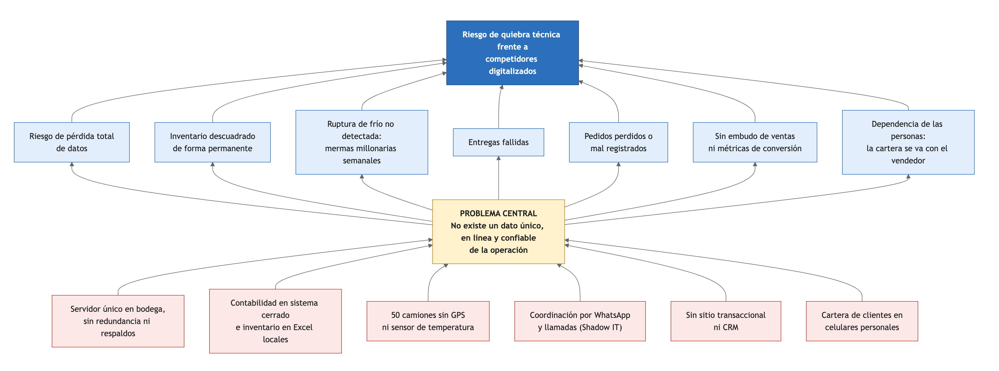
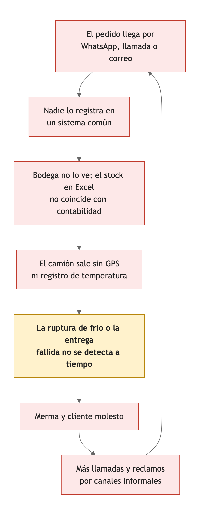

# 1. Diagnóstico y análisis del dolor

> Rúbrica H1-D1 (Logrado): analizar **en profundidad** (no repetir el caso) y argumentar con solidez técnica y de negocio.
> **Estado: borrador de redacción**, pendiente de validación del equipo. Las cifras de la sección de impacto son supuestos ilustrativos, no datos de Cofrial; se marcan como tales y se validan con la empresa.

## Síntesis

Los tres focos críticos del caso no son tres problemas distintos, sino un mismo problema visto desde tres ángulos: **Cofrial no tiene un dato único, en línea y confiable de su operación**. El servidor en la bodega guarda datos que nadie reconcilia, los camiones no emiten ninguna información y los pedidos y la cartera de clientes viven en canales y dispositivos personales. Cada dolor alimenta a los otros dos, de modo que atender uno solo no resuelve la situación: un camión con GPS seguiría recibiendo rutas por WhatsApp, y un portal de ventas seguiría escribiendo en un servidor sin respaldo. Por eso el análisis busca la causa raíz común y no solo los síntomas.

## Datos del caso (fuente: pauta)

**Tabla 1**
*Hechos del caso y su consecuencia de negocio*

| Dolor | Hechos | Consecuencia de negocio |
|---|---|---|
| On-premises vulnerable y silos | 1 servidor físico en bodega, sin redundancia eléctrica ni respaldos automáticos. Contabilidad en sistema cerrado; inventario en Excel locales | Riesgo de pérdida total de datos; inventario descuadrado permanentemente |
| Última milla a ciegas y Shadow IT | 50 camiones sin GPS ni registro de temperatura; coordinación por llamadas y WhatsApp personales | Entregas fallidas; mermas millonarias semanales por ruptura de frío no detectada |
| Sin canales digitales ni CRM | Sin web transaccional ni portal; pedidos por teléfono o correo; cartera en celulares de vendedores | Pedidos perdidos o mal registrados; sin embudo ni métricas de conversión; la cartera se va con el vendedor |

*Nota.* Elaboración propia a partir de la pauta del curso (INACAP Sede Temuco, 2026).

## Método de análisis

El equipo consultor usa tres herramientas, de lo general a lo específico: un **árbol de problemas**, propio de la metodología del marco lógico (Ortegón et al., 2005), para ubicar la causa raíz común; la técnica de los **cinco porqués** (Ohno, 1988) para profundizar en cada dolor; y un **ciclo de refuerzo** para mostrar cómo se alimentan entre sí. Las respuestas a los "porqués" son inferencias del equipo a partir del caso; se contrastan con Cofrial en la fase de validación.

**Figura 1**
*Árbol de problemas de Cofrial SpA*

*Nota.* Elaboración propia. Las causas (rojo) convergen en un problema central (amarillo) que produce los efectos (azul) y, en conjunto, el riesgo de quiebra técnica que describe el caso.

## Análisis por dolor

### Dolor 1: infraestructura on-premises vulnerable y silos de datos

**Cinco porqués.**

**Tabla 2**
*Cinco porqués del dolor 1 (inferencias del equipo)*

| Nivel | Pregunta | Respuesta |
|---|---|---|
| 1 | ¿Por qué Cofrial puede perder todos sus datos? | Porque todo está en un único servidor físico, sin copia automática |
| 2 | ¿Por qué no hay copia? | Porque el respaldo depende de que alguien lo haga a mano, y no hay redundancia eléctrica ni de equipo |
| 3 | ¿Por qué el inventario nunca cuadra? | Porque bodega lleva el stock en Excel locales y contabilidad lo registra en un sistema cerrado, sin enlace entre ambos |
| 4 | ¿Por qué nadie reconcilia ambos? | Porque ninguno es la fuente oficial: cada área confía en su propia planilla o sistema |
| 5 | Causa raíz | La infraestructura creció por acumulación, sin una arquitectura que defina dónde vive el dato oficial ni cómo se protege |

*Nota.* Elaboración propia.

**Riesgos técnicos.**

- **Punto único de falla.** Una falla de disco, un corte eléctrico o un incendio en la bodega detienen la facturación, el despacho y la consulta de inventario al mismo tiempo. Sin copias fuera de la bodega, la pérdida es total.
- **Recuperación indefinida.** No hay un objetivo de recuperación (cuánto dato se puede perder y cuánto tarda volver a operar). En la práctica, el dato perdido es el que no se respaldó y el tiempo de recuperación es el de conseguir un equipo y reconstruir a mano.
- **Silos sin integración.** El sistema contable cerrado no se conecta con el stock de bodega; cada traspaso es una digitación manual propensa a errores y sin trazabilidad.
- **Planillas sin control.** Excel no controla quién cambió una cantidad, ni evita que dos personas trabajen con versiones distintas del mismo archivo.

**Impacto de negocio.** El inventario descuadrado en un producto perecible tiene un costo doble: vender lo que no hay (entrega fallida y cliente molesto) o comprar de más lo que se vence (merma). Además, la continuidad del negocio depende de un equipo que nadie puede reemplazar rápido, lo que contradice los compromisos con clientes institucionales, que exigen abastecimiento sin interrupciones.

### Dolor 2: colapso de la última milla y Shadow IT

**Cinco porqués.**

**Tabla 3**
*Cinco porqués del dolor 2 (inferencias del equipo)*

| Nivel | Pregunta | Respuesta |
|---|---|---|
| 1 | ¿Por qué hay mermas por ruptura de frío? | Porque nadie se entera de que la temperatura sube mientras el camión está en ruta |
| 2 | ¿Por qué nadie se entera? | Porque los camiones no miden ni registran la temperatura |
| 3 | ¿Por qué hay entregas fallidas? | Porque no se sabe dónde está cada camión ni en qué estado viaja la carga |
| 4 | ¿Por qué la coordinación es informal? | Porque las rutas y la carga se acuerdan por llamadas y grupos de WhatsApp personales, que no dejan un registro estructurado ni emiten alertas |
| 5 | Causa raíz | La flota no emite datos y el único canal de coordinación es conversacional: la información existe en la cabeza del conductor, pero no se captura |

*Nota.* Elaboración propia.

**Riesgos técnicos y regulatorios.**

- **Sin evidencia de cumplimiento.** El Reglamento Sanitario de los Alimentos establece, en su artículo 68, que los alimentos perecibles que requieren frío solo pueden transportarse en vehículos de carrocería cerrada, con equipos que mantengan la temperatura exigida y termómetros legibles desde el exterior (Ministerio de Salud, 1997). Un termómetro exterior muestra la temperatura de un instante; sin un registro continuo, Cofrial no puede demostrar que la cadena de frío se mantuvo durante todo el viaje, ni ante una fiscalización ni ante un cliente hospitalario que se lo pida.
- **Riesgo sanitario real.** Un hospital que recibe carne con la cadena de frío cortada puede no notarlo a simple vista; el daño no es solo comercial.
- **Datos de la empresa en cuentas personales.** Los chats de coordinación viven en teléfonos de las personas: si un conductor o un despachador se va, se va el historial, y no hay forma de auditar qué se acordó.
- **Reacción tardía.** Cuando la ruptura se descubre, ocurre al abrir la carga en el cliente: la pérdida ya está hecha y el cliente ya la presenció.

**Impacto de negocio.** Es el dolor de mayor costo directo: la carga rechazada se pierde completa, se paga el viaje y se daña la relación con el cliente. El caso lo describe como "pérdidas millonarias semanales"; la sección de impacto estimado muestra cómo dimensionarlas con supuestos explícitos.

### Dolor 3: ausencia de canales digitales y de CRM

**Cinco porqués.**

**Tabla 4**
*Cinco porqués del dolor 3 (inferencias del equipo)*

| Nivel | Pregunta | Respuesta |
|---|---|---|
| 1 | ¿Por qué se pierden o se registran mal los pedidos? | Porque llegan por teléfono o correo y alguien los anota a mano |
| 2 | ¿Por qué llegan por cualquier vía? | Porque Cofrial no tiene un canal transaccional propio que sea el punto de entrada |
| 3 | ¿Por qué no hay métricas de ventas? | Porque la cartera y las conversaciones comerciales viven en los celulares de los vendedores |
| 4 | ¿Por qué eso es un riesgo? | Porque el conocimiento comercial es de la persona y no de la empresa: si el vendedor renuncia, se lleva la cartera |
| 5 | Causa raíz | La empresa no controla el punto de entrada de la información comercial, y lo que no entra a un sistema no se puede medir ni proteger |

*Nota.* Elaboración propia.

**Riesgos.**

- **Fuga de cartera.** La cartera de clientes institucionales es el activo comercial más valioso y hoy no pertenece a la empresa en ningún sentido práctico.
- **Decisiones a ciegas.** Sin embudo no se conoce la tasa de conversión, el tamaño medio del pedido ni la recurrencia de cada cliente; no se puede priorizar a quién visitar ni cuánto vender.
- **Desventaja competitiva.** Los competidores digitalizados atienden pedidos a cualquier hora y muestran el estado del despacho. Los clientes institucionales tienden a preferir al proveedor que les entrega trazabilidad (inferencia del equipo, a validar con entrevistas a clientes).

**Impacto de negocio.** Cada pedido mal anotado es una venta perdida o una entrega equivocada; cada prospecto sin seguimiento es una oportunidad que nadie mide.

## Cómo se refuerzan los tres dolores

Los dolores forman un ciclo: lo que falla en uno agrava a los otros dos.

**Figura 2**
*Ciclo de refuerzo de los tres dolores*

*Nota.* Elaboración propia. El eslabón destacado (detección tardía de la ruptura de frío) es donde el ciclo se vuelve costoso.

Un pedido que llega por WhatsApp (dolor 3) no queda en ningún sistema, así que bodega no lo ve y su Excel no coincide con contabilidad (dolor 1). El camión sale sin GPS ni sensor (dolor 2), la ruptura de frío o la entrega fallida no se detecta a tiempo y termina en merma y en un cliente molesto, que reclama por los mismos canales informales y vuelve a alimentar el ciclo.

El ciclo tiene dos consecuencias para el diseño de la solución. Primero, hay que **romper el ciclo en el primer eslabón**: que el pedido nazca en un canal propio y quede registrado. Segundo, hay que **capturar los datos que hoy no existen** (temperatura y posición), porque ningún proceso se puede mejorar si no se mide.

## Impacto estimado con supuestos explícitos

Ni la pauta ni este equipo disponen de las cifras reales de Cofrial. Para no dejar el análisis en lo cualitativo, se propone un modelo con parámetros que se reemplazan por datos reales apenas existan. **Los valores de la tabla son ilustrativos.**

**Tabla 5**
*Modelo de pérdidas por ruptura de frío no detectada (supuestos ilustrativos)*

| Parámetro | Valor supuesto | Fundamento |
|---|---|---|
| Camiones en operación | 50 | Dato del caso |
| Viajes por camión | 1 al día, 6 días a la semana | Supuesto del equipo |
| Viajes semanales | 300 | 50 camiones por 6 viajes |
| Valor medio de la carga por viaje | 1 500 000 pesos | Supuesto del equipo |
| Fracción de la carga que se pierde si hay ruptura | 100 % (rechazo total) | Supuesto conservador de pérdida máxima |

*Nota.* Elaboración propia. Fórmula: pérdida semanal = viajes semanales × proporción de viajes con ruptura no detectada × valor medio de la carga × fracción perdida.

**Tabla 6**
*Escenarios de pérdida semanal según la frecuencia de rupturas (ilustrativo)*

| Escenario | Viajes con ruptura no detectada | Viajes afectados por semana | Pérdida semanal |
|---|---|---|---|
| Bajo | 3 % | 9 | 13,5 millones de pesos |
| Base | 5 % | 15 | 22,5 millones de pesos |
| Alto | 8 % | 24 | 36,0 millones de pesos |

*Nota.* Elaboración propia con los parámetros de la Tabla 5. El orden de magnitud es coherente con las "pérdidas millonarias semanales" que describe el caso, pero no lo prueba.

El resultado no pretende ser una predicción: sirve para mostrar que una variación de un par de puntos porcentuales en la frecuencia de rupturas mueve las pérdidas en decenas de millones, y que por eso detectar la ruptura a tiempo tiene un retorno alto frente al costo de una plataforma de bajo costo. Las otras dos pérdidas (entregas fallidas y horas de digitación duplicada) siguen la misma lógica y se calcularán cuando se disponga de los datos.

**Datos que se solicitarán a Cofrial para reemplazar los supuestos**

**Tabla 7**
*Datos a solicitar a Cofrial para validar el diagnóstico*

| Dato | Para qué sirve |
|---|---|
| Mermas semanales por ruptura de frío, en pesos y en kilos | Reemplazar los supuestos de la Tabla 5 |
| Cantidad de viajes semanales y valor medio por viaje | Calibrar el modelo de pérdidas |
| Porcentaje de entregas fallidas y su causa | Dimensionar el costo de la última milla |
| Pedidos semanales por canal (teléfono, correo, WhatsApp) | Línea base para medir cuánto se migra a la plataforma |
| Frecuencia de caídas del servidor y fecha del último respaldo | Cuantificar el riesgo del dolor 1 |
| Cantidad de vendedores y tamaño de su cartera | Dimensionar el riesgo de fuga de cartera |
| Exigencias de temperatura de los clientes institucionales | Definir los rangos críticos de la alerta |

*Nota.* Elaboración propia.

## Conclusión del diagnóstico

La causa raíz común es la ausencia de un dato único, en línea y confiable. De ella se desprenden tres palancas de solución, que la propuesta de valor (`02-propuesta-valor.md`) convierte en componentes concretos:

1. **Un dato central y protegido**, para terminar con el servidor único y los silos.
2. **Captura automática de lo que hoy no se mide** (temperatura, posición, combustible), para ver la última milla.
3. **Un canal propio para pedidos y relación comercial**, para que la información de ventas pertenezca a la empresa.

## Por verificar antes de la redacción final

- [ ] Validar los supuestos de las Tablas 5 y 6 con los datos de la Tabla 7.
- [ ] Contrastar las inferencias de los "cinco porqués" con una conversación con Cofrial.

## Notas del equipo
