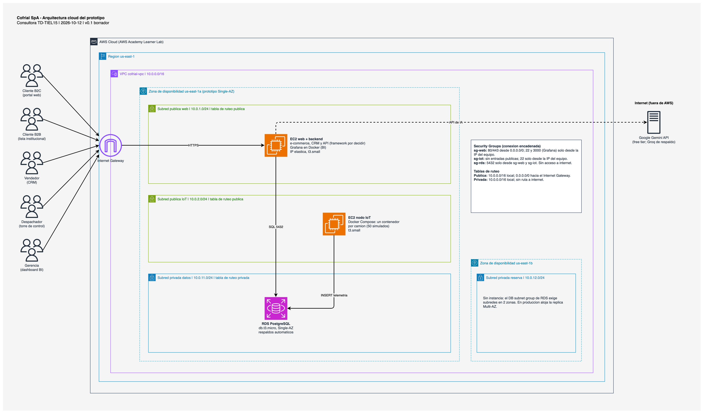

# Diagrama de arquitectura cloud

## Topología implementada

La Figura 1 representa la configuración vigente de `aws/provision.sh` y los compose de AWS. El equipo consultor reemplazó el dibujo inicial de cuatro subredes por una topología con una subred pública compartida y dos privadas. La región por defecto es us-east-1; las zonas se seleccionan al ejecutar el script.

**Figura 1**
*Arquitectura cloud implementada para el prototipo Cofrial SpA*

Nota. Elaboración propia. Las líneas indican acceso web, consultas SQL cifradas y llamadas a servicios externos. La segunda subred privada pertenece al DB subnet group; no aloja una réplica activa.

## Elementos y flujos

**Tabla 1**
*Elementos de la topología implementada*

| Elemento | Configuración | Función |
|---|---|---|
| Región | us-east-1 por defecto | Entorno del laboratorio académico |
| VPC | 10.0.0.0/16 | Comunicación privada común |
| Subred pública A | 10.0.1.0/24, zona A | EC2 web primaria t3.small y EC2 IoT t3.micro; salida por IGW |
| Subred pública B | 10.0.4.0/24, zona B | EC2 web secundaria t3.small |
| ALB `cofrial-alb` | Internet-facing en las dos subredes públicas; 80 (redirige a 443 con certificado de confianza) y 443 | Reparte entre las dos web; chequeo `/salud/`; afinidad por cookie |
| Subred privada A | 10.0.2.0/24, zona A | Integrante del grupo de subredes de RDS |
| Subred privada B | 10.0.3.0/24, zona B | Segundo integrante del grupo; aloja la réplica síncrona de RDS |
| RDS | PostgreSQL 16, db.t3.micro, 20 GB, Multi-AZ, sin acceso público | Pedidos, CRM y telemetría; conmuta sola a la otra zona |
| sg-alb | 80 y 443 desde internet | Único punto de entrada público |
| sg-web | 80 solo desde sg-alb; 22 desde la IP del equipo | Portal y Grafana (por `/bi/`); administración SSH |
| sg-iot | 22 desde la IP del equipo | Administración; sin servicio público IoT |
| sg-rds | 5432 desde sg-web y sg-iot | Acceso SQL de aplicación, BI y simulador |
| API de IA externa | Gemini y Groq | Clasificación y asistente de tienda |
| Mapas externos | OpenFreeMap, Nominatim y OSRM | Estilo y teselas vectoriales (datos de OpenStreetMap), ubicación de direcciones y rutas |

Nota. Elaboración propia. Zona A y zona B identifican las zonas seleccionadas por el script; no fijan letras de disponibilidad.

El cliente compra por el portal; Django persiste las órdenes y el CRM las consulta sin duplicarlas. El nodo IoT inserta lecturas y Grafana consulta RDS con una cuenta de solo lectura. Las llamadas a IA salen desde la aplicación; el navegador obtiene teselas y rutas según la pantalla. La protección de RDS depende de su acceso privado y de las referencias entre Security Groups, aunque las EC2 compartan subred.

**Actualización del 8-nov-2026 (revisión técnica).** Se incorporaron el balanceador, la segunda web y Multi-AZ en RDS; el dibujo de la Figura 1 y el diagrama de archify muestran la versión anterior y están pendientes de redibujar con estas piezas. La tabla de arriba es la vigente. Las dos web corren el mismo compose; la primaria migra la base y corre el podador y el despachador, la secundaria solo sirve la aplicación.

La topología no incluye Nginx, NAT Gateway, Secrets Manager ni Session Manager porque esos componentes no están configurados en el despliegue actual. Sus alternativas de evolución se justifican en `03-arquitectura-cloud.md`.
