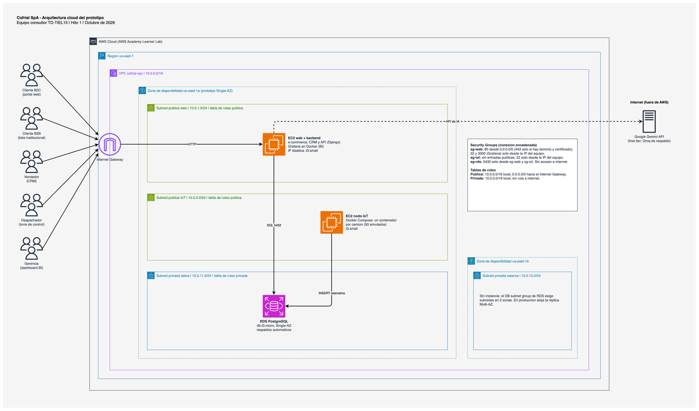
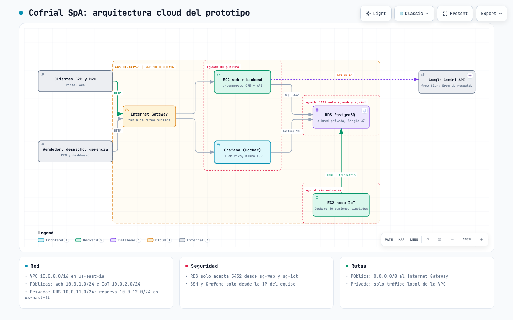

# 4a. Diagrama de arquitectura cloud

> Rúbrica H1-D3 (Logrado): diagrama **profesional** y conectado con la realidad del caso.
> **Estado: borrador de redacción**, pendiente de validación del equipo (CIDR y tamaños de instancia son propuestas). Los archivos editables y el script que los genera están en `informe/img/`.

## Topología propuesta

El diagrama muestra la topología completa de red y servicios del prototipo en AWS Academy, con los íconos oficiales de AWS. Toda la solución vive en una región (us-east-1) y en una red virtual privada propia (VPC `10.0.0.0/16`), dividida en cuatro subredes: una pública para la aplicación web, una pública para el nodo de simulación IoT y dos privadas para los datos. Las restricciones del Learner Lab (una sola zona con instancia de base de datos, rol `LabRole`, HTTP sin certificado) están reflejadas tal como son y se justifican en la sección de arquitectura cloud.

**Figura 1**
*Arquitectura cloud del prototipo de Cofrial SpA*

*Nota.* Elaboración propia con draw.io e íconos oficiales de AWS. Las flechas continuas son tráfico de usuarios y datos; la flecha punteada es la llamada saliente a la API de IA, fuera de AWS.

## Elementos del diagrama

**Tabla 1**
*Elementos de la topología, su configuración y la decisión que los respalda*

| Elemento | Configuración | Por qué está así |
|---|---|---|
| Región | us-east-1 | El Learner Lab solo permite us-east-1 y us-west-2 |
| VPC | `10.0.0.0/16`, tabla de ruteo pública y privada | Red propia: la base de datos no queda en una red compartida |
| Subred pública web | `10.0.1.0/24`; EC2 web con aplicación Django y Grafana en Docker | Atiende a clientes, vendedores y gerencia por el Internet Gateway |
| Subred pública IoT | `10.0.2.0/24`; EC2 con un contenedor Docker por camión simulado | Nodo dedicado, que la pauta exige; sin entradas públicas |
| Subred privada de datos | `10.0.11.0/24`; RDS PostgreSQL | Sin dirección pública ni ruta a internet |
| Subred privada de reserva | `10.0.12.0/24`, en us-east-1b | El grupo de subredes de RDS exige dos zonas |
| Internet Gateway | Entrada y salida de las subredes públicas | Único punto de contacto con internet |
| Security Groups | `sg-web`, `sg-iot` y `sg-rds` encadenados | `sg-rds` solo acepta el puerto 5432 desde los otros dos |
| API de IA externa | Google Gemini, con Groq de respaldo | Servicio gratuito fuera de AWS; llamada saliente desde la EC2 web |
| Actores | Cliente B2B, cliente B2C, vendedor, despachador y gerencia | Los cinco perfiles que usan el ecosistema |

*Nota.* Elaboración propia.

## Cómo viaja la información

La topología se entiende mejor siguiendo tres recorridos:

- **Compra y gestión comercial.** Cliente, vendedor, despachador o gerencia entran por el Internet Gateway a la EC2 web. La aplicación lee y escribe en RDS por el puerto 5432, que solo esa instancia y el nodo IoT pueden usar.
- **Telemetría.** Los contenedores del nodo IoT insertan lecturas en RDS cada pocos segundos. Grafana, en la EC2 web, consulta esas mismas tablas para el dashboard.
- **Inteligencia artificial.** La aplicación envía el texto de cada requerimiento a la API externa por una llamada saliente y guarda la categoría que devuelve.

## Vista simplificada para la defensa

Además del diagrama completo, el equipo preparó una versión interactiva que agrupa los servicios por región y por Security Group. Permite hacer zoom, cambiar de tema y seguir una ruta de datos durante la defensa técnica. No incluye íconos de AWS ni cajas de subredes, por lo que no reemplaza al diagrama de la Figura 1.

**Figura 2**
*Vista simplificada e interactiva de la arquitectura*

*Nota.* Elaboración propia con una herramienta de diagramas interactivos; captura de la versión en HTML.

## Pendiente

- [ ] Validar CIDR y tamaños de instancia con el equipo.
- [ ] Retirar las marcas de borrador del bloque de título del diagrama antes de entregar.

## Notas del equipo
