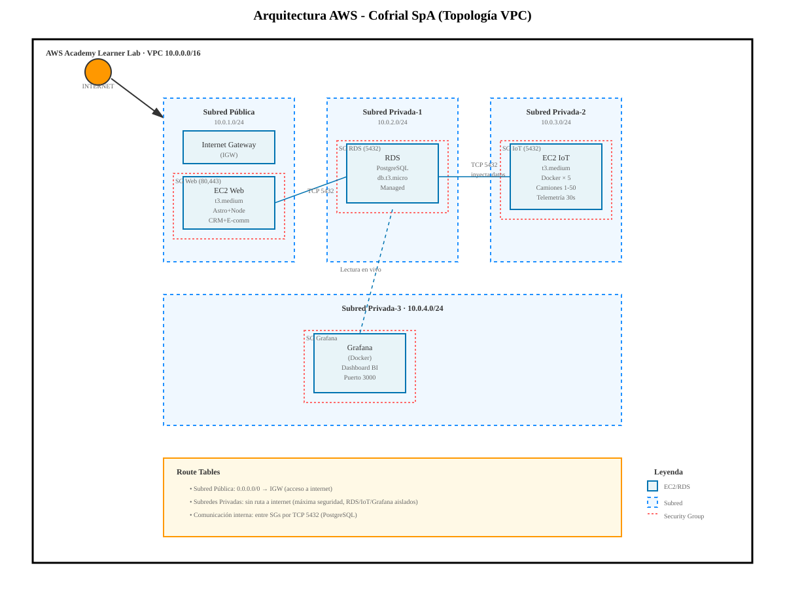

# 4a. Diagrama de arquitectura cloud (topología AWS)

Rúbrica H1-D3 (Logrado): diagrama **profesional** y conectado con la realidad del caso.

## Topología: VPC con EC2 segregadas y RDS privada

```
INTERNET (Clientes B2B/B2C)
    │
    ↓ TCP 80, 443 (HTTPS)
    │
┌───────────────────────────────────────────────────────────────┐
│ AWS Academy Learner Lab                                       │
│                                                               │
│  ┌─────────────────────────────────────────────────────────┐ │
│  │ VPC (10.0.0.0/16)                                       │ │
│  │                                                          │ │
│  │ ┌────────────────┐          ┌──────────────────┐       │ │
│  │ │ Subred Pública │          │ Subred Privada-1 │       │ │
│  │ │ 10.0.1.0/24    │          │ 10.0.2.0/24      │       │ │
│  │ │                │          │                  │       │ │
│  │ │ Internet GW    │          │ RDS DB Subnet    │       │ │
│  │ │ (IGW)          │          │ (PostgreSQL)     │       │ │
│  │ │                │          │                  │       │ │
│  │ │ ┌────────────┐ │          │ ┌──────────────┐ │       │ │
│  │ │ │ EC2 web    │ │          │ │ RDS          │ │       │ │
│  │ │ │ t3.medium  │─┼──────────┤─│ PostgreSQL   │ │       │ │
│  │ │ │            │ │ TCP 5432 │ │ (managed)    │ │       │ │
│  │ │ │ Astro SSR  │ │          │ │              │ │       │ │
│  │ │ │ CRM        │ │          │ │ Respaldos:   │ │       │ │
│  │ │ │ E-commerce │ │          │ │ Snapshots 7d │ │       │ │
│  │ │ │ API REST   │ │          │ │              │ │       │ │
│  │ │ └────┬───────┘ │          │ └──────────────┘ │       │ │
│  │ │      │ SG web  │          │ SG privado      │       │ │
│  │ │      └─────────┘          │ (5432 de EC2)   │       │ │
│  │ │                            └──────────────────┘       │ │
│  │ │                                                        │ │
│  │ │         ┌──────────────────────┐                      │ │
│  │ │         │ Subred Privada-2     │                      │ │
│  │ │         │ 10.0.3.0/24          │                      │ │
│  │ │         │                      │                      │ │
│  │ │         │ ┌──────────────────┐ │                      │ │
│  │ │         │ │ EC2 IoT          │ │                      │ │
│  │ │         │ │ t3.medium        │ │                      │ │
│  │ │         │ │                  │ │                      │ │
│  │ │         │ │ Docker Compose:  │─┼──────────────────┐   │ │
│  │ │         │ │ - 5 contenedores │ │ TCP 5432 a RDS   │   │ │
│  │ │         │ │ (camiones 1-50)  │ │ (inyecta datos)  │   │ │
│  │ │         │ │                  │ │                  │   │ │
│  │ │         │ │ Telemetría:      │ │                  │   │ │
│  │ │         │ │ temp, lat, long  │ │                  │   │ │
│  │ │         │ │ combustible, etc │ │                  │   │ │
│  │ │         │ └──────────────────┘ │                  │   │ │
│  │ │         │ SG IoT               │                  │   │ │
│  │ │         │ (salida: 5432)       │                  │   │ │
│  │ │         └──────────────────────┘                  │   │ │
│  │ │                                                    │   │ │
│  │ │                                   ┌────────────────┘   │ │
│  │ │                                   │                    │ │
│  │ │         ┌──────────────────────┐  │                    │ │
│  │ │         │ Subred Privada-3     │  │                    │ │
│  │ │         │ 10.0.4.0/24          │  │                    │ │
│  │ │         │                      │  │                    │ │
│  │ │         │ ┌──────────────────┐ │  │                    │ │
│  │ │         │ │ Grafana (Docker) │ │  │                    │ │ 
│  │ │         │ │                  │ │  │                    │ │
│  │ │         │ │ Lee de RDS ↓      │◄─┼────────────────────┘ │ │
│  │ │         │ │ Dashboard BI      │ │  TCP 5432             │ │
│  │ │         │ │ (Puerto 3000)     │ │                       │ │
│  │ │         │ └──────────────────┘ │                       │ │
│  │ │         └──────────────────────┘                       │ │
│  │ │                                                        │ │
│  │ └────────────────────────────────────────────────────────┘ │
│  │                                                           │
│  │ Route Tables:                                            │ │
│  │ - Subred Pública: 0.0.0.0/0 → IGW (internet)            │ │
│  │ - Subredes Privadas: sin ruta a internet (seg. máxima)  │ │
│  └───────────────────────────────────────────────────────────┘ │
│                                                               │
└───────────────────────────────────────────────────────────────┘

API IA Externa (Gemini free tier)
    ↑
    │ HTTPS
    │
EC2 web → Solicita clasificación de requerimientos
```

---

## Flujos de datos principales

### 1. Cliente compra en e-commerce
```
Cliente (navegador)
    ↓ HTTPS
EC2 web (Astro)
    ↓ TCP 5432
RDS PostgreSQL ← Inserta ORDEN + ORDEN_ITEM
    ↓
CRM actualizado (lectura desde RDS)
Vendedor asignado notificado
```

### 2. Camión en ruta → telemetría → alerta
```
Contenedor Docker (camión simulado)
    ↓ TCP 5432 cada 30 seg
RDS (tabla telemetria)
    ↓ Select en tiempo real
Grafana Dashboard
    ↓
¿temp_camara > 4.5°C?
    ├─ SÍ → Alerta (roja) → Despachador ve
    └─ NO → Normal (verde)
```

### 3. Requerimiento → IA → CRM
```
Cliente ingresa en e-commerce: "¿Puedo devolver si está fuera de temp?"
    ↓ HTTPS
EC2 web → API Gemini (clasificación)
    ↓
Clasificado como: CALIDAD + RECLAMO
    ↓ TCP 5432
CRM: crea REQUERIMIENTO + notifica responsable
    ↓
Gerencia de operaciones lo ve al instante
```

---

## Seguridad: Security Groups (VPC Firewall)

### SG Web (EC2 pública)
```
Entrada:
  - TCP 80 (HTTP) desde 0.0.0.0/0 (cualquiera)
  - TCP 443 (HTTPS) desde 0.0.0.0/0 (cualquiera)
  - TCP 22 (SSH) desde IP del equipo (desarrollo)
Salida:
  - TCP 5432 a SG-RDS (hacia RDS)
  - TCP 443 a 0.0.0.0/0 (HTTPS hacia APIs externas: Gemini)
```

### SG RDS (base de datos)
```
Entrada:
  - TCP 5432 (PostgreSQL) desde SG-Web únicamente
  - TCP 5432 (PostgreSQL) desde SG-IoT únicamente
  - NO desde internet, NO desde publico
Salida:
  - Ninguna (RDS es reactivo, no inicia conexiones)
```

### SG IoT (EC2 privada para Docker)
```
Entrada:
  - Ninguna (solo env vars y volúmenes Docker locales)
Salida:
  - TCP 5432 a SG-RDS (inyecta telemetría)
```

---

## Instancias y recursos

| Recurso | Especificación | Justificación | Costo Lab |
|---|---|---|---|
| EC2 web | t3.medium (2 vCPU, 4 GB RAM) | Astro + Node + APIs | ~$0.04/h |
| EC2 IoT | t3.medium (2 vCPU, 4 GB RAM) | Docker × 5 contenedores | ~$0.04/h |
| RDS PostgreSQL | db.t3.micro (1 vCPU, 1 GB RAM) | Prototipo, suficiente | ~$0.025/h |
| Snapshots RDS | 7 días de retención | Respaldos automáticos | ~$0.10/GB/mes |
| Elastic IP | 1 dirección fija (opcional) | Reasignación al reiniciar | $0 si está en uso |
| **Total estim.** | | | **~$3-5/día** |

Nota. Learner Lab suele otorgar $100 USD por 36 horas. Suficiente para desarrollo. Elaboración propia.

---

## Diagrama visual profesional



Nota. Diagrama profesional de la topología VPC: subredes públicas y privadas, EC2 segregadas (web e IoT), RDS PostgreSQL en subred privada, Security Groups por capas. Elaboración propia.
