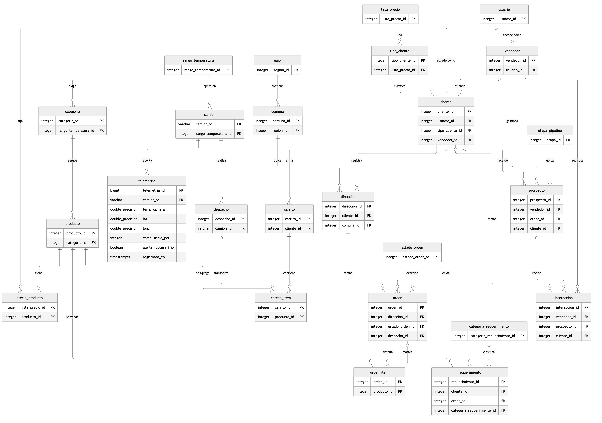
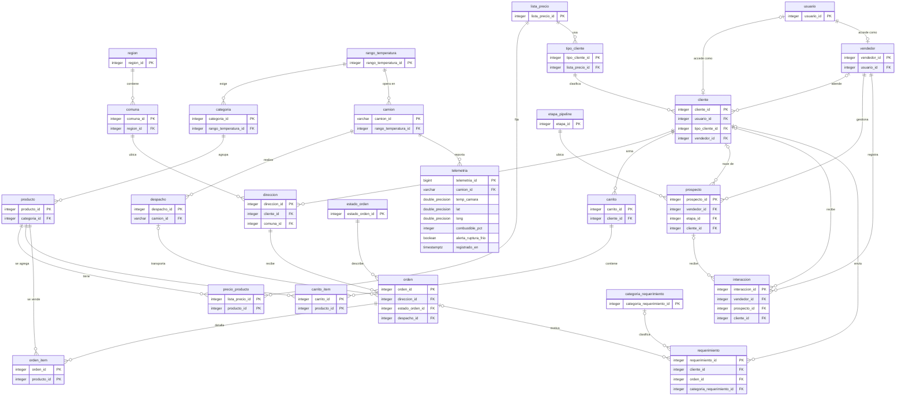

# 4b. Modelo de datos (MER en 3FN + diccionario)

> Rúbrica H1-D3 (Logrado): MER **rigurosamente normalizado** que soporte transacciones (E-commerce/CRM) **y** telemetría IoT.
> **Estado: borrador de redacción**, pendiente de validación del equipo. El modelo no depende del framework web. La web se hará con Django (decisión D-01): los modelos se generan desde este diseño, la tabla `usuario` la reemplaza el sistema de autenticación del framework y las tres tablas de clave compuesta usan `CompositePrimaryKey` (Django 5.2 o superior) o una clave autogenerada con restricción de unicidad, que mantiene la 3FN.
> La fuente del modelo es `informe/modelo/modelo.py`. De ahí se generan el script SQL (`informe/modelo/esquema.sql`), el diagrama y el diccionario de este documento, así que los tres no pueden contradecirse. Para regenerar: `python3 informe/modelo/modelo.py --png`.

## Alcance y supuestos

El modelo tiene **25 tablas** en cinco módulos: geografía y cadena de frío, comercial (catálogo, precios, carrito y órdenes), clientes y accesos, CRM y logística e IoT. Supuestos que el equipo debe validar:

- Los montos son pesos chilenos enteros, sin decimales.
- Cada tipo de cliente (B2B o B2C) usa una lista de precios; un precio por producto y lista. El historial de precios queda en las líneas de cada orden.
- Un cliente puede tener varias direcciones y un solo carrito abierto.
- Un despacho (viaje de un camión) lleva varias órdenes; una orden va en un solo despacho.
- La telemetría llega cada 5 segundos por camión (estimación: unas 864 000 lecturas diarias con 50 camiones).
- El pago queda fuera del alcance: B2B con número de orden de compra, B2C con pago simulado.
- La implementación en Django usa `CompositePrimaryKey` para las tres tablas de clave compuesta, función disponible desde Django 5.2 (Django Software Foundation, 2025); en versiones anteriores se usa una clave autogenerada con restricción de unicidad sobre el par, que mantiene la 3FN.

## Diagrama entidad-relación

**Figura 1**
*Modelo entidad-relación del ecosistema Cofrial (claves y campos de telemetría)*



*Nota.* Elaboración propia. Se muestran las claves primarias (PK) y foráneas (FK); la tabla `telemetria` aparece completa. Los demás campos están en el diccionario de datos. Generado con Mermaid y el motor de trazado ELK.

<details>
<summary>Código del diagrama (Mermaid)</summary>

<!-- INICIO:diagrama -->

<!-- FIN:diagrama -->

PRODUCTO ──┬─→ CATEGORIA (N:1)
           ├─→ LISTA_PRECIO (1:N)
           └─→ ORDEN_ITEM (1:N)

CATEGORIA ←── PRODUCTO (N:1)

## Telemetría IoT: nombres exactos exigidos por la pauta

PRECIO_PRODUCTO ──→ PRODUCTO (N:1)

ORDEN ──┬─→ CLIENTE (N:1)
        ├─→ ORDEN_ITEM (1:N)
        ├─→ ESTADO_ORDEN (N:1)
        └─→ CAMION (N:1) [asignado cuando sale a ruta]

ORDEN_ITEM ──┬─→ PRODUCTO (N:1)
             ├─→ LISTA_PRECIO (N:1)
             └─→ ORDEN (N:1)

ESTADO_ORDEN ←── ORDEN (N:1)

VENDEDOR ──┬─→ OPORTUNIDAD (1:N)
           └─→ INTERACCION (1:N)

OPORTUNIDAD ──┬─→ CLIENTE (N:1)
              ├─→ VENDEDOR (N:1)
              ├─→ ETAPA_PIPELINE (N:1)
              └─→ INTERACCION (1:N)

INTERACCION ──┬─→ OPORTUNIDAD (N:1)
              └─→ VENDEDOR (N:1)

CAMION ──┬─→ TELEMETRIA (1:N)
         └─→ ORDEN (1:N) [entregas]

TELEMETRIA ──→ CAMION (N:1)
            └─→ alerta_ruptura_frio: boolean (derivada: temp_camara > rango)
```

### Diagrama ER profesional (14 entidades)

**[GENERA AQUÍ CON DRAW.IO + TU SKILL DE INFORME]**

Entidades a dibujar (relaciones en el ASCII arriba):
- CLIENTE (central) ↔ DIRECCION, ORDEN, OPORTUNIDAD
- PRODUCTO ↔ CATEGORIA, LISTA_PRECIO, ORDEN_ITEM
- ORDEN ↔ CLIENTE, ORDEN_ITEM, ESTADO_ORDEN, CAMION (NEW)
- VENDEDOR ↔ OPORTUNIDAD, INTERACCION
- OPORTUNIDAD ↔ CLIENTE, VENDEDOR, ETAPA_PIPELINE, INTERACCION
- CAMION ↔ TELEMETRIA, ORDEN
- Todas las claves foráneas (FK) explícitas

Exportar a: `informe/img/modelo-er-3fn.png`

---

**Tabla 2**
*Dependencias funcionales y resultado de la verificación en 3FN*

| Tabla | Clave primaria | Dependencias funcionales relevantes | Resultado |
|---|---|---|---|
| `region` | `region_id` | `region_id` → `nombre` | 3FN |
| `comuna` | `comuna_id` | `comuna_id` → `region_id`, `nombre` | 3FN |
| `rango_temperatura` | `rango_temperatura_id` | → `nombre`, `temp_min_c`, `temp_max_c` | 3FN |
| `categoria` | `categoria_id` | → `nombre`, `rango_temperatura_id` | 3FN |
| `producto` | `producto_id` | → `sku`, `nombre`, `categoria_id`, `unidad_medida`, `stock_disponible`; sin atributos de la categoría | 3FN |
| `lista_precio` | `lista_precio_id` | → `nombre` | 3FN |
| `precio_producto` | (`lista_precio_id`, `producto_id`) | clave completa → `precio_clp` | 3FN |
| `tipo_cliente` | `tipo_cliente_id` | → `codigo`, `nombre`, `lista_precio_id` | 3FN |
| `usuario` | `usuario_id` | → `email`, `password_hash`, `rol`, `activo` | 3FN |
| `vendedor` | `vendedor_id` | → `usuario_id`, `nombre`, `telefono` | 3FN |
| `cliente` | `cliente_id` | → `tipo_cliente_id`, `vendedor_id`, `rut`, `nombre`; sin la lista de precios | 3FN |
| `direccion` | `direccion_id` | → `cliente_id`, `calle_numero`, `comuna_id`; sin la región | 3FN |
| `carrito` | `carrito_id` | → `cliente_id`, `estado`, `creado_en` | 3FN |
| `carrito_item` | (`carrito_id`, `producto_id`) | clave completa → `cantidad` | 3FN |
| `estado_orden` | `estado_orden_id` | → `nombre`, `orden_flujo`, `es_final` | 3FN |
| `camion` | `camion_id` | → `patente`, `capacidad_kg`, `rango_temperatura_id`; `patente` → `camion_id` (clave candidata) | 3FN |
| `despacho` | `despacho_id` | → `camion_id`, `programado_para`, `salida_en`, `llegada_en` | 3FN |
| `orden` | `orden_id` | → `direccion_id`, `estado_orden_id`, `despacho_id`, `numero_oc`, `creada_en`; sin cliente, canal ni total | 3FN |
| `orden_item` | (`orden_id`, `producto_id`) | clave completa → `cantidad`, `precio_unitario_clp` | 3FN |
| `telemetria` | `telemetria_id` | → todas las lecturas; (`camion_id`, `registrado_en`) es clave candidata | 3FN, ver D1 |
| `etapa_pipeline` | `etapa_id` | → `nombre`, `orden_etapa`, `es_final`, `es_ganada` | 3FN |
| `prospecto` | `prospecto_id` | → `vendedor_id`, `etapa_id`, `cliente_id`, datos de contacto, `origen`, `monto_estimado_clp`, `cerrado_en`, `motivo_perdida` | 3FN |
| `interaccion` | `interaccion_id` | → `vendedor_id`, `prospecto_id`, `cliente_id`, `tipo`, `detalle` | 3FN |
| `categoria_requerimiento` | `categoria_requerimiento_id` | → `nombre` | 3FN |
| `requerimiento` | `requerimiento_id` | → `cliente_id`, `orden_id`, `asunto`, `descripcion`, categoría, `confianza_ia`, `estado`, `creado_en`, `respondido_en` | 3FN, ver reglas de negocio |

*Nota.* Elaboración propia.

### Desnormalizaciones controladas

Tres datos parecen repetir información y se mantienen a propósito. Cada uno tiene una razón y un control:

**Tabla 3**
*Redundancias aparentes y su justificación*

| Dato | Por qué parece redundante | Justificación | Control |
|---|---|---|---|
| **D1.** `telemetria.alerta_ruptura_frio` | Se puede calcular comparando `temp_camara` con el rango del camión | La pauta exige guardarlo. Además registra el resultado con el rango vigente al momento de la lectura, y la consulta 5 detecta cualquier inconsistencia | El simulador lo calcula al insertar; `consultas_bi.sql` incluye un control que debe devolver cero filas |
| **D2.** `orden_item.precio_unitario_clp` | Existe `precio_producto.precio_clp` | Es un hecho histórico: el precio pagado no cambia si después se modifica la lista. Depende de la orden y del producto, no del producto solo | Se copia de la lista dentro de la misma transacción que crea la orden |
| **D3.** `producto.stock_disponible` | Sería la suma de movimientos de inventario | No hay tabla de movimientos; el stock es el dato primario y se descuenta al generar la orden | Descuento dentro de la transacción de la orden, con restricción de no negativo. Limitación: no deja historial de movimientos |

*Nota.* Elaboración propia.

**Clave natural en `camion`.** La pauta pide que `camion_id` sea un string, por eso la clave de `camion` es ese código (por ejemplo `CAM-01`) y no un entero autogenerado. La patente queda como segunda clave candidata.

### Reglas de negocio que el esquema no puede garantizar

El diseño relacional no expresa estas reglas; se validan en la aplicación o con pruebas:

- Un usuario con rol `vendedor` debe tener fila en `vendedor`, y uno con rol `cliente`, fila en `cliente`.
- Un cliente B2B debería tener vendedor asignado; uno B2C normalmente no.
- Una orden solo puede asignarse a un despacho cuyo camión tenga un rango de temperatura compatible con la categoría de sus productos.
- En un requerimiento, si `orden_id` está presente, la orden debe ser del mismo `cliente_id`. Es una dependencia condicional (solo aplica cuando la orden no es nula), por eso no se trata como dependencia funcional.
- Al ganar un prospecto se crea el cliente, se completa `prospecto.cliente_id` y la etapa pasa a "Cliente ganado".
- Al perder un prospecto, la etapa «Perdido» exige `motivo_perdida` y `cerrado_en`; la base solo impide un motivo sin fecha de cierre, por lo que la exigencia completa se valida en la aplicación (RN-11 de `04d-crm.md`).
- La clasificación de un requerimiento no es obligatoria: si la IA no responde, queda `sin_clasificar`.

## Cómo responde el modelo a la rúbrica y a los casos de uso

**Tabla 4**
*Casos de uso y tablas que los soportan*

| Caso de uso | Tablas principales |
|---|---|
| CU-01 Perfil e inicio de sesión | `usuario`, `cliente`, `tipo_cliente` |
| CU-02 Catálogo con precio por perfil | `producto`, `categoria`, `precio_producto`, `lista_precio`, `tipo_cliente` |
| CU-03 Carrito | `carrito`, `carrito_item` |
| CU-04 Generar orden | `orden`, `orden_item`, `direccion`, `estado_orden`, `producto` (stock) |
| CU-05 y CU-08 Seguimiento del pedido | `orden`, `estado_orden`, `despacho`, `telemetria` |
| CU-06 y CU-07 Clientes y prospectos | `cliente`, `prospecto`, `etapa_pipeline`, `interaccion`, `vendedor` |
| CU-09 Requerimiento con IA | `requerimiento`, `categoria_requerimiento` |
| CU-10 y CU-11 Telemetría y ruptura de frío | `telemetria`, `camion`, `rango_temperatura` |
| CU-12 Monitoreo de flota | `camion`, `despacho`, `telemetria` |
| CU-13 Dashboard ventas y frío | `v_orden`, `v_orden_total`, `telemetria` (ver `consultas_bi.sql`) |

*Nota.* Elaboración propia.

## Validación realizada

El esquema (archivo `esquema.sql` del repositorio del proyecto; Aguayo Quintriqueo y Vásquez Marimán, 2026) se probó en PostgreSQL 16, en un contenedor temporal:

- El script `esquema.sql` crea sin errores las 25 tablas y 2 vistas.
- `datos_prueba.sql` carga datos ficticios coherentes (hospital B2B, cliente B2C, camiones, órdenes, lecturas con una alerta, pipeline y un requerimiento).
- `consultas_bi.sql` entrega ventas por día y canal, alertas por día, el cruce de ambas y las órdenes afectadas por una ruptura de frío. Los montos coinciden con el cálculo manual (por ejemplo, 10 × 38 990 + 5 × 29 990 = 539 850 pesos para la orden B2B).
- 15 inserciones inválidas fueron rechazadas por la base de datos: orden sin dirección o con dirección inexistente, combustible fuera de 0 a 100, latitud imposible, camión inexistente, lectura duplicada, precio negativo, interacción sin destinatario, etapa ganada que no cierra, segundo carrito abierto, producto repetido en una orden, despacho que llega sin haber salido, dos direcciones principales, un motivo de pérdida en un prospecto sin cerrar y una respuesta anterior a la creación del requerimiento.

Archivos: `informe/modelo/esquema.sql`, `informe/modelo/datos_prueba.sql` y `informe/modelo/consultas_bi.sql`.

## Diccionario de datos

Formato por tabla: campo, tipo, nulo, clave, descripción y ejemplo. Todos los datos de ejemplo son ficticios.

<!-- INICIO:diccionario -->
### Tablas de Geografía

**Tabla D1**  
*`region`: Regiones de Chile donde se entregan pedidos.*

| Campo | Tipo | Nulo | Clave | Descripción | Ejemplo |
|---|---|---|---|---|---|
| `region_id` | integer | No | PK | Identificador de la región. | 9 |
| `nombre` | varchar(60) | No | UK | Nombre de la región. | La Araucanía |

*Nota.* Elaboración propia.

**Tabla D2**  
*`comuna`: Comunas, cada una dentro de una región. La región no se repite en la dirección.*

| Campo | Tipo | Nulo | Clave | Descripción | Ejemplo |
|---|---|---|---|---|---|
| `comuna_id` | integer | No | PK | Identificador de la comuna. | 1 |
| `region_id` | integer | No | FK → region | Región a la que pertenece. | 9 |
| `nombre` | varchar(60) | No | — | Nombre de la comuna. | Temuco |

*Restricciones adicionales:* `UNIQUE (region_id, nombre)`.

*Nota.* Elaboración propia.

### Tablas de Cadena de frío

**Tabla D3**  
*`rango_temperatura`: Rangos de temperatura de conservación. Definen cuándo una lectura es crítica.*

| Campo | Tipo | Nulo | Clave | Descripción | Ejemplo |
|---|---|---|---|---|---|
| `rango_temperatura_id` | integer | No | PK | Identificador del rango. | 1 |
| `nombre` | varchar(40) | No | UK | Nombre del rango. | Refrigerado |
| `temp_min_c` | numeric(5,1) | No | — | Temperatura mínima permitida en grados Celsius. | 0.0 |
| `temp_max_c` | numeric(5,1) | No | — | Temperatura máxima permitida en grados Celsius. | 4.0 |

*Restricciones adicionales:* `CHECK (temp_min_c < temp_max_c)`.

*Nota.* Elaboración propia.

### Tablas de Comercial

**Tabla D4**  
*`categoria`: Categorías de producto. Cada una exige un rango de temperatura de conservación.*

| Campo | Tipo | Nulo | Clave | Descripción | Ejemplo |
|---|---|---|---|---|---|
| `categoria_id` | integer | No | PK | Identificador de la categoría. | 1 |
| `nombre` | varchar(60) | No | UK | Nombre de la categoría. | Cárnicos refrigerados |
| `rango_temperatura_id` | integer | No | FK → rango_temperatura | Rango de conservación que exige la categoría. | 1 |

*Nota.* Elaboración propia.

**Tabla D5**  
*`producto`: Productos del catálogo de refrigerados y congelados.*

| Campo | Tipo | Nulo | Clave | Descripción | Ejemplo |
|---|---|---|---|---|---|
| orden_id | INT | SÍ | — | No | Identificador único |
| cliente_id | INT | — | SÍ (CLIENTE) | No | Quién compra |
| camion_id | VARCHAR(20) | — | SÍ (CAMION) | Sí | Qué vehículo entrega (asignado cuando sale) |
| estado_orden_id | INT | — | SÍ (ESTADO_ORDEN) | No | Estado actual (Nueva, Preparando, En tránsito, Entregada) |
| fecha_creacion | TIMESTAMP | — | — | No | Cuándo se generó la orden |
| fecha_entrega_requerida | DATE | — | — | No | Cuándo lo necesita el cliente |
| tiempo_salida | TIMESTAMP | — | — | Sí | Cuándo salió del almacén (NULL si pendiente) |
| fecha_entrega_real | DATE | — | — | Sí | Cuándo se entregó (NULL si pendiente) |
| notas | TEXT | — | — | Sí | Observaciones especiales |

*Restricciones adicionales:* `unidad_medida IN ('kg','un','caja')`; `stock_disponible >= 0`.

*Nota.* Elaboración propia.

**Tabla D6**  
*`lista_precio`: Listas de precios: institucional para B2B y pública para B2C.*

| Campo | Tipo | Nulo | Clave | Descripción | Ejemplo |
|---|---|---|---|---|---|
| `lista_precio_id` | integer | No | PK | Identificador de la lista. | 1 |
| `nombre` | varchar(60) | No | UK | Nombre de la lista. | Institucional B2B |

*Nota.* Elaboración propia.

**Tabla D7**  
*`precio_producto`: Precio de cada producto en cada lista de precios.*

| Campo | Tipo | Nulo | Clave | Descripción | Ejemplo |
|---|---|---|---|---|---|
| `lista_precio_id` | integer | No | PK, FK → lista_precio | Lista de precios. | 1 |
| `producto_id` | integer | No | PK, FK → producto | Producto. | 101 |
| `precio_clp` | integer | No | — | Precio unitario en pesos chilenos, sin decimales. | 38990 |

*Restricciones adicionales:* `precio_clp > 0`.

*Nota.* Elaboración propia.

**Tabla D8**  
*`tipo_cliente`: Tipos de cliente. Cada tipo usa una lista de precios, así el cliente no la repite.*

| Campo | Tipo | Nulo | Clave | Descripción | Ejemplo |
|---|---|---|---|---|---|
| `tipo_cliente_id` | integer | No | PK | Identificador del tipo. | 1 |
| `codigo` | varchar(3) | No | UK | Código del canal. | B2B |
| `nombre` | varchar(40) | No | — | Nombre descriptivo. | Institucional |
| `lista_precio_id` | integer | No | FK → lista_precio | Lista de precios que le corresponde. | 1 |

*Restricciones adicionales:* `codigo IN ('B2B','B2C')`.

*Nota.* Elaboración propia.

**Tabla D9**  
*`carrito`: Carrito de compras de un cliente.*

| Campo | Tipo | Nulo | Clave | Descripción | Ejemplo |
|---|---|---|---|---|---|
| `carrito_id` | integer | No | PK | Identificador del carrito. | 55 |
| `cliente_id` | integer | No | FK → cliente | Cliente dueño del carrito. | 15 |
| `estado` | varchar(12) | No | — | Estado del carrito. | abierto |
| `creado_en` | timestamptz | No | — | Fecha y hora de creación. | 2026-10-12 10:05:00-03 |

### CATEGORIA
| Campo | Tipo | PK | FK | Nulo | Descripción |
|---|---|---|---|---|---|
| categoria_id | INT | SÍ | — | No | Identificador único |
| nombre | VARCHAR(100) | — | — | No | Ej. "Carnes rojas", "Aves", "Productos procesados" |
| descripcion | TEXT | — | — | Sí | Detalles de la categoría |

### DIRECCION
| Campo | Tipo | PK | FK | Nulo | Descripción |
|---|---|---|---|---|---|
| direccion_id | INT | SÍ | — | No | Identificador único |
| cliente_id | INT | — | SÍ (CLIENTE) | No | A quién pertenece |
| calle | VARCHAR(150) | — | — | No | Dirección completa o domicilio |
| numero | VARCHAR(10) | — | — | Sí | Número de calle |
| ciudad | VARCHAR(100) | — | — | No | Localidad (Temuco, Villarrica, etc.) |
| region | VARCHAR(100) | — | — | No | Región administrativa |
| codigo_postal | VARCHAR(10) | — | — | Sí | Código postal |
| es_principal | BOOLEAN | — | — | No | Dirección de entrega por defecto (default: false) |

### ESTADO_ORDEN
| Campo | Tipo | PK | FK | Nulo | Descripción |
|---|---|---|---|---|---|
| estado_orden_id | INT | SÍ | — | No | Identificador único |
| nombre | VARCHAR(50) | — | — | No | "Nueva", "Preparando", "En tránsito", "Entregada", "Cancelada" |
| secuencia | INT | — | — | No | Orden en el flujo (1, 2, 3, ...) |

### CAMION
| Campo | Tipo | PK | FK | Nulo | Descripción |
|---|---|---|---|---|---|
| `carrito_id` | integer | No | PK, FK → carrito | Carrito. | 55 |
| `producto_id` | integer | No | PK, FK → producto | Producto. | 101 |
| `cantidad` | integer | No | — | Cantidad solicitada. | 10 |

*Restricciones adicionales:* `cantidad > 0`.

*Nota.* Elaboración propia.

**Tabla D11**  
*`estado_orden`: Estados por los que pasa una orden.*

| Campo | Tipo | Nulo | Clave | Descripción | Ejemplo |
|---|---|---|---|---|---|
| `estado_orden_id` | integer | No | PK | Identificador del estado. | 1 |
| `nombre` | varchar(30) | No | UK | Nombre del estado. | Recibida |
| `orden_flujo` | smallint | No | UK | Posición en el flujo del pedido. | 1 |
| `es_final` | boolean | No | — | Si cierra el pedido (entregada o cancelada). | false |

*Nota.* Elaboración propia.

**Tabla D12**  
*`orden`: Órdenes de compra generadas en el portal. El cliente, el canal y el total se obtienen por consulta (vistas v_orden y v_orden_total), no se guardan.*

| Campo | Tipo | Nulo | Clave | Descripción | Ejemplo |
|---|---|---|---|---|---|
| `orden_id` | integer | No | PK | Identificador de la orden. | 1001 |
| `direccion_id` | integer | No | FK → direccion | Dirección de entrega. De ella se obtiene el cliente que compra. | 30 |
| `estado_orden_id` | integer | No | FK → estado_orden | Estado actual. | 1 |
| `despacho_id` | integer | Sí | FK → despacho | Despacho que la lleva (vacío hasta asignarla). | 88 |
| `numero_oc` | varchar(30) | Sí | — | Número de orden de compra del cliente (B2B). | OC-2026-0457 |
| `creada_en` | timestamptz | No | — | Fecha y hora de la orden. | 2026-10-12 10:20:00-03 |

*Nota.* Elaboración propia.

**Tabla D13**  
*`orden_item`: Líneas de una orden, con el precio vigente al momento de comprar.*

| Campo | Tipo | Nulo | Clave | Descripción | Ejemplo |
|---|---|---|---|---|---|
| `orden_id` | integer | No | PK, FK → orden | Orden. | 1001 |
| `producto_id` | integer | No | PK, FK → producto | Producto. | 101 |
| `cantidad` | integer | No | — | Cantidad comprada. | 10 |
| `precio_unitario_clp` | integer | No | — | Precio pagado por unidad, copiado de la lista al comprar. | 38990 |

*Restricciones adicionales:* `cantidad > 0`; `precio_unitario_clp > 0`.

*Nota.* Elaboración propia.

### Tablas de Clientes

**Tabla D14**  
*`usuario`: Cuentas de acceso al portal, al CRM y al panel. Si el framework trae su propia autenticación, reemplaza esta tabla.*

| Campo | Tipo | Nulo | Clave | Descripción | Ejemplo |
|---|---|---|---|---|---|
| `usuario_id` | integer | No | PK | Identificador de la cuenta. | 1 |
| `email` | varchar(120) | No | UK | Correo de acceso. | compras@hospital.cl |
| `password_hash` | varchar(255) | No | — | Contraseña cifrada (nunca en texto plano). | pbkdf2_sha256$... |
| `rol` | varchar(20) | No | — | Rol que define los permisos. | cliente |
| `activo` | boolean | No | — | Si la cuenta puede iniciar sesión. | true |
| `creado_en` | timestamptz | No | — | Fecha y hora de creación. | 2026-10-12 09:30:00-03 |

*Restricciones adicionales:* `rol IN ('cliente','vendedor','despachador','gerencia','admin')`.

*Nota.* Elaboración propia.

**Tabla D15**  
*`cliente`: Clientes B2B y B2C. Reemplaza la cartera que hoy vive en los celulares de los vendedores.*

| Campo | Tipo | Nulo | Clave | Descripción | Ejemplo |
|---|---|---|---|---|---|
| `cliente_id` | integer | No | PK | Identificador del cliente. | 15 |
| `usuario_id` | integer | Sí | FK → usuario, UK | Cuenta de acceso al portal, si ya la tiene. | 12 |
| `tipo_cliente_id` | integer | No | FK → tipo_cliente | Canal del cliente (B2B o B2C). | 1 |
| `vendedor_id` | integer | Sí | FK → vendedor | Vendedor que atiende la cuenta (aplica a B2B). | 1 |
| `rut` | varchar(12) | No | UK | RUT del cliente o de la empresa. | 61.973.200-4 |
| `nombre` | varchar(120) | No | — | Nombre de la persona o razón social. | Hospital Regional de Temuco |
| `email` | varchar(120) | No | — | Correo de contacto. | abastecimiento@hospital.cl |
| `telefono` | varchar(20) | Sí | — | Teléfono de contacto. | +56452123456 |
| `creado_en` | timestamptz | No | — | Fecha de alta. | 2026-10-12 09:30:00-03 |

*Nota.* Elaboración propia.

**Tabla D16**  
*`direccion`: Direcciones de entrega de cada cliente.*

| Campo | Tipo | Nulo | Clave | Descripción | Ejemplo |
|---|---|---|---|---|---|
| `direccion_id` | integer | No | PK | Identificador de la dirección. | 30 |
| `cliente_id` | integer | No | FK → cliente | Cliente dueño de la dirección. | 15 |
| `calle_numero` | varchar(150) | No | — | Calle y número. | Manuel Montt 115 |
| `comuna_id` | integer | No | FK → comuna | Comuna (de ahí se obtiene la región). | 1 |
| `referencia` | varchar(150) | Sí | — | Indicación para el conductor. | Entrada de bodega, portón 2 |
| `es_principal` | boolean | No | — | Si es la dirección por defecto. | true |

*Restricciones adicionales:* `UNIQUE (direccion_id, cliente_id)`.

*Nota.* Elaboración propia.

### Tablas de CRM

**Tabla D17**  
*`vendedor`: Vendedores que administran la cartera de clientes y los prospectos.*

| Campo | Tipo | Nulo | Clave | Descripción | Ejemplo |
|---|---|---|---|---|---|
| `vendedor_id` | integer | No | PK | Identificador del vendedor. | 1 |
| `usuario_id` | integer | No | FK → usuario, UK | Cuenta con la que ingresa al CRM. | 7 |
| `nombre` | varchar(120) | No | — | Nombre completo. | María Paz Soto |
| `telefono` | varchar(20) | Sí | — | Teléfono de contacto. | +56912345678 |
| `activo` | boolean | No | — | Si sigue en funciones. | true |

*Nota.* Elaboración propia.

**Tabla D18**  
*`etapa_pipeline`: Etapas del embudo comercial.*

| Campo | Tipo | Nulo | Clave | Descripción | Ejemplo |
|---|---|---|---|---|---|
| `etapa_id` | integer | No | PK | Identificador de la etapa. | 1 |
| `nombre` | varchar(30) | No | UK | Nombre de la etapa. | Propuesta enviada |
| `orden_etapa` | smallint | No | UK | Posición en el embudo. | 3 |
| `es_final` | boolean | No | — | Si cierra la oportunidad. | false |
| `es_ganada` | boolean | No | — | Si el cierre es una venta lograda. | false |

*Restricciones adicionales:* `CHECK (NOT es_ganada OR es_final)`.

*Nota.* Elaboración propia.

**Tabla D19**  
*`prospecto`: Posibles clientes que sigue un vendedor a lo largo del embudo.*

| Campo | Tipo | Nulo | Clave | Descripción | Ejemplo |
|---|---|---|---|---|---|
| `prospecto_id` | integer | No | PK | Identificador del prospecto. | 40 |
| `vendedor_id` | integer | No | FK → vendedor | Vendedor responsable. | 1 |
| `etapa_id` | integer | No | FK → etapa_pipeline | Etapa actual del embudo. | 2 |
| `cliente_id` | integer | Sí | FK → cliente | Cliente en que se convirtió (vacío mientras no se gane). | 15 |
| `nombre_contacto` | varchar(120) | No | — | Persona de contacto. | Carlos Muñoz |
| `empresa` | varchar(120) | Sí | — | Empresa u organización. | Supermercado El Sur |
| `email` | varchar(120) | Sí | — | Correo de contacto. | cmunoz@elsur.cl |
| `telefono` | varchar(20) | Sí | — | Teléfono de contacto. | +56987654321 |
| `origen` | varchar(20) | No | — | Cómo llegó el prospecto. | web |
| `monto_estimado_clp` | integer | Sí | — | Venta mensual estimada en pesos. | 2500000 |
| `creado_en` | timestamptz | No | — | Fecha de ingreso. | 2026-10-12 11:00:00-03 |
| `cerrado_en` | timestamptz | Sí | — | Fecha de cierre (ganado o perdido); vacío mientras siga abierto. | 2026-10-20 16:00:00-03 |
| `motivo_perdida` | varchar(200) | Sí | — | Por qué se perdió la venta; solo si el prospecto se cerró como perdido. | Eligió otro proveedor por precio |

*Restricciones adicionales:* `CHECK (email IS NOT NULL OR telefono IS NOT NULL)`; `CHECK (cerrado_en IS NOT NULL OR motivo_perdida IS NULL)`; `origen IN ('web','referido','llamada','feria','otro')`; `monto_estimado_clp >= 0`.

*Nota.* Elaboración propia.

**Tabla D20**  
*`interaccion`: Llamadas, correos, reuniones y notas registradas en la ficha de un prospecto o cliente.*

| Campo | Tipo | Nulo | Clave | Descripción | Ejemplo |
|---|---|---|---|---|---|
| `interaccion_id` | integer | No | PK | Identificador de la interacción. | 300 |
| `vendedor_id` | integer | No | FK → vendedor | Vendedor que la registra. | 1 |
| `prospecto_id` | integer | Sí | FK → prospecto | Prospecto relacionado. | 40 |
| `cliente_id` | integer | Sí | FK → cliente | Cliente relacionado. | 15 |
| `tipo` | varchar(10) | No | — | Tipo de interacción. | llamada |
| `detalle` | text | No | — | Resumen de lo conversado. | Se envía propuesta de precios |
| `registrada_en` | timestamptz | No | — | Fecha y hora. | 2026-10-12 12:30:00-03 |

*Restricciones adicionales:* `CHECK (prospecto_id IS NOT NULL OR cliente_id IS NOT NULL)`; `tipo IN ('llamada','correo','reunion','nota')`.

*Nota.* Elaboración propia.

**Tabla D21**  
*`categoria_requerimiento`: Categorías con las que se clasifican consultas y reclamos.*

| Campo | Tipo | Nulo | Clave | Descripción | Ejemplo |
|---|---|---|---|---|---|
| `categoria_requerimiento_id` | integer | No | PK | Identificador de la categoría. | 4 |
| `nombre` | varchar(40) | No | UK | Nombre de la categoría. | Calidad o frío |

*Nota.* Elaboración propia.

**Tabla D22**  
*`requerimiento`: Consultas y reclamos de clientes, clasificados por la IA.*

| Campo | Tipo | Nulo | Clave | Descripción | Ejemplo |
|---|---|---|---|---|---|
| `requerimiento_id` | integer | No | PK | Identificador del requerimiento. | 500 |
| `cliente_id` | integer | Sí | FK → cliente | Cliente que lo envía (vacío si es una consulta anónima). | 15 |
| `orden_id` | integer | Sí | FK → orden | Orden a la que se refiere. | 1001 |
| `asunto` | varchar(150) | No | — | Asunto del mensaje. | Llegó tibia la carga |
| `descripcion` | text | No | — | Texto completo del cliente. | El pedido llegó con la cadena de frío cortada. |
| `categoria_requerimiento_id` | integer | Sí | FK → categoria_requerimiento | Categoría asignada por la IA (vacía si no pudo clasificar). | 4 |
| `confianza_ia` | numeric(3,2) | Sí | — | Seguridad de la clasificación, entre 0 y 1. | 0.91 |
| `estado` | varchar(14) | No | — | Estado del requerimiento. | clasificado |
| `creado_en` | timestamptz | No | — | Fecha y hora de ingreso. | 2026-10-13 12:00:00-03 |
| `respondido_en` | timestamptz | Sí | — | Fecha y hora de la primera respuesta al cliente (vacío si aún no se responde). | 2026-10-13 12:40:00-03 |

*Restricciones adicionales:* `CHECK (respondido_en IS NULL OR respondido_en >= creado_en)`; `confianza_ia BETWEEN 0 AND 1`; `estado IN ('sin_clasificar','clasificado','resuelto')`.

*Nota.* Elaboración propia.

### Tablas de Logística

**Tabla D23**  
*`camion`: Flota de camiones frigoríficos. La clave es el código que usa la telemetría (texto, según la pauta).*

| Campo | Tipo | Nulo | Clave | Descripción | Ejemplo |
|---|---|---|---|---|---|
| `camion_id` | varchar(20) | No | PK | Código del camión, el mismo que envía la telemetría. | CAM-01 |
| `patente` | varchar(8) | No | UK | Patente del vehículo. | HJKL-42 |
| `capacidad_kg` | integer | No | — | Capacidad de carga en kilos. | 8000 |
| `rango_temperatura_id` | integer | No | FK → rango_temperatura | Rango en que opera su cámara. | 1 |
| `activo` | boolean | No | — | Si está en servicio. | true |

*Restricciones adicionales:* `capacidad_kg > 0`.

*Nota.* Elaboración propia.

**Tabla D24**  
*`despacho`: Viaje de un camión con una o más órdenes. Su estado se deduce de las marcas de tiempo.*

| Campo | Tipo | Nulo | Clave | Descripción | Ejemplo |
|---|---|---|---|---|---|
| `despacho_id` | integer | No | PK | Identificador del despacho. | 88 |
| `camion_id` | varchar(20) | No | FK → camion | Camión asignado. | CAM-01 |
| `programado_para` | timestamptz | No | — | Salida planificada. | 2026-10-13 07:00:00-03 |
| `salida_en` | timestamptz | Sí | — | Salida real (vacío si aún no sale). | 2026-10-13 07:12:00-03 |
| `llegada_en` | timestamptz | Sí | — | Cierre del viaje (vacío si sigue en ruta). | 2026-10-13 11:40:00-03 |

*Restricciones adicionales:* `CHECK (llegada_en IS NULL OR salida_en IS NOT NULL)`; `CHECK (llegada_en IS NULL OR llegada_en >= salida_en)`.

*Nota.* Elaboración propia.

### Tablas de Logística e IoT

**Tabla D25**  
*`telemetria`: Lecturas que envían los contenedores del simulador. Los nombres de campo son los que exige la pauta.*

| Campo | Tipo | Nulo | Clave | Descripción | Ejemplo |
|---|---|---|---|---|---|
| `telemetria_id` | bigint | No | PK | Identificador de la lectura. | 250311 |
| `camion_id` | varchar(20) | No | FK → camion | Camión que reporta (string). | CAM-01 |
| `temp_camara` | double precision | No | — | Temperatura de la cámara en grados Celsius (float). | 3.6 |
| `lat` | double precision | No | — | Latitud en grados decimales. | -38.7359 |
| `long` | double precision | No | — | Longitud en grados decimales. En SQL se escribe entre comillas. | -72.5904 |
| `combustible_pct` | integer | No | — | Nivel de combustible, de 0 a 100 (integer). | 64 |
| `alerta_ruptura_frio` | boolean | No | — | Verdadero si temp_camara sale del rango crítico del camión. | false |
| `registrado_en` | timestamptz | No | — | Momento de la lectura. | 2026-10-13 08:15:05-03 |

*Restricciones adicionales:* `UNIQUE (camion_id, registrado_en)`; `lat BETWEEN -90 AND 90`; `"long" BETWEEN -180 AND 180`; `combustible_pct BETWEEN 0 AND 100`.

*Nota.* Elaboración propia.
<!-- FIN:diccionario -->

## Pendiente para validar en equipo

- [ ] Confirmar los supuestos de la sección de alcance (un despacho con varias órdenes, un precio por lista, pago fuera de alcance).
- [ ] Decidir si se agrega historial de estados de la orden y movimientos de inventario (hoy fuera del alcance; mejoran el seguimiento y la auditoría).
- [ ] Revisar los rangos de temperatura reales de Cofrial (los ejemplos, 0 a 4 y -25 a -18 grados, son supuestos).
- [ ] Al crear el proyecto Django, generar los modelos desde este diseño y reemplazar `usuario` por el sistema de autenticación.

## Notas del equipo
