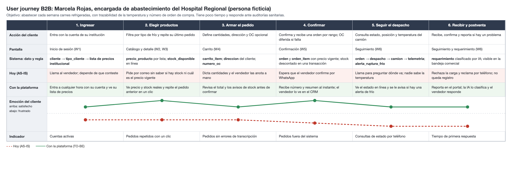
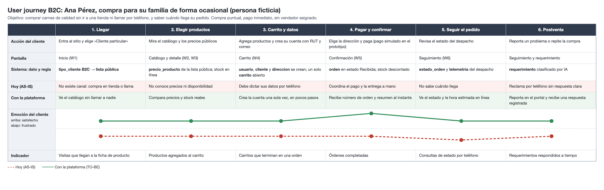
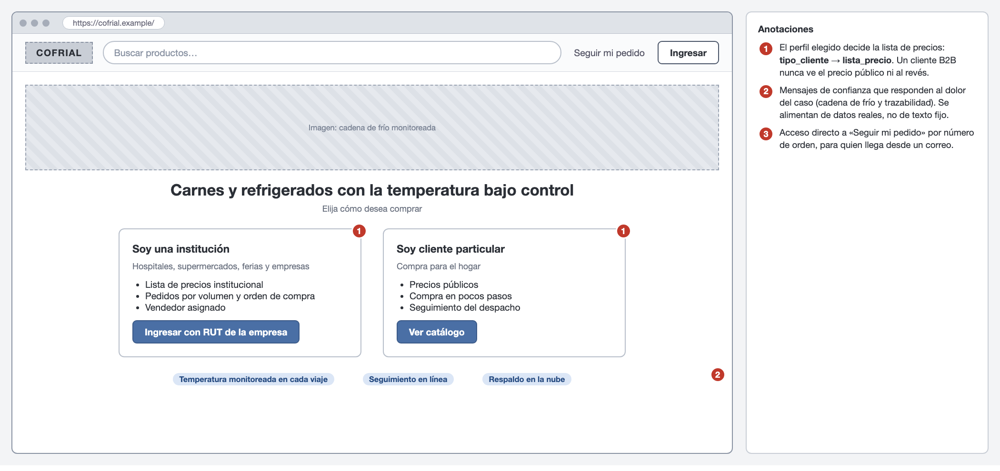
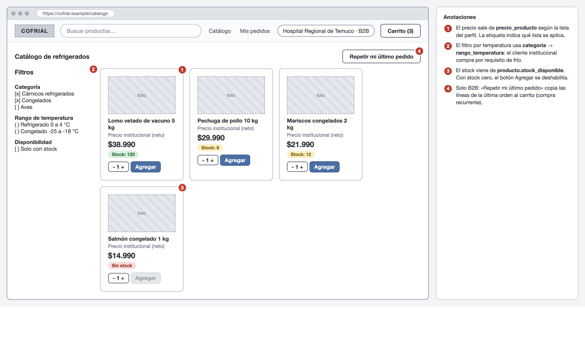
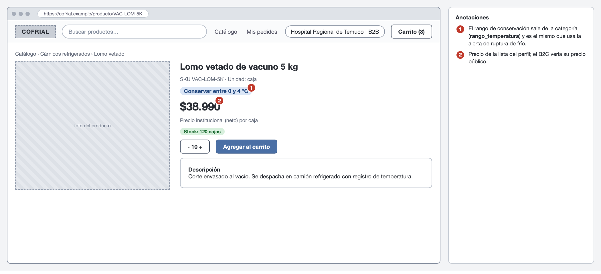
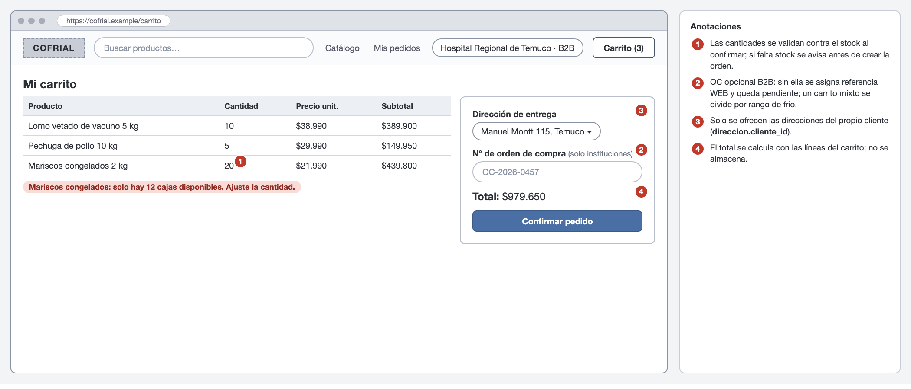
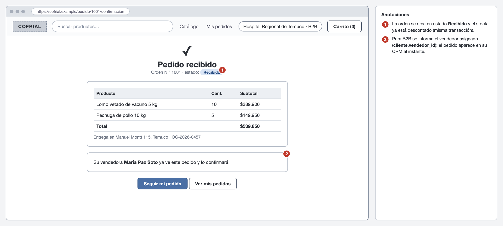
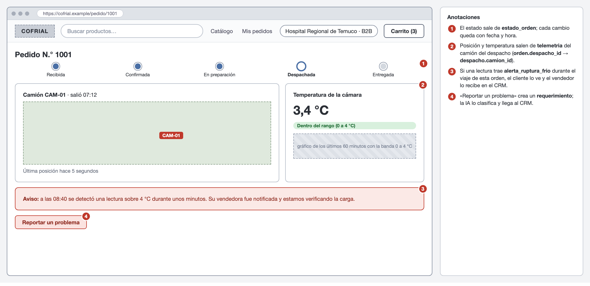
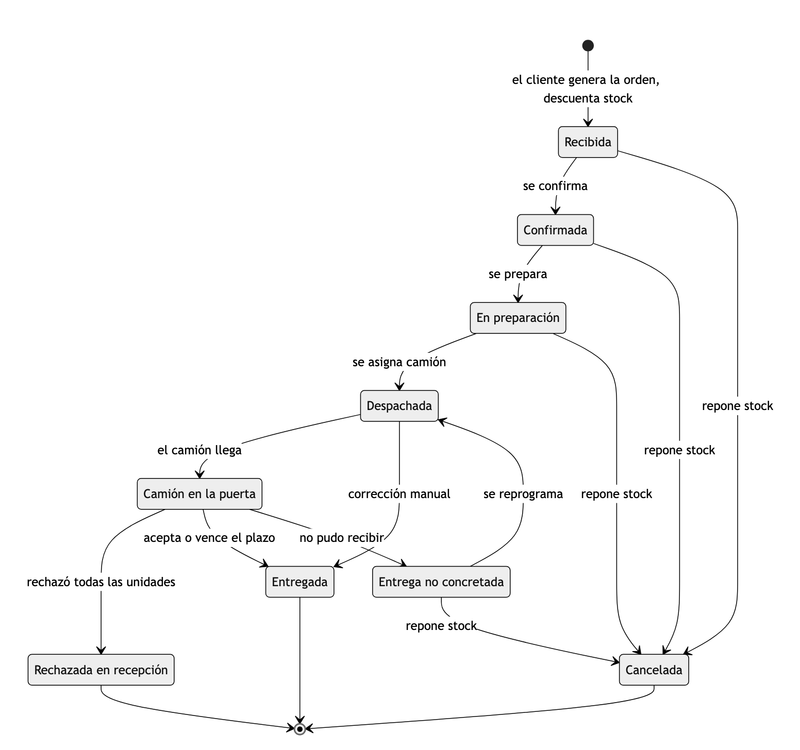

# 4c. Arquitectura de canales: wireframes y user journeys B2B/B2C

## Perfiles y qué los diferencia

El portal atiende a dos perfiles con la misma plataforma y la misma base de datos. Lo que cambia entre ellos no es la pantalla, sino las reglas que se aplican.

**Tabla 1**
*Diferencias de negocio entre los perfiles B2B y B2C*

| | B2B (institucional) | B2C (público general) | Regla |
|---|---|---|---|
| Quiénes | Hospitales, supermercados, ferias, instituciones | Personas | |
| Lista de precios | Institucional | Pública | RN-01 |
| Número de orden de compra | Se solicita; si falta, la orden queda «OC pendiente» | No aplica | RN-05 |
| Vendedor asignado | Sí; ve sus pedidos en el CRM | No | RN-09 |
| Compra recurrente | «Repetir mi último pedido» | Recompra desde el historial | RN-08 |
| Pago | Factura a crédito después de la entrega (simulada) | Pago inmediato con boleta o factura, a elección (MP prueba o Webpay simulado) | RN-18, RN-19 |
| Registro | Alta institucional gestionada por el personal autorizado | Registro previo B2C con RUT, correo, dirección y clave | |

*Nota.* Elaboración propia. La forma de solicitar la orden de compra (con la opción de dejarla pendiente) y la forma de pago son supuestos a validar con Cofrial.

## Arquitectura de canales

La propuesta ofrece tres canales de entrada. Los tres terminan en la misma base de datos, que es lo que impide que un pedido o una consulta vuelvan a vivir en un celular.

**Tabla 2**
*Canales de entrada y dónde queda el registro*

| Canal | Quién lo usa | Qué puede hacer | Dónde queda el registro |
|---|---|---|---|
| Portal web | Clientes B2B y B2C | Comprar, seguir el pedido y reportar un problema | `orden`, `requerimiento` |
| CRM del vendedor | Vendedor | Gestionar su cartera y, durante la transición, ingresar un pedido a nombre del cliente (RN-15) | `orden`, `interaccion`, `prospecto` |
| Atención por requerimientos | Clientes autenticados | Enviar una consulta o un reclamo, clasificado por IA | `requerimiento` |

*Nota.* Elaboración propia.

## User journeys

Cada journey sigue a una persona ficticia a lo largo de seis etapas. Compara lo que ocurre hoy (línea roja punteada) con lo que ocurre con la plataforma (línea verde) e indica en cada etapa la pantalla, el dato y la regla de negocio que intervienen. Las pantallas (W1 a W6) se muestran en la sección siguiente.

**Figura 1**
*User journey B2B: encargada de abastecimiento de un hospital*

*Nota.* Elaboración propia. Persona ficticia. Las emociones son estimaciones del equipo consultor en una escala de 1 (frustrado) a 5 (satisfecho).

**Lectura del journey B2B.** La mayor brecha está en las etapas 4 y 5 (confirmar y seguir el despacho), donde hoy el cliente espera una confirmación por WhatsApp y no sabe en qué condiciones viaja la carga. Es también donde el cliente institucional más valora la plataforma: un hospital necesita demostrar que la cadena de frío se mantuvo. La compra recurrente (etapa 2) reduce el esfuerzo de un cliente que pide casi lo mismo cada semana.

**Figura 2**
*User journey B2C: cliente particular*

*Nota.* Elaboración propia. Persona ficticia. Las emociones son estimaciones del equipo consultor en una escala de 1 a 5.

**Lectura del journey B2C.** Hoy no existe un canal para este perfil, por lo que la comparación es contra no poder comprar a distancia. La etapa crítica es el carrito y los datos (3): el equipo consultor considera que solicitar datos repetidos aumenta la fricción, por eso la cuenta se crea una sola vez y con los campos mínimos.

## Wireframes del portal

Los wireframes son de baja fidelidad (escala de grises) y llevan anotaciones numeradas que explican la regla de negocio y la tabla de datos detrás de cada elemento. Los ejemplos de productos y precios coinciden con los datos de prueba del modelo (`informe/modelo/datos_prueba.sql`).

**Figura 3**
*W1. Inicio y selección de perfil*

*Nota.* Elaboración propia.

**Figura 4**
*W2. Catálogo con filtros y precio según el perfil*

*Nota.* Elaboración propia.

**Figura 5**
*W3. Detalle de producto con rango de conservación*

*Nota.* Elaboración propia.

**Figura 6**
*W4. Carrito con validaciones de stock, dirección y orden de compra*

*Nota.* Elaboración propia.

**Figura 7**
*W5. Confirmación de la orden*

*Nota.* Elaboración propia.

**Figura 8**
*W6. Seguimiento del pedido con estado, posición y temperatura*

*Nota.* Elaboración propia.

## Documentos tributarios y pago

El cliente no elige guías ni notas de crédito: son documentos que Cofrial emite según lo que ocurre con el pedido. Lo que cambia entre canales es el comprobante de venta y el momento del pago: el público elige boleta o factura en el carrito y la institución recibe factura a crédito. El documento se consulta y se descarga en PDF desde el pedido. Se simula la emisión tributaria (sin SII). En B2C, con **Mercado Pago Checkout Pro en modo prueba** configurado, la orden y la boleta se crean solo tras pago aprobado; sin token de MP se mantiene Webpay simulado al confirmar el carrito (ver `docs/mercadopago-checkout.md`).

**Tabla 2b**
*Documentos por canal, momento de emisión y pago*

| Documento | Quién lo recibe | Cuándo se emite | Cuándo se paga |
|---|---|---|---|
| Boleta | Cliente B2C | Tras pago aprobado (RN-18) | Mercado Pago (prueba) o Webpay simulado si MP no está configurado |
| Guía de despacho | Ambos canales | Al despachar (RN-17) | No se paga: ampara el traslado |
| Factura | Cliente B2B (con RUT, razón social y giro) | Después de la entrega (RN-19) | A crédito, 30 días desde la factura |
| Factura a elección | Cliente B2C que la elige en el carrito (con su RUT, nombre y giro) | Tras pago aprobado (RN-18) | Queda pagada al comprar |
| Nota de crédito | Quien tenga un reclamo, una cancelación o un rechazo al recibir | Cuando el vendedor la emite (RN-21) o, sola, si el cliente rechaza unidades de un documento ya emitido (RN-23) | Rebaja la deuda o se devuelve lo pagado |

*Nota.* Elaboración propia. Los plazos de pago y el momento de emisión de la factura son supuestos a validar con Cofrial; en la práctica algunas empresas facturan varias guías juntas a fin de mes. El CRM muestra qué se entregó y aún no se facturó, y qué facturas están por cobrar o vencidas (RN-22 de `04d-crm.md`).

## Ciclo de vida de una orden

**Figura 9**
*Estados de una orden y sus transiciones*

*Nota.* Elaboración propia. La figura muestra los nueve estados de la tabla `estado_orden` y sus transiciones. Son finales «Entregada», «Cancelada» y «Rechazada en recepción» (el cliente revisó y rechazó todas las unidades, RN-23). «Entrega no concretada» no es final: nadie pudo recibir el pedido y este se reprograma en otro viaje o lo cancela ventas. La corrección manual la hacen el administrador o el despachador, con la orden «Despachada» o con el camión en la puerta. El detalle está en `docs/ciclo-entrega.md`.

## Reglas de negocio del portal

**Tabla 3**
*Reglas de negocio del e-commerce*

| ID | Regla | Dónde se ve |
|---|---|---|
| RN-01 | **Precio por perfil.** El precio mostrado y cobrado sale de la lista de precios del tipo de cliente. Un cliente solo ve su lista. | W2, W3, W4 |
| RN-02 | **Stock transaccional.** Una orden solo se genera si todas sus líneas tienen stock suficiente. La validación y el descuento ocurren en una misma transacción con bloqueo del producto, para que dos compras simultáneas no vendan la misma unidad. | W4, W5 |
| RN-03 | **Un carrito abierto por cliente.** Al generar la orden el carrito pasa a «convertido». | W4 |
| RN-04 | **Dirección propia.** La dirección de entrega debe pertenecer al cliente que compra. | W4 |
| RN-05 | **Orden de compra B2B.** Se solicita a los clientes institucionales su número de orden de compra, que emite la propia institución y no puede generarlo Cofrial. Si todavía no la tienen, la orden se crea igual, con una referencia propia (WEB-año-número) y marcada «OC pendiente»; el cliente la reemplaza por la real desde el detalle del pedido, y el CRM muestra cuántas órdenes siguen pendientes para que ventas la gestione. No aplica a B2C. | W4 |
| RN-06 | **Precio congelado.** Cada línea de la orden guarda el precio vigente al comprar; cambios posteriores de la lista no la alteran. | W5 |
| RN-07 | **Estados y cancelación.** La orden avanza según la Figura 9. Se puede cancelar antes de «Despachada»; el cliente solo mientras esté «Recibida», y el vendedor, desde la ficha del cliente en el CRM, hasta «En preparación». Cancelar repone el stock. | W5, W6 |
| RN-08 | **Compra recurrente.** «Repetir mi último pedido» copia al carrito las líneas de la última compra no cancelada (todas sus órdenes, si se dividió por rango de temperatura); las cantidades se ajustan al stock disponible y se avisa de cada ajuste. | W2 |
| RN-17 | **Guía de despacho.** Cuando una orden pasa a «Despachada» se emite su guía de despacho, que ampara el traslado de la mercadería. No cobra nada y es única por orden. | W5 |
| RN-18 | **El público paga al comprar.** Con Mercado Pago **Payment Brick** (modo prueba), el pago ocurre en el carrito; la orden B2C y el documento elegido, boleta o factura (IVA incluido), se crean cuando el pago queda `approved`. Sin credenciales MP, el cobro sigue simulado con Webpay al confirmar. | W4, W5 |
| RN-19 | **Factura B2B.** Los clientes institucionales no pagan al comprar. La factura se emite una sola vez, cuando la orden ya fue entregada, con el IVA sumado al neto y el vencimiento según el crédito del tipo de cliente (30 días). | W5 |
| RN-20 | **Pagos.** Un pago se registra contra una boleta o factura y no puede superar su saldo pendiente. El saldo se calcula (monto menos pagos y notas de crédito); no se guarda. | CRM |
| RN-21 | **Nota de crédito.** Rebaja un documento por un reclamo, una ruptura de frío o una cancelación. Exige motivo y no puede superar lo que aún no se ha rebajado. Si el cliente ya había pagado, el excedente se le devuelve en el mismo acto. Cancelar una orden con boleta emitida la anula completa. | CRM, W5 |
| RN-23 | **Recepción parcial (supuesto a validar con Cofrial).** Al revisar la entrega, el cliente indica por producto cuántas unidades rechaza y el motivo (temperatura, faltante, dañado u otro); por ejemplo, vienesas a buena temperatura pero con la bolsa abierta. Lo aceptado queda «Entregada». En B2B la factura se emite solo por lo aceptado; si ya existe un documento, se genera una nota de crédito por lo rechazado, con tope en lo que aún no se ha rebajado, y lo ya pagado se devuelve (B2C siempre, porque paga al comprar). Si rechaza todas las unidades, la orden queda «Rechazada en recepción», estado final distinto de «Entrega no concretada»: no se reprograma ni se factura. Lo rechazado no vuelve al stock sin revisión de bodega, el reclamo llega a ventas y el silencio del cliente no rechaza nada. | W5, CRM |

*Nota.* Elaboración propia. Las reglas del CRM (RN-09 a RN-15 y RN-22) y la separación térmica del portal (RN-16) están en `04d-crm.md`. RN-23 no viene del caso: se inspira en cómo un supermercado recibe parte de la mercadería tras su control de calidad y debe validarse con Cofrial, en especial si el cliente decide solo o lo hace junto al chofer, qué pasa físicamente con lo rechazado y quién revisa el stock.

## Implementación actual de los recorridos

Los wireframes representan reglas y navegación, no una captura exacta del estilo actual. El sitio implementado utiliza plantillas Django, CSS propio, fuente Schibsted Grotesk autoalojada y JavaScript progresivo. El catálogo se puede consultar sin sesión con lista pública; la sesión determina el perfil institucional y sus precios. Comprar y enviar requerimientos exige una cuenta de cliente. La selección visual de perfil no cambia por sí sola los permisos ni la lista asignada a la cuenta.

**Tabla 4**
*Recorridos implementados y controles por etapa*

| Etapa | B2B | B2C | Control implementado |
|---|---|---|---|
| Acceso | Solicitud en el portal, aprobada por ventas, que asigna el vendedor | Registro público con RUT, correo, dirección y clave | Autenticación Django; el rol de la cuenta gobierna el acceso; recuperación de clave por correo con enlace de un solo uso |
| Catálogo | Precios institucionales netos e IVA desglosado | Precios públicos con IVA incluido | Lista asociada al tipo de cliente; búsqueda y filtros |
| Carrito | Recompra y número de OC opcional | Selección de productos y cantidades | Dirección propia, validación de stock y precios vigentes |
| Confirmación | Si falta OC se genera WEB-año-número y queda pendiente | No aplica OC | Una transacción; una orden por rango de temperatura |
| Seguimiento | Órdenes propias, referencia institucional y OC pendiente | Órdenes propias y estado de entrega | Mapa, última lectura, ETA aproximada y aviso de señal antigua |
| Atención | Requerimiento asociado opcionalmente a una orden propia | Mismo canal de soporte | Persistencia previa a IA, bandeja CRM y resolución manual |
| Pago y documentos | Guía al despachar; factura a 30 días tras la entrega | Pago simulado al comprar y boleta | Documentos en el detalle del pedido y cobranza en el CRM (RN-17 a RN-22) |

Nota. Elaboración propia. Las emociones de los journeys son hipótesis de diseño; no corresponden a entrevistas realizadas.

**RN-16 Separación térmica.** Un carrito puede contener refrigerados y congelados, pero la confirmación genera una orden por rango de conservación. Todas comparten la dirección y la OC institucional entregada; sin OC, cada orden B2B obtiene su propia referencia WEB. El stock se valida antes de crear el conjunto y el carrito se convierte una sola vez. El despacho comprueba nuevamente que la orden sea homogénea y compatible con el camión. El informe utiliza RN-16 para evitar colisión con RN-09, que identifica la cartera por vendedor en el CRM. Las órdenes de un mismo carrito pueden viajar juntas en un camión de dos cámaras, cada una en la de su rango: así no salen dos camiones a la misma dirección. Cofrial renueva su flota de a poco, por lo que hoy son 5 de 50; si no hay uno libre, cada rango sale en su propio camión. Una ruptura de frío afecta solo a los pedidos de la cámara donde ocurre.

El número de OC se completa desde el detalle de una orden propia mientras no sea final. La falta de OC no impide crear ni despachar la orden: queda visible para la gestión comercial, sin afirmar un bloqueo que el código no realiza. El pedido asistido del CRM reutiliza el mismo servicio de compra; una compra mixta también puede producir varias órdenes, aunque el servicio de retorno identifica la primera.

El seguimiento se actualiza cada cinco segundos y la campanita cada quince. La ETA utiliza distancia recta multiplicada por 1,3 y velocidad media configurable de 50 km/h, valores compartidos con el simulador. Si la señal tiene más de diez minutos, se omite la ETA. OSRM propone geometría vial cuando responde; el movimiento sintético sigue tramos rectos. El registro manual de llegada cierra el viaje y libera el camión. La temperatura actual y el antecedente de una ruptura reciente se muestran como datos distintos; el gráfico de seguimiento comprende la última hora del camión, mientras que CRM y BI vinculan lecturas al intervalo de cada despacho.

## Atención y asistente de inteligencia artificial

El asistente de tienda está implementado en catálogo, detalle, carrito y seguimiento. Responde sobre productos, precios del perfil, conservación, stock y pedidos de la propia cuenta; no crea órdenes ni cambia datos. El servidor construye el contexto y omite nombre, RUT, correo, teléfono y dirección de ese contexto. El mensaje que escribe el usuario sí se envía al proveedor y puede contener información que la persona haya incluido. No se guardan los mensajes en los registros del asistente.

El chat utiliza Groq y luego Gemini por defecto, con presupuesto nominal de diez segundos y configuración independiente del clasificador. Limita las entradas a 300 caracteres y usa contadores de seis mensajes por minuto y sesenta por hora por proceso. Como la caché es local a cada proceso Gunicorn, no es un límite global estricto para toda la instalación. Los controles rechazan intentos detectados de manipulación y montos ajenos al contexto, sin garantizar que todo riesgo de generación esté eliminado. Si falla el proveedor, la tienda sigue disponible y ofrece soporte.

## Información legal y datos del cliente (13-nov-2026)

El portal publica cinco páginas en `/legal/`: política de privacidad (Ley 19.628 y Ley 21.719), términos y condiciones, devoluciones y reembolsos (Ley 19.496), cookies y créditos y licencias. Todas describen lo que el sistema hace de verdad: qué datos pide y para qué, quiénes los procesan (AWS, Gemini y Groq, Mercado Pago, OpenStreetMap, OSRM y OpenFreeMap), cuánto tiempo se guardan y cómo ejercer los derechos.

- **Consentimiento:** los dos registros (B2C y empresa) piden marcar una casilla que parte sin marcar; sin ella no se crea la cuenta. Queda en `aceptacion_legal` quién aceptó, cuándo, qué versión y desde qué IP.
- **Mis datos (`/cuenta/mis-datos/`):** el cliente descarga en JSON todo lo que el sistema guarda de su cuenta y puede eliminarla con su clave. La eliminación borra o reemplaza nombre, correo, teléfono, direcciones, carrito y avisos, y cierra el acceso; conserva los pedidos y documentos con el RUT por la obligación tributaria. No se permite con pedidos en curso ni en las cuentas de demostración.
- **Otros derechos (Ley 21.719, desde el 1-dic-2026):** en la misma página se pide rectificación, oposición o bloqueo temporal. Cada solicitud recibe un número y una fecha límite (30 días corridos, prorrogables una vez; 2 días hábiles el bloqueo), y la respuesta aparece ahí mismo. El equipo también tiene «Mis datos», en el menú lateral, y además pide la supresión, porque su cuenta la administra la empresa. El administrador responde en `/operacion/privacidad/` y la campana le avisa de las pendientes (tabla D33).
- **Cookies:** solo hay cookies necesarias (sesión, CSRF y afinidad del balanceador), así que el aviso informa y no pide aceptar. No hay analítica ni rastreo.
- **Compra:** el carrito avisa, antes de confirmar, que por ser alimentos perecibles no aplica el derecho de retracto y que lo que llegue mal se rechaza al recibir y no se cobra.
- **IA:** el asistente y la clasificación ya se presentan como IA; la política advierte que el nivel gratuito de Gemini puede usar lo enviado para mejorar sus productos. Las imágenes generadas con IA se declaran en «Créditos y licencias».

## Presentación y estados de interfaz

El catálogo de demostración contiene veinte productos en cuatro categorías. Las imágenes prioritarias son representaciones referenciales generadas con IA y no fotografías de envases reales de Cofrial; los recursos previos quedan como respaldo. Se utilizan AVIF adaptables y JPG de respaldo, tipografía y MapLibre GL JS autoalojados. Los mapas conservan dependencias externas para teselas, geocodificación y rutas; si OpenFreeMap no responde, siguen mostrando rutas y puntos sobre un fondo local.

Las pantallas contemplan vacío, carga, errores de formulario, confirmación de acciones y pérdida de conexión con señal de antigüedad. El cliente puede solicitar avisos de reposición por cantidad mínima; se muestran dentro del portal y el CRM consulta la demanda en espera. No se ha implementado correo de reposición, pasarela de pago, factura electrónica ni integración automática con el sistema contable.
