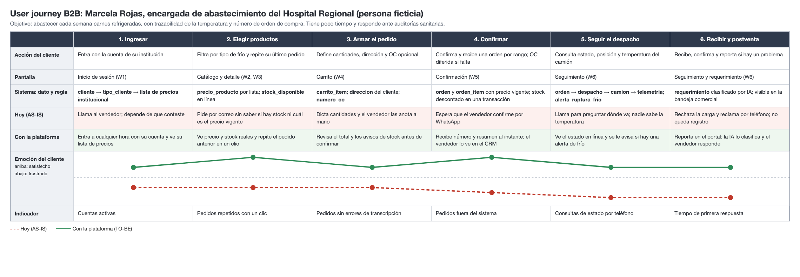
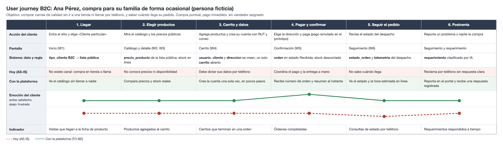
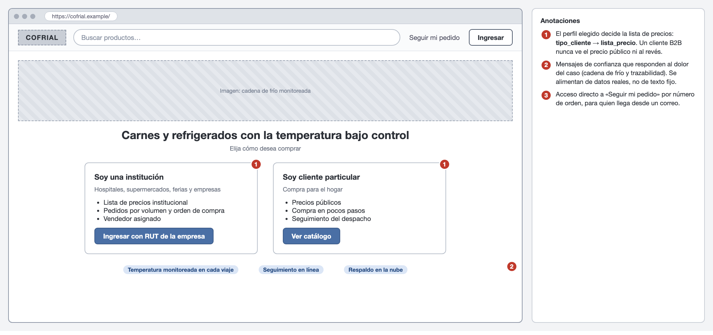
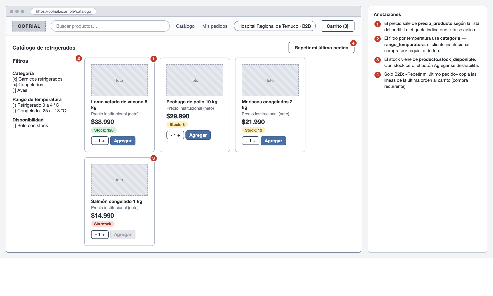
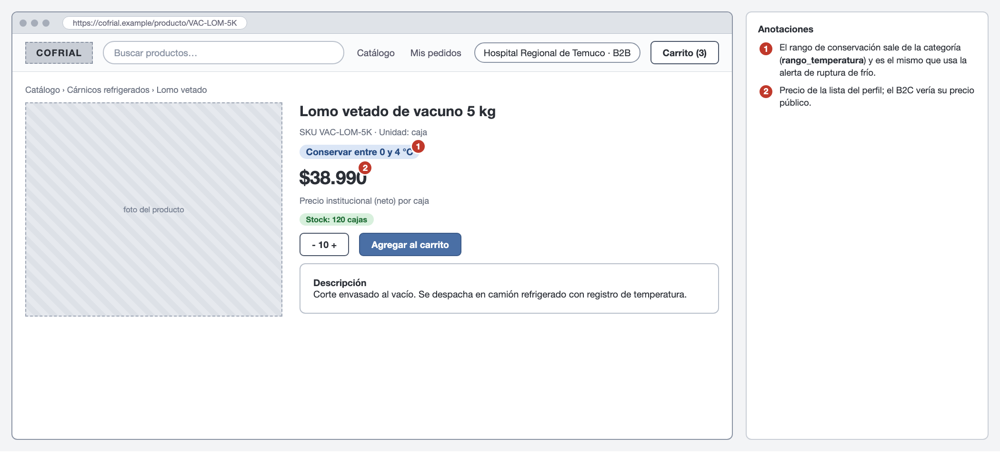
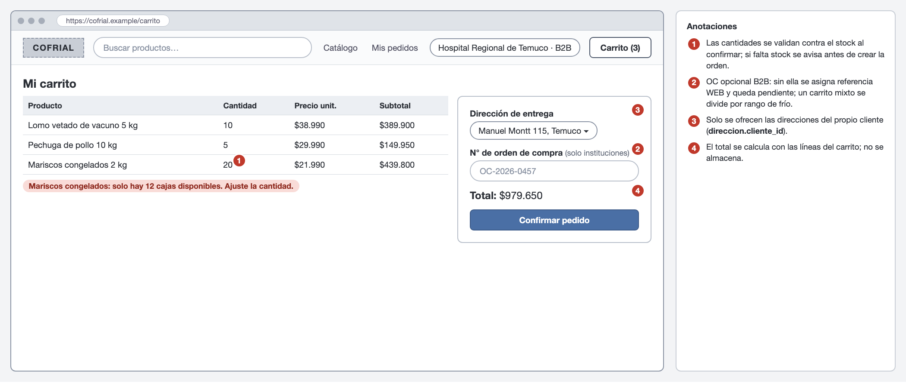
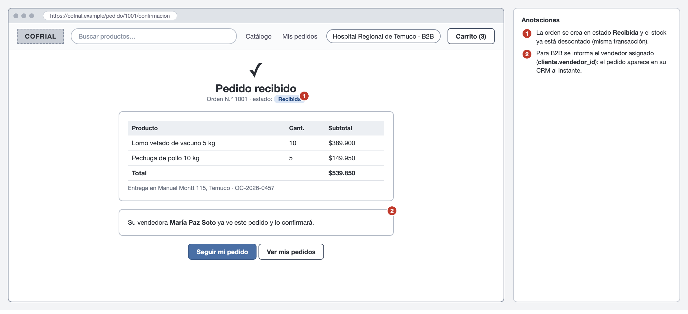
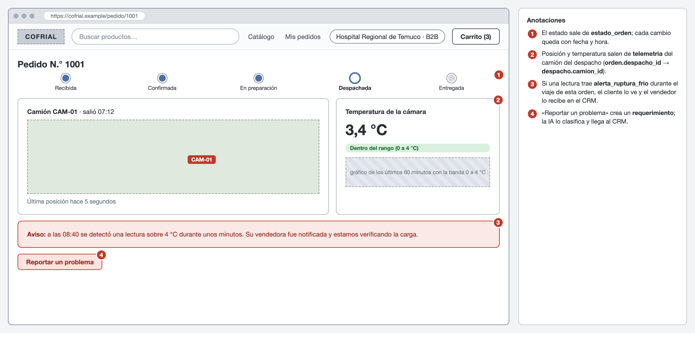
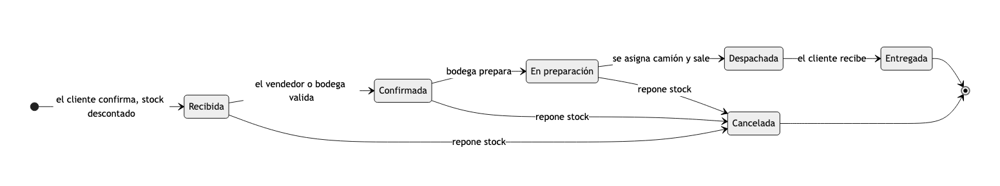

# 4c. Arquitectura de canales: wireframes y user journeys B2B/B2C

> Rúbrica H1-D4 (Logrado): user journeys **avanzados** del portal con diferenciación B2B/B2C y lógica de negocio detrás de cada pantalla.
> **Estado: borrador de redacción**, pendiente de validación del equipo. Los clientes de los ejemplos son ficticios; las emociones de los journeys son estimaciones del equipo que se contrastan con entrevistas a clientes reales.

## Perfiles y qué los diferencia

El portal atiende a dos perfiles con la misma plataforma y la misma base de datos. Lo que cambia entre ellos no es la pantalla, sino las reglas que se aplican.

**Tabla 1**
*Diferencias de negocio entre los perfiles B2B y B2C*

| | B2B (institucional) | B2C (público general) | Regla |
|---|---|---|---|
| Quiénes | Hospitales, supermercados, ferias, instituciones | Personas | |
| Lista de precios | Institucional | Pública | RN-01 |
| Número de orden de compra | Obligatorio | No aplica | RN-05 |
| Vendedor asignado | Sí; ve sus pedidos en el CRM | No | RN-09 |
| Compra recurrente | «Repetir mi último pedido» | Recompra desde el historial | RN-08 |
| Pago | Factura posterior (simulado en el prototipo) | Pago inmediato (simulado) | Fuera de alcance |
| Registro | Cuenta institucional creada con RUT de empresa | Cuenta rápida al comprar (RUT y correo) | |

*Nota.* Elaboración propia. El carácter obligatorio de la orden de compra y la forma de pago son supuestos a validar con Cofrial.

## Arquitectura de canales

La propuesta ofrece tres canales de entrada. Los tres terminan en la misma base de datos, que es lo que impide que un pedido o una consulta vuelvan a vivir en un celular.

**Tabla 2**
*Canales de entrada y dónde queda el registro*

| Canal | Quién lo usa | Qué puede hacer | Dónde queda el registro |
|---|---|---|---|
| Portal web | Clientes B2B y B2C | Comprar, seguir el pedido y reportar un problema | `orden`, `requerimiento` |
| CRM del vendedor | Vendedor | Gestionar su cartera y, durante la transición, ingresar un pedido a nombre del cliente (RN-15) | `orden`, `interaccion`, `prospecto` |
| Atención por requerimientos | Clientes y visitantes | Enviar una consulta o un reclamo, clasificado por IA | `requerimiento` |

*Nota.* Elaboración propia.

## User journeys

Cada journey sigue a una persona ficticia a lo largo de seis etapas. Compara lo que ocurre hoy (línea roja punteada) con lo que ocurre con la plataforma (línea verde) e indica en cada etapa la pantalla, el dato y la regla de negocio que intervienen. Las pantallas (W1 a W6) se muestran en la sección siguiente.

**Figura 1**
*User journey B2B: encargada de abastecimiento de un hospital*

*Nota.* Elaboración propia. Persona ficticia. Las emociones son estimaciones del equipo en una escala de 1 (frustrado) a 5 (satisfecho).

**Lectura del journey B2B.** La mayor brecha está en las etapas 4 y 5 (confirmar y seguir el despacho), donde hoy el cliente espera una confirmación por WhatsApp y no sabe en qué condiciones viaja la carga. Es también donde el cliente institucional más valora la plataforma: un hospital necesita demostrar que la cadena de frío se mantuvo. La compra recurrente (etapa 2) reduce el esfuerzo de un cliente que pide casi lo mismo cada semana.

**Figura 2**
*User journey B2C: cliente particular*

*Nota.* Elaboración propia. Persona ficticia. Las emociones son estimaciones del equipo en una escala de 1 a 5.

**Lectura del journey B2C.** Hoy no existe un canal para este perfil, por lo que la comparación es contra no poder comprar a distancia. La etapa crítica es el carrito y los datos (3): pedir demasiados datos antes de comprar es la causa más común de abandono, por eso la cuenta se crea una sola vez y con los campos mínimos.

## Wireframes del portal

Los wireframes son de baja fidelidad (escala de grises) y llevan anotaciones numeradas que explican la regla de negocio y la tabla de datos detrás de cada elemento. Los ejemplos de productos y precios coinciden con los datos de prueba del modelo (`informe/modelo/datos_prueba.sql`).

**Figura 3**
*W1. Inicio y selección de perfil*

*Nota.* Elaboración propia.

**Figura 4**
*W2. Catálogo con filtros y precio según el perfil*

*Nota.* Elaboración propia.

**Figura 5**
*W3. Detalle de producto con rango de conservación*

*Nota.* Elaboración propia.

**Figura 6**
*W4. Carrito con validaciones de stock, dirección y orden de compra*

*Nota.* Elaboración propia.

**Figura 7**
*W5. Confirmación de la orden*

*Nota.* Elaboración propia.

**Figura 8**
*W6. Seguimiento del pedido con estado, posición y temperatura*

*Nota.* Elaboración propia.

## Ciclo de vida de una orden

**Figura 9**
*Estados de una orden y sus transiciones*

*Nota.* Elaboración propia. Los estados corresponden a la tabla `estado_orden`.

## Reglas de negocio del portal

**Tabla 3**
*Reglas de negocio del e-commerce*

| ID | Regla | Dónde se ve |
|---|---|---|
| RN-01 | **Precio por perfil.** El precio mostrado y cobrado sale de la lista de precios del tipo de cliente. Un cliente solo ve su lista. | W2, W3, W4 |
| RN-02 | **Stock transaccional.** Una orden solo se genera si todas sus líneas tienen stock suficiente. La validación y el descuento ocurren en una misma transacción con bloqueo del producto, para que dos compras simultáneas no vendan la misma unidad. | W4, W5 |
| RN-03 | **Un carrito abierto por cliente.** Al generar la orden el carrito pasa a «convertido». | W4 |
| RN-04 | **Dirección propia.** La dirección de entrega debe pertenecer al cliente que compra. | W4 |
| RN-05 | **Orden de compra B2B.** Los clientes institucionales deben indicar su número de orden de compra; no aplica a B2C. | W4 |
| RN-06 | **Precio congelado.** Cada línea de la orden guarda el precio vigente al comprar; cambios posteriores de la lista no la alteran. | W5 |
| RN-07 | **Estados y cancelación.** La orden avanza según la Figura 9. Se puede cancelar antes de «Despachada»; el cliente solo mientras esté «Recibida», y el vendedor hasta «En preparación». Cancelar repone el stock. | W5, W6 |
| RN-08 | **Compra recurrente.** «Repetir mi último pedido» copia al carrito las líneas de la última orden no cancelada; las cantidades se ajustan al stock disponible y se avisa de cada ajuste. | W2 |

*Nota.* Elaboración propia. Las reglas del CRM (RN-09 a RN-15) están en `04d-crm.md`.

## Pendiente

- [ ] Validar con una persona de Cofrial los supuestos de la Tabla 1 (orden de compra obligatoria, forma de pago, quién puede cancelar).
- [ ] Contrastar las emociones de los journeys con entrevistas breves a un cliente institucional y a uno particular.
- [x] Se agregaron «Mis pedidos» (listado) e inicio de sesión con registro B2C; los B2B los crea Cofrial (ver `backend/README.md`).
- [ ] Renumerar figuras y tablas al integrar el informe completo.

## Notas del equipo

## Implementación frente a los wireframes (23-oct-2026)

La parte del cliente se rehízo para que el prototipo coincida con W1 a W6: tienda pública con barra superior y sin menú lateral (el personal conserva su panel en «Panel interno»).

| Wireframe | Implementación | Dónde |
|---|---|---|
| W1 Portada | Buscador, «Seguir mi pedido», «Ingresar», tarjetas «Soy una institución» y «Soy cliente particular», y datos reales (productos, camiones, última lectura de la flota) | `/` |
| W2 Catálogo | Tarjetas con ilustración por categoría, filtros (categoría, rango de temperatura, solo con stock), búsqueda por nombre o SKU, estado de stock (verde, ámbar, rojo), −1+ y «Agregar», y «Repetir mi último pedido» para B2B | `/catalogo/` |
| W3 Detalle | Rango de conservación, descripción, stock y productos de la misma categoría | `/catalogo/<id>/` |
| W4 y W5 | Carrito y confirmación con las validaciones RN-01 a RN-08 (sin cambios) | `/carrito/`, `/pedidos/<id>/` |
| W6 Seguimiento | Mapa con la posición del camión, temperatura de la cámara con su franja permitida y gráfico de la última hora, aviso si hubo ruptura de frío y «Reportar un problema», que crea un requerimiento ligado a la orden y lo clasifica la IA | `/pedidos/<id>/` y `/api/pedidos/<id>/seguimiento/` |
| Registro B2C | Formulario con RUT validado (módulo 11), correo, dirección y clave; crea cuenta, cliente B2C y dirección principal | `/cuenta/registro/` |

El catálogo de demostración tiene 20 productos en 4 categorías (cárnicos refrigerados, aves, congelados, lácteos y embutidos). Las imágenes son ilustraciones propias por categoría, no fotografías de producto. El seguimiento se actualiza cada 5 s consultando la API; el mapa usa Leaflet con teselas de OpenStreetMap.

**Imágenes y rutas (23-oct-2026).** Las fotos de producto son referenciales y provienen de Wikimedia Commons (API pública sin cuenta ni clave), con licencias libres; el autor y la licencia se muestran en el detalle del producto y los productos sin foto adecuada usan una ilustración. Los mapas usan OpenStreetMap; las direcciones se ubican con Nominatim y las rutas se calculan con OSRM, ambos gratuitos y sin clave. El panel de flota propone el orden de entrega de cada viaje (recorrido de menor distancia desde el frigorífico central) y el cliente ve la ruta restante de su camión hasta su dirección.

**Ilustraciones generadas con IA y formato chileno (23-oct-2026).** Los productos sin foto libre adecuada (carne molida, merluza, mix de mariscos y mantequilla) usan una ilustración SVG creada con IA (Gemini, con Groq como respaldo) mediante `manage.py generar_ilustraciones`. El SVG se valida y se reconstruye con una lista blanca de etiquetas y atributos antes de guardarse, y el detalle del producto indica el modelo que lo creó. Los precios se muestran al modo chileno (`$34.990`, punto como separador de miles y sin «CLP»); a los clientes institucionales se les desglosa neto, IVA de 19 % y total.

**Avisos de stock (24-oct-2026).** Cuando un producto está sin stock, el cliente con sesión puede pedir que se le avise al haber al menos la cantidad que necesita (por ejemplo, 5 cajas). El aviso se muestra en «Avisos» de la barra superior y como novedad en el catálogo en cuanto el stock alcanza esa cantidad, y se da por atendido cuando el cliente agrega el producto al carrito. No se envía correo electrónico; el equipo comercial ve la demanda en espera en el CRM (pestaña «Demanda en espera»), con los clientes que esperan, las unidades pedidas y si el stock alcanza.

**Imágenes de producto (24-oct-2026).** Las fotografías del catálogo son imágenes referenciales de cada producto en su envase, creadas con herramientas de inteligencia artificial generativa a partir de descripciones del producto, con etiqueta en blanco y sin marcas; no son fotografías de las cajas reales de Cofrial. Las ilustraciones y fotos de Wikimedia Commons que se usaron antes quedan como respaldo si falta una imagen. En la tienda las etiquetas de conservación muestran el rango de temperatura con un ícono (termómetro para refrigerado y copo para congelado) y el estado de stock se indica con texto, sin leyendas sobre cómo se creó la imagen.
