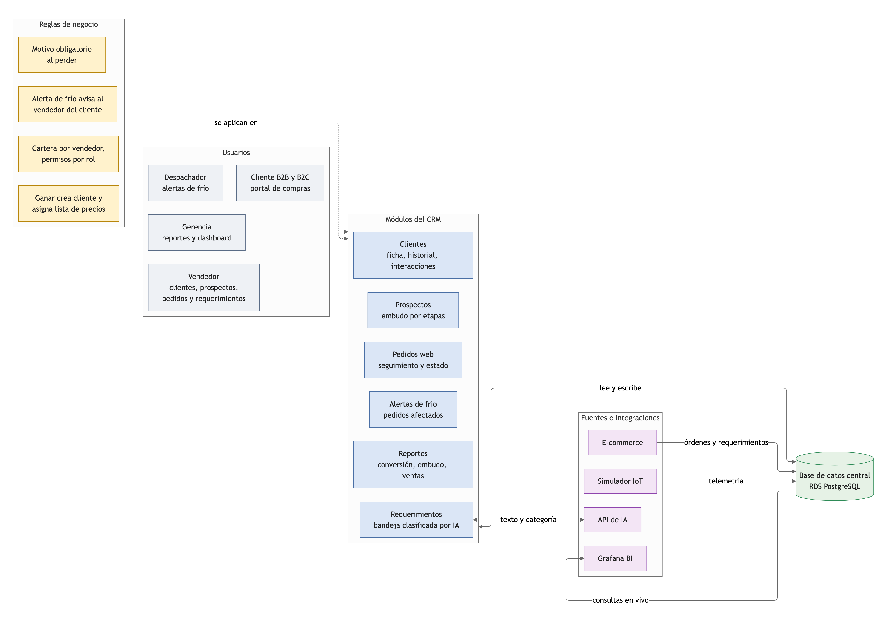
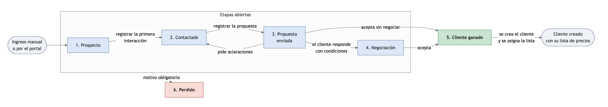
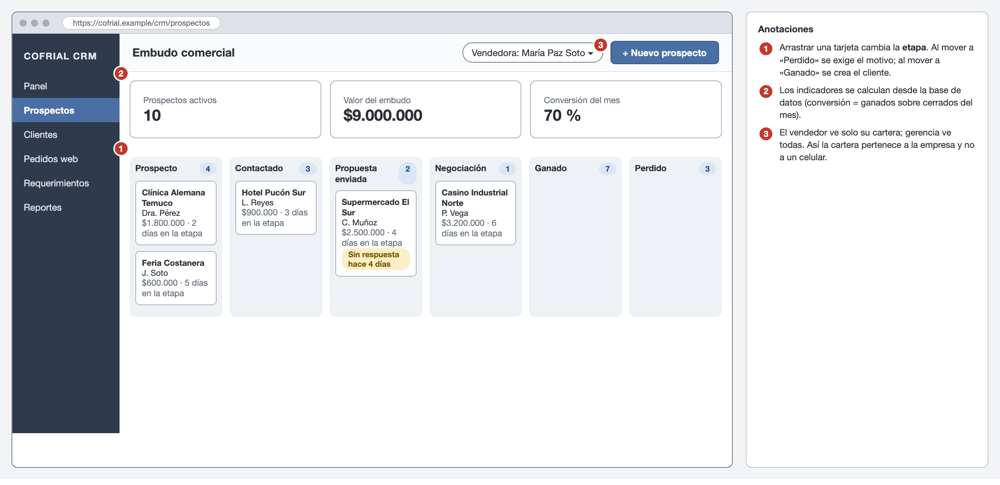
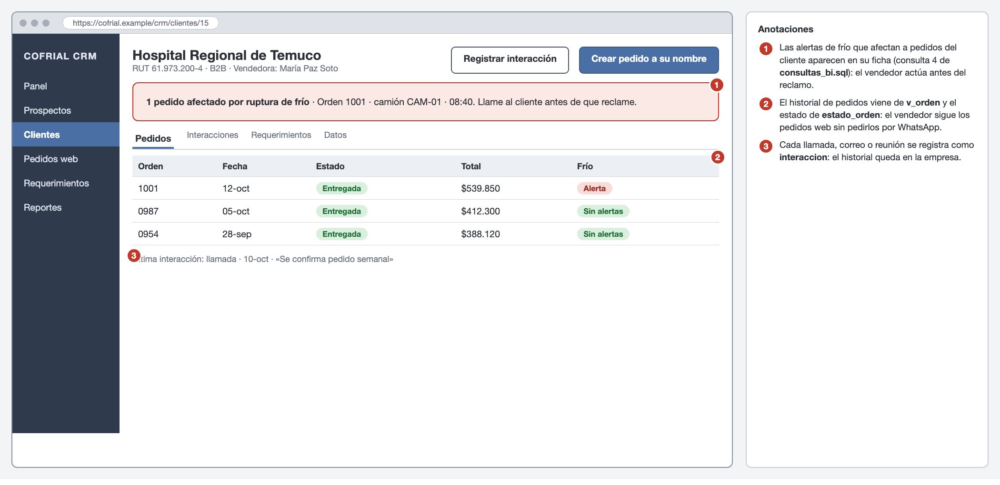
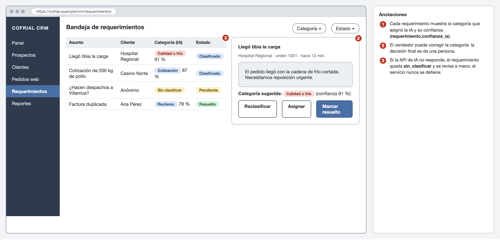

# 4d. Arquitectura funcional del CRM y pipeline comercial

> Rúbrica H1-D4 (Logrado): arquitectura funcional del CRM que **erradica el Shadow IT** (cartera en celulares, WhatsApp), con flujos y lógica de negocio.
> **Estado: borrador de redacción**, pendiente de validación del equipo.

## Arquitectura funcional

El CRM no es un sistema aparte: es una vista de la misma base de datos que usa el portal y el simulador IoT. Eso es lo que cumple el requisito de «una sola fuente de verdad» y lo que permite, por ejemplo, que el vendedor vea una alerta de cadena de frío en la ficha de su cliente.

**Figura 1**
*Arquitectura funcional del CRM*

*Nota.* Elaboración propia. Los módulos leen y escriben en la base de datos central; el portal, el simulador IoT y la API de IA son fuentes que la alimentan, y Grafana la consulta en vivo.

## Módulos

**Tabla 1**
*Módulos del CRM, usuarios, datos y pantallas*

| Módulo | Usuarios | Qué hace | Tablas principales | Pantalla |
|---|---|---|---|---|
| Clientes | Vendedor | Ficha del cliente, historial de pedidos e interacciones, alertas de frío que lo afectan | `cliente`, `direccion`, `interaccion`, `v_orden` | W8 |
| Prospectos | Vendedor | Embudo comercial por etapas, con el monto estimado de cada oportunidad | `prospecto`, `etapa_pipeline`, `interaccion` | W7 |
| Pedidos web | Vendedor | Seguimiento de las órdenes del portal: estado, despacho y total | `orden`, `orden_item`, `estado_orden`, `despacho` | W8 |
| Requerimientos | Vendedor | Bandeja de consultas y reclamos clasificados por IA | `requerimiento`, `categoria_requerimiento` | W9 |
| Alertas de frío | Despachador, vendedor | Pedidos afectados por una ruptura de frío durante el viaje | `telemetria`, `despacho`, `orden` | W8 |
| Reportes | Gerencia | Conversión, valor del embudo, ventas por canal | `prospecto`, `v_orden`, `v_orden_total` | Grafana |

*Nota.* Elaboración propia. Las pantallas W7 a W9 corresponden a los wireframes de esta sección; W1 a W6 están en `04c-canales-b2b-b2c.md`.

## Roles y permisos

El permiso por rol es lo que hace que la cartera pertenezca a la empresa y no a la persona (RN-09).

**Tabla 2**
*Permisos por rol y módulo (L: leer, E: escribir, —: sin acceso)*

| Módulo | Vendedor | Despachador | Gerencia | Administrador |
|---|---|---|---|---|
| Clientes (su cartera) | L, E | — | L | L, E |
| Clientes (cartera de otros) | — | — | L | L, E |
| Prospectos (propios) | L, E | — | L | L, E |
| Pedidos web (de sus clientes) | L | — | L | L, E |
| Crear pedido a nombre del cliente | E | — | — | E |
| Requerimientos | L, E | — | L | L, E |
| Alertas de frío | L | L | L | L |
| Reportes | L (propios) | — | L (todos) | L (todos) |

*Nota.* Elaboración propia. Los clientes B2B y B2C no entran al CRM: usan solo el portal.

## Pipeline comercial

**Figura 2**
*Etapas del embudo comercial y transiciones permitidas*

*Nota.* Elaboración propia. «Perdido» se puede alcanzar desde cualquier etapa abierta, siempre con motivo.

**Tabla 3**
*Etapas del pipeline: criterio de entrada y salida*

| Etapa | Qué significa | Para entrar | Siguiente acción esperada |
|---|---|---|---|
| 1. Prospecto | Contacto nuevo, sin conversación | Se ingresa con contacto, correo o teléfono y origen | Hacer el primer contacto |
| 2. Contactado | Hubo al menos una conversación | Registrar la primera interacción | Preparar la propuesta |
| 3. Propuesta enviada | El cliente tiene precios y condiciones | Registrar la propuesta | Esperar respuesta; alerta si pasan 4 días |
| 4. Negociación | El cliente respondió con condiciones | El cliente responde | Cerrar el acuerdo |
| 5. Cliente ganado | Aceptó | Aceptación | Se crea el cliente con su lista de precios (RN-11) |
| 6. Perdido | No compró | Motivo de pérdida | Aprender del motivo |

*Nota.* Elaboración propia. Las etapas corresponden a la tabla `etapa_pipeline`.

## Reglas de negocio del CRM

**Tabla 4**
*Reglas de negocio del CRM*

| ID | Regla | Efecto |
|---|---|---|
| RN-09 | **Cartera por vendedor.** Cada cliente B2B tiene un vendedor asignado y cada prospecto, un responsable. El vendedor solo ve su cartera; gerencia ve todas. | La cartera es de la empresa |
| RN-10 | **Transiciones del pipeline.** Solo se permiten los movimientos de la Figura 2. No se puede saltar, por ejemplo, de Prospecto a Negociación. | Datos de embudo confiables |
| RN-11 | **Cierre.** Perder un prospecto exige un motivo y registra la fecha de cierre. Ganarlo crea el cliente (tipo B2B, con la lista institucional y el mismo vendedor) y vincula el prospecto a él. | Se aprende de las ventas perdidas; la conversión se puede medir |
| RN-12 | **Registro de interacciones.** Toda llamada, correo o reunión con un prospecto o cliente se registra en su ficha. «Si no está en el CRM, no ocurrió.» | Historial en la empresa, no en el celular |
| RN-13 | **Alerta de frío.** Cuando una lectura trae `alerta_ruptura_frio` durante el viaje de un despacho, sus órdenes se consideran afectadas y aparecen destacadas en la ficha del cliente y en el seguimiento del pedido. | El vendedor actúa antes del reclamo |
| RN-14 | **Clasificación con IA.** Cada requerimiento se clasifica con IA y se guarda con su confianza. Si la API falla o la confianza es menor que 0,60 (umbral supuesto), queda marcado para revisión manual. El servicio nunca pierde un requerimiento. | La IA ayuda, la persona decide |
| RN-15 | **Pedido a nombre del cliente.** Durante la transición, el vendedor puede generar el pedido desde la ficha del cliente y debe registrar la interacción (llamada o correo) que lo originó. | Los clientes que aún llaman quedan dentro del sistema |

*Nota.* Elaboración propia. Las reglas del portal (RN-01 a RN-08) están en `04c-canales-b2b-b2c.md`.

## Verificación de la regla RN-14 en el prototipo

La regla de clasificación con IA se implementó y se midió con la interfaz real de Gemini (Google, s.f.), en la capa gratuita y sobre la instalación desplegada en AWS Academy. El cliente registra su consulta en la sección de soporte del portal; el sistema la guarda siempre y consulta a la IA, que devuelve una categoría y una confianza. Con confianza de 0,60 o más el requerimiento queda clasificado y aparece en el CRM con su categoría y la confianza de la IA; si es menor o la API falla, queda sin clasificar y el vendedor lo resuelve a mano o reintenta con la IA.

- **Acierto medido: 100 % (20 de 20 mensajes etiquetados)** con Gemini como proveedor principal y Groq de respaldo, sobre la meta de más de 85 %. Una medición previa solo con Gemini había dado 90 % (18 de 20): las 18 respuestas recibidas fueron correctas y dos quedaron sin respuesta del proveedor gratuito (una por demora y otra por saturación). El respaldo resolvió esa debilidad; Groq por sí solo también acertó 20 de 20 y responde en cerca de un segundo.
- **Tiempo de respuesta: de 4 a 7 segundos por consulta.** El diseño inicial fijaba un máximo de cinco segundos, plazo con el que casi todas las consultas habrían quedado sin clasificar; el prototipo concede doce segundos en total.
- **La IA es visible y explicable.** La página «IA» del CRM muestra el estado de los proveedores, un resumen de lo clasificado por la IA, por personas y lo que quedó dudoso, y una prueba en vivo que compara los proveedores lado a lado (respuesta, confianza y tiempo) sin crear datos. Sirve para demostrar y explicar la integración durante la defensa.
- **Categorías implementadas:** consulta de producto, reclamo por temperatura, atraso en entrega, facturación y otro.
- **Alcance:** el enrutamiento automático por área y el aviso al supervisor cuando la IA falla no se implementaron; hoy existe una bandeja única de requerimientos en el CRM, que el vendedor ve y gestiona.
- **Una lección sobre la capa gratuita.** El primer modelo elegido ya no estaba disponible para cuentas nuevas y los vigentes se consumen con otra interfaz. Por eso el nombre del modelo se configura y se prueba en cascada en lugar de fijarse en el código.

## Wireframes del CRM

**Figura 3**
*W7. Embudo comercial con indicadores*

*Nota.* Elaboración propia.

**Figura 4**
*W8. Ficha de cliente con alertas de frío y pedidos*

*Nota.* Elaboración propia.

**Figura 5**
*W9. Bandeja de requerimientos clasificados por IA*

*Nota.* Elaboración propia.

## Flujos entre componentes

Estos son los eventos que conectan el portal, el IoT, la IA y el CRM. Cada uno se prueba en la demostración del Hito 2.

**Tabla 5**
*Eventos entre componentes y su efecto en el CRM*

| Evento | Origen | Qué ocurre en el CRM |
|---|---|---|
| Se genera una orden | Portal | Aparece en «Pedidos web» del vendedor asignado y en la ficha del cliente |
| Cambia el estado de la orden | Bodega o vendedor | El estado se actualiza para el cliente y para el vendedor |
| Llega una lectura con alerta de frío | Simulador IoT | La orden del despacho en curso aparece como afectada en la ficha del cliente |
| Llega un requerimiento | Portal | Aparece en la bandeja con la categoría que sugiere la IA |
| Se gana un prospecto | Vendedor | Se crea el cliente y desaparece del embudo abierto |

*Nota.* Elaboración propia.

## Indicadores del CRM

Todos se calculan con consultas sobre la base de datos (`informe/modelo/consultas_bi.sql`), sin planillas.

**Tabla 6**
*Indicadores del CRM, fórmula y consulta*

| Indicador | Fórmula | Consulta |
|---|---|---|
| Conversión del mes | ganados / (ganados + perdidos), según la fecha de cierre | 6 |
| Valor del embudo | suma del monto estimado de los prospectos abiertos, por etapa | 7 |
| Prospectos sin actividad | abiertos sin interacción en los últimos 7 días | 8 |
| Primera respuesta a requerimientos | promedio de (respondido_en − creado_en), en minutos | 9 |
| Pedidos afectados por frío | órdenes cuyo despacho tuvo una lectura con alerta | 4 |
| Ventas por canal | total de las órdenes por B2B y B2C | 1 |

*Nota.* Elaboración propia. «Pedidos fuera del sistema» no se calcula desde la base de datos: se mide con un conteo manual en la fase de adopción (ver `02-propuesta-valor.md`).

## Cómo el CRM erradica el Shadow IT

**Tabla 7**
*Prácticas informales sustituidas, mecanismo y control*

| Antes | Ahora | Mecanismo | Control |
|---|---|---|---|
| Cartera en el celular del vendedor | Cartera centralizada y asignada en el CRM | RN-09: el prospecto y el cliente viven en la base; el vendedor accede por su cuenta | Prospectos y clientes cargados por vendedor |
| Pedido por WhatsApp o correo | Pedido en el portal, visible en el CRM | RN-15: si el cliente llama, el vendedor lo ingresa en la plataforma | Pedidos fuera del sistema |
| Seguimiento por llamada | Estado del pedido y del camión en línea | RN-13: el cliente y el vendedor ven el estado y las alertas | Consultas de estado por canales informales |
| Conversaciones sin registro | Historial en la ficha | RN-12: toda interacción se registra | Interacciones registradas por semana |
| Ventas perdidas sin explicación | Motivo de pérdida | RN-11: no se puede perder sin motivo | Porcentaje de pérdidas con motivo |
| Reclamos por canales informales | Requerimientos clasificados | RN-14: bandeja única | Requerimientos con primera respuesta |

*Nota.* Elaboración propia.

**Qué impide volver al canal informal.** La plataforma no elimina el WhatsApp por decreto: lo hace innecesario. El vendedor gana porque su cartera y sus comisiones se calculan sobre lo registrado, y el cliente gana porque ve el estado sin llamar. Además, la gerencia adopta una regla simple: lo que no está en el sistema no se prepara ni se despacha (ver hoja de ruta en `02-propuesta-valor.md`).

## Pendiente

- [ ] Validar con un vendedor de Cofrial el flujo del embudo y las etapas.
- [ ] Acordar el umbral de confianza de la IA (0,60 es un supuesto) y los días de alerta por falta de respuesta (4 es un supuesto).
- [ ] Definir cómo se avisa al vendedor de una alerta de frío: hoy se destaca en la ficha; un correo o aviso es una mejora posible.
- [ ] Renumerar figuras y tablas al integrar el informe completo.

## Notas del equipo
