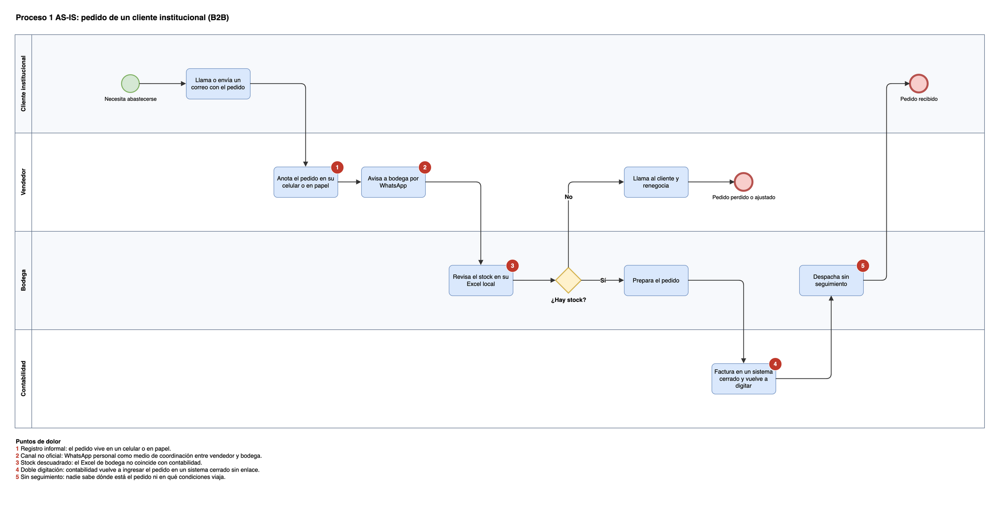
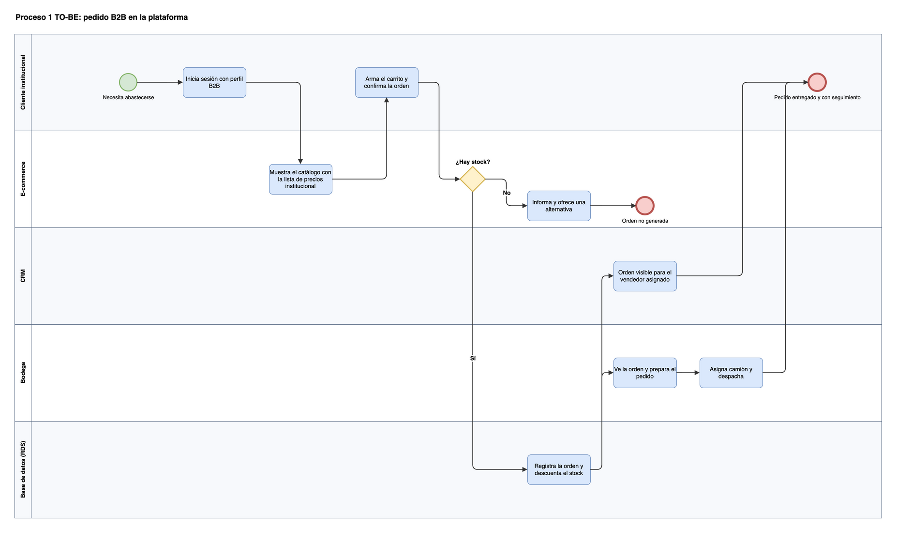
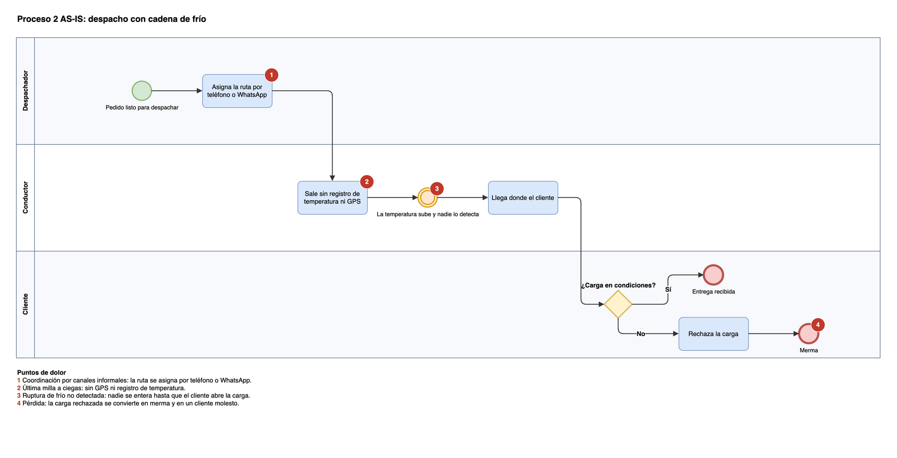
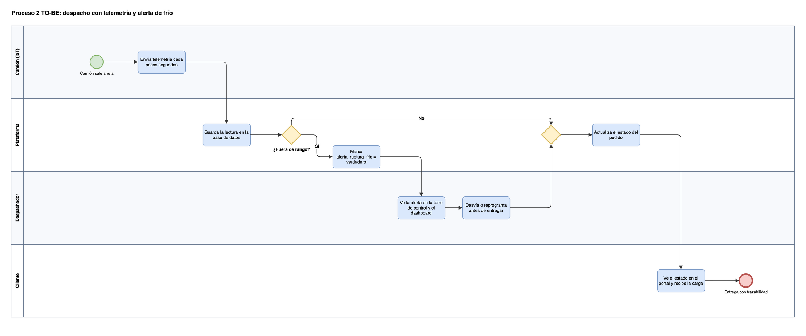
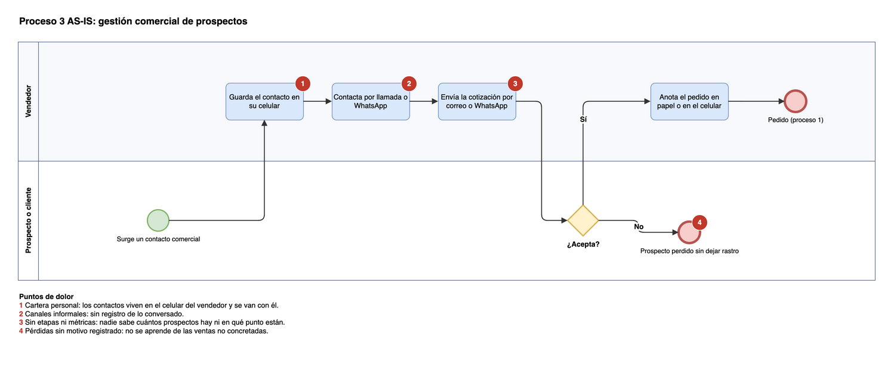
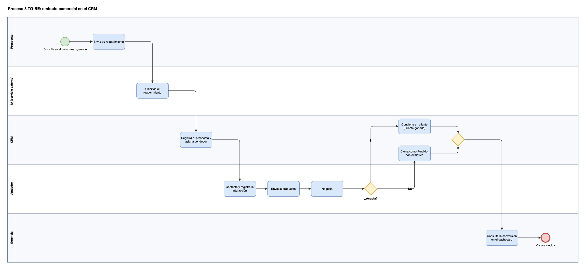

# Procesos AS-IS y TO-BE (BPMN 2.0)

> Aporta a H1-D1 (el diagnóstico se ve en el AS-IS) y a H1-D4 (el TO-BE muestra cómo se elimina el Shadow IT).
> **Estado: borrador de redacción**, pendiente de validación del equipo. Los seis diagramas están hechos; falta contrastarlos con cómo opera Cofrial en la realidad.

## Notación elegida

**Tabla 1**
*Comparación de notaciones de modelado de procesos*

| Notación | Fortaleza | Limitación | Decisión |
|---|---|---|---|
| BPMN 2.0 | Estándar abierto, con carriles por responsable, eventos y compuertas | Requiere conocer la simbología | Adoptada. Muestra los traspasos entre vendedor, bodega y despacho, que es donde hoy se pierde la información |
| Diagrama de actividades UML | Conocido en desarrollo de software | Menos legible para la gerencia | Descartada |
| Flujograma simple | Muy fácil de leer | Sin carriles: oculta quién hace cada paso | Complementaria. Solo para la presentación |

*Nota.* Elaboración propia, con el mismo criterio usado en TRAZO.

**Herramienta.** Los diagramas usan la notación BPMN 2.0 (carriles, eventos de inicio y fin, tareas y compuertas exclusivas) dibujada en draw.io, que es gratuito, guarda un archivo `.drawio` editable y exporta a PNG. Se eligió sobre bpmn.io porque ya se usa para el diagrama de arquitectura. Se trata de dibujos con notación BPMN, no de modelos ejecutables: si se necesitara un archivo `.bpmn`, se reconstruyen en bpmn.io a partir de estos diagramas. Los archivos y el script que los genera están en `informe/img/` (`generar-figuras-d1.py`).

**Convenciones de lectura.** Círculo verde: inicio. Círculo con borde grueso: fin. Círculo doble naranja: evento intermedio. Rombo: compuerta exclusiva (se sigue un solo camino). Círculos rojos numerados: **puntos de dolor** del proceso actual, explicados en la leyenda de cada diagrama AS-IS.

## Proceso 1: pedido de un cliente institucional (B2B)

**Figura 1**
*Proceso 1 AS-IS: pedido de un cliente institucional*

*Nota.* Elaboración propia. Carriles: cliente institucional, vendedor, bodega y contabilidad.

**Figura 2**
*Proceso 1 TO-BE: pedido B2B en la plataforma*

*Nota.* Elaboración propia. Carriles: cliente institucional, e-commerce, CRM, bodega y base de datos.

**Tabla 2**
*Proceso 1: de dónde viene el dolor y cómo lo resuelve el TO-BE*

| Punto de dolor (AS-IS) | Qué ocurre hoy | Cómo lo resuelve el TO-BE |
|---|---|---|
| 1. Registro informal | El vendedor anota el pedido en su celular o en papel | El cliente genera la orden en el portal; queda registrada en la base de datos |
| 2. Canal no oficial | El vendedor avisa a bodega por WhatsApp personal | Bodega ve la orden en la misma base de datos, sin intermediarios |
| 3. Stock descuadrado | Bodega revisa su Excel local, que no coincide con contabilidad | El portal valida el stock en tiempo real contra la base central y descuenta al confirmar |
| 4. Doble digitación | Contabilidad vuelve a ingresar el pedido en un sistema cerrado | La orden existe una sola vez; se exporta a contabilidad desde la base (ver límites en `02-propuesta-valor.md`) |
| 5. Sin seguimiento | Nadie sabe dónde está el pedido | El cliente ve el estado y el vendedor lo ve en el CRM |

*Nota.* Elaboración propia. Casos de uso asociados: CU-01 a CU-05 y CU-08.

## Proceso 2: despacho con cadena de frío

**Figura 3**
*Proceso 2 AS-IS: despacho con cadena de frío*

*Nota.* Elaboración propia. Carriles: despachador, conductor y cliente.

**Figura 4**
*Proceso 2 TO-BE: despacho con telemetría y alerta de frío*

*Nota.* Elaboración propia. Carriles: camión (IoT), plataforma, despachador y cliente. La compuerta compara `temp_camara` con el rango del camión (tabla `rango_temperatura`, ver `04b-modelo-datos.md`).

**Tabla 3**
*Proceso 2: de dónde viene el dolor y cómo lo resuelve el TO-BE*

| Punto de dolor (AS-IS) | Qué ocurre hoy | Cómo lo resuelve el TO-BE |
|---|---|---|
| 1. Coordinación informal | La ruta se asigna por teléfono o WhatsApp | El despacho queda registrado en la plataforma, asociado a un camión y a sus órdenes |
| 2. Última milla a ciegas | El conductor sale sin registro de temperatura ni GPS | El camión envía telemetría con posición, temperatura y combustible cada pocos segundos |
| 3. Ruptura no detectada | La temperatura sube y nadie se entera | Cada lectura se evalúa contra el rango del camión y marca `alerta_ruptura_frio` |
| 4. Pérdida | El cliente rechaza la carga al recibirla y se convierte en merma | El despachador ve la alerta mientras el camión está en ruta y puede actuar antes de entregar |

*Nota.* Elaboración propia. Casos de uso asociados: CU-10, CU-11 y CU-12.

## Proceso 3: gestión comercial de prospectos

**Figura 5**
*Proceso 3 AS-IS: gestión comercial de prospectos*

*Nota.* Elaboración propia. Carriles: vendedor y prospecto o cliente.

**Figura 6**
*Proceso 3 TO-BE: embudo comercial en el CRM*

*Nota.* Elaboración propia. Carriles: prospecto, IA (servicio externo), CRM, vendedor y gerencia. Las etapas entre paréntesis corresponden a la tabla `etapa_pipeline`.

**Tabla 4**
*Proceso 3: de dónde viene el dolor y cómo lo resuelve el TO-BE*

| Punto de dolor (AS-IS) | Qué ocurre hoy | Cómo lo resuelve el TO-BE |
|---|---|---|
| 1. Cartera personal | El contacto se guarda en el celular del vendedor | El prospecto queda en el CRM, asignado al vendedor pero propiedad de la empresa |
| 2. Canales informales | Se contacta por llamada o WhatsApp, sin registro | Cada contacto se registra como interacción en la ficha |
| 3. Sin etapas ni métricas | Nadie sabe en qué punto está cada prospecto | El prospecto avanza por etapas visibles en un tablero |
| 4. Pérdidas sin motivo | Si el prospecto no acepta, no queda rastro | Se cierra como Perdido con el motivo, y la gerencia mide la conversión |

*Nota.* Elaboración propia. Casos de uso asociados: CU-06, CU-07 y CU-09. El requerimiento que llega por el portal lo clasifica la IA antes de ingresar al CRM; si la API no responde, queda "sin clasificar" y lo revisa una persona.

## Pendiente

- [ ] Contrastar los seis diagramas con una conversación con Cofrial (en especial los pasos de bodega y contabilidad, que son supuestos del equipo).
- [ ] Revisar si hace falta un cuarto proceso (por ejemplo, devoluciones o reclamos por cadena de frío).
- [ ] Renumerar figuras y tablas al integrar el informe completo.

## Notas del equipo
