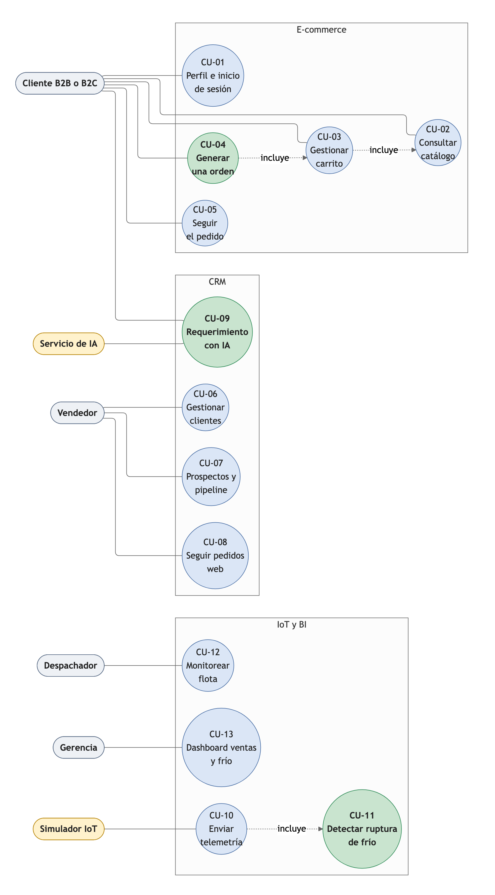

# 6. Casos de uso del ecosistema

Aporta a H1-D4 (arquitectura de canales y CRM). Sirve como guion para la demo del Hito 2.

## Formato y decisión

| Formato | Fortaleza | Limitación | Decisión |
|---|---|---|---|
| Diagrama UML + especificación textual | Muestra actores, límites y relaciones de un vistazo | Especificación completa es costosa (flows, alternativas) | Adoptada. Diagrama general + especificación de 3 casos críticos |
| Historias de usuario | Rápidas, orientadas al valor | Sin vista global de actores | Complementaria. Tarjetas en Trello |

Nota. Elaboración propia.

## Actores del sistema

| Actor | Tipo | Descripción | Interactúa con |
|---|---|---|---|
| Cliente B2B | Primario | Hospital, supermercado, institución con lista de precios institucional | E-commerce, CRM |
| Cliente B2C | Primario | Persona que compra a precio público | E-commerce |
| Vendedor | Primario | Gestiona cartera y prospectos | CRM, IA |
| Despachador | Primario | Supervisa flota y alertas de frío | Torre de control, BD |
| Gerencia | Primario | Consulta métricas | Dashboard BI |
| Simulador IoT | Sistema | Contenedores Docker que envían telemetría | BD (RDS) |
| Servicio de IA | Sistema externo | Clasifica requerimientos (NLP) | CRM, E-commerce |
| Base de datos (RDS) | Sistema | Único origen de verdad | Todos |

Nota. Elaboración propia.

## Catálogo de casos de uso (CU-01 a CU-13)

| ID | Caso de uso | Actor principal | Módulo | Prioridad | Rúbrica |
|---|---|---|---|---|---|
| CU-01 | Seleccionar perfil e iniciar sesión (B2B/B2C) | Cliente | E-commerce | Obligatorio | H2-D2 |
| CU-02 | Consultar catálogo de refrigerados con precio según perfil | Cliente | E-commerce | Obligatorio | H2-D2 |
| CU-03 | Gestionar carrito de compras | Cliente | E-commerce | Obligatorio | H2-D2 |
| CU-04 | Generar una orden | Cliente | E-commerce | Obligatorio | H2-D2 |
| CU-05 | Seguir estado del pedido en tiempo real | Cliente | E-commerce + BI | Extra | H2-D5 |
| CU-06 | Gestionar clientes (CRUD, historial) | Vendedor | CRM | Obligatorio | H2-D2 |
| CU-07 | Gestionar prospectos y avanzar etapas del pipeline | Vendedor | CRM | Obligatorio | H2-D2 |
| CU-08 | Hacer seguimiento de pedidos web | Vendedor | CRM | Obligatorio | H2-D2 |
| CU-09 | Registrar requerimiento y clasificarlo con IA | Cliente/Vendedor | CRM + IA | Obligatorio | H2-D5 |
| CU-10 | Enviar telemetría del camión automáticamente | Simulador IoT | IoT | Obligatorio | H2-D3 |
| CU-11 | Detectar ruptura de cadena de frío | Sistema | IoT + Alertas | Obligatorio | H2-D3 |
| CU-12 | Monitorear flota y alertas en tiempo real | Despachador | Torre de control | Extra | H2-D4 |
| CU-13 | Consultar dashboard de ventas y cadena de frío | Gerencia | BI | Obligatorio | H2-D4 |

Nota. Elaboración propia. "Obligatorio" refiere a lo exigido en la pauta del Hito 2.

## Especificaciones de casos críticos

### CU-04: Generar una orden

**Actor:** Cliente B2B o B2C.
**Precondición:** cliente autenticado, carrito no vacío.

**Flujo normal:**
1. Cliente revisa el carrito (producto, cantidad, precio).
2. Ingresa datos de despacho (dirección, fecha deseada, contacto).
3. Selecciona método de pago (crédito empresa / tarjeta / transferencia).
4. Sistema **genera la orden** en RDS con estado "Nueva".
5. Sistema **descuenta stock** en RDS.
6. Sistema **crea un registro en CRM** vinculado al cliente.
7. Sistema **envía confirmación** por correo y dentro del e-commerce.
8. **Postcondición:** orden visible en CRM, inventario actualizado.

**Flujo alternativo 1 (sin stock):**
- Paso 5 falla: stock < cantidad solicitada.
- Sistema pone la orden en estado "Pendiente stock".
- Notifica al cliente: "Stock disponible en 3 días; ¿desea esperar?"
- Si cliente confirma, orden queda en espera.

**Reglas de negocio:**
- Precio B2B: según lista institucional del cliente.
- Precio B2C: precio público + IVA.
- Descuento por volumen: > 100 unidades = -10 %.

---

### CU-09: Clasificar un requerimiento con IA

**Actor:** Cliente registra una consulta; IA clasifica.
**Precondición:** requerimiento ingresado en e-commerce o CRM.

**Flujo normal:**
1. Cliente o vendedor ingresa texto: "El último pedido llegó con temperatura elevada".
2. Sistema envía al API de Gemini (o alternativa): `{texto, cliente_id}`.
3. IA **clasifica** en una de: RECLAMO | COTIZACIÓN | DESPACHO | CALIDAD | OTRO.
4. Sistema **enruta** al área responsable:
   - RECLAMO → Atención al cliente.
   - COTIZACIÓN → Vendedor asignado.
   - DESPACHO → Despachador.
   - CALIDAD → Gerencia operativa.
5. Área recibe **notificación en el CRM** con contexto.
6. **Postcondición:** requerimiento clasificado, responsable asignado, tiempo registrado.

**Flujo alternativo (API no responde):**
- IA no responde en 5 segundos.
- Sistema deja requerimiento en estado "Sin clasificar".
- Notifica al supervisor: "Revisar manualmente".

**Regla:** la clasificación automática debe lograr > 85 % de acierto en la demo.

---

### CU-11: Detectar ruptura de cadena de frío

**Actor:** Sistema IoT y plataforma.
**Precondición:** camión en ruta, telemetría llegando cada 30 segundos.

**Flujo normal:**
1. IoT envía: `{camion_id: "TR-2205", temp_camara: 4.2, lat: -38.74, long: -72.59, ...}`.
2. Sistema inserta en RDS tabla `telemetria`.
3. Sistema **verifica rango crítico:** para cárnicos, 0 °C a 4 °C.
4. **Compuerta:** ¿temp_camara > 4.5 °C?
   - Si SÍ: `alerta_ruptura_frio = true` en la BD.
   - Si NO: continúa normal.
5. Si alerta: sistema **notifica inmediatamente:**
   - Despachador en la torre de control (resalta en rojo).
   - Gerencia logística (correo + SMS).
6. Despachador puede:
   - Desviar a parada refrigerada (actualiza ruta).
   - Contactar al cliente (cambiar hora entrega).
   - Registrar una "Nota de operación" (por qué subió temp).
7. **Postcondición:** alerta documentada, acción registrada, merma evitada o mitigada.

**Regla:** alerta debe llegar en < 2 minutos de ocurrir el evento.

---

## Diagrama de casos de uso

**Figura 1**
*Casos de uso del ecosistema Cofrial*

Nota. Elaboración propia.
