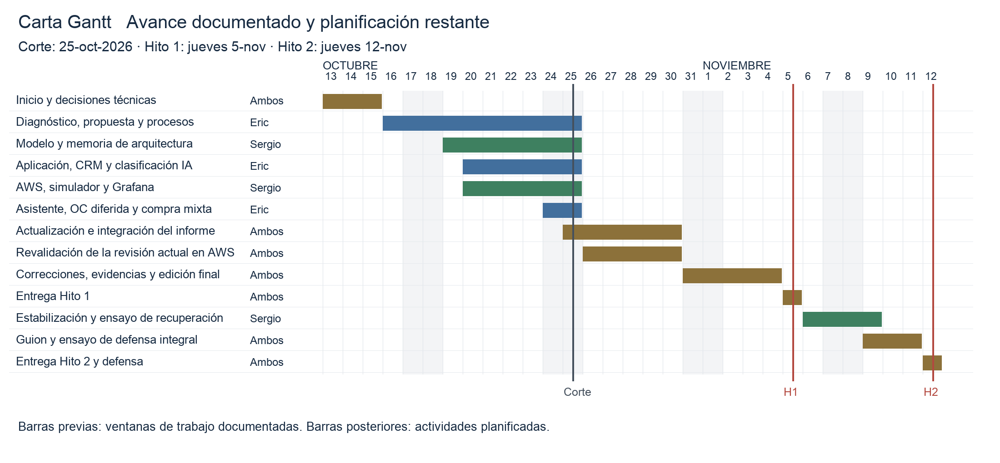

# Metodología, cronograma, gestión en Trello, equipo y riesgos

## Metodología

El equipo consultor adopta Kanban (Anderson, 2010) como método de trabajo diario: el flujo se hace visible en un tablero y el trabajo en curso se limita. Los dos hitos de la pauta funcionan como cierres de iteración, de modo que se toma de Scrum solo la idea de revisar y ajustar en cada uno.

**Tabla 1**
*Enfoques de metodología considerados*

| Enfoque | Fortaleza | Limitación | Decisión |
|---|---|---|---|
| Kanban | Flujo visible y continuo; encaja con un tablero y dos personas | No fija iteraciones | Adoptada para el día a día |
| Scrum | Iteraciones con revisión | Ceremonias costosas para dos personas en cinco semanas | Complementaria: se toman los hitos como "sprints" |
| Cascada | Planificación simple | No absorbe cambios; el Hito 2 depende de aprender en el camino | Descartada |

Nota. Elaboración propia.

## Gestión en Trello

Tablero: https://trello.com/b/yrKII80H/cofrial-spa-transformaci%C3%B3n-digital

**Tabla 2**
*Listas del tablero de Trello y su uso*

| Lista | Uso |
|---|---|
| Inicio del proyecto | Kickoff, roles, herramientas |
| Decisiones (elegir stack) | Registro de decisiones adoptadas y sus fundamentos |
| Hito 1 · Informe | Backlog del informe, una tarjeta por sección |
| Hito 2 · Despliegue | Backlog del prototipo |
| En curso / En revisión / Terminado | Flujo Kanban |

Nota. Elaboración propia.

## Herramientas de gestión evaluadas

**Tabla 3**
*Herramientas de gestión evaluadas*

| Herramienta | Fortaleza | Limitación | Decisión |
|---|---|---|---|
| Trello | Gratis, simple, lo conocen ambos, se integra con asistentes de IA | Sin Gantt nativo en el plan gratuito | Adoptada |
| GitHub Projects | Vinculado al código | Menos cómodo para tareas del informe | Complementaria (issues del código) |
| Jira | Muy completo | Curva de aprendizaje alta para dos personas | Descartada |
| Notion | Flexible | Gestión de tareas menos directa | Descartada |

Nota. Elaboración propia.

## Cronograma y carta Gantt

El cronograma conserva el inicio académico planificado y actualiza el trabajo restante según el avance observado al 25-oct-2026. Las barras históricas representan ventanas de trabajo, no fechas certificadas de finalización. La instalación base tiene evidencia del 22 de octubre; las ampliaciones del 24 y 25 requieren su nueva comprobación en AWS. El Hito 1 se fija para el jueves 05-nov-2026, según el aviso del foro adoptado por el equipo consultor; se conserva el 12-nov-2026 para el Hito 2.

**Tabla 4**
*Cronograma actualizado por avance y trabajo restante*

| Actividad | Responsable | Inicio | Término | Situación al corte |
|---|---|---|---|---|
| Inicio y decisiones técnicas | Ambos | 13-oct | 15-oct | Decisiones implementadas |
| Diagnóstico, propuesta y procesos | Eric | 16-oct | 25-oct | Documentados; ajuste de consistencia |
| Modelo y memoria de arquitectura | Sergio | 19-oct | 25-oct | Documentados; correspondencia física explícita |
| Aplicación, CRM y clasificación IA | Eric | 20-oct | 25-oct | Implementados |
| AWS, simulador y Grafana | Sergio | 20-oct | 25-oct | Base AWS registrada el 22; ampliaciones en código |
| Asistente, OC diferida y compra mixta | Eric | 24-oct | 25-oct | Incorporados al repositorio |
| Actualización e integración del informe | Ambos | 25-oct | 30-oct | En curso y cierre planificado |
| Revalidación de la revisión actual en AWS | Ambos | 26-oct | 30-oct | Planificado |
| Correcciones, evidencias y edición final | Ambos | 31-oct | 4-nov | Planificado |
| Entrega Hito 1 | Ambos | 5-nov | 5-nov | Hito |
| Estabilización y ensayo de recuperación | Sergio | 6-nov | 9-nov | Planificado |
| Guion y ensayo de defensa integral | Ambos | 9-nov | 11-nov | Planificado |
| Entrega Hito 2 y defensa | Ambos | 12-nov | 12-nov | Hito |

Nota. Elaboración propia. Las fechas posteriores al corte son planificación del equipo consultor y pueden ajustarse al resultado de las verificaciones.

**Figura 1**
*Carta Gantt actualizada del proyecto*

Nota. Elaboración propia a partir de la Tabla 4. La línea de corte diferencia el avance documentado de las actividades planificadas; los hitos se destacan el 5 y el 12 de noviembre.

## Equipo y matriz RACI

**Tabla 5**
*Matriz de responsabilidades (RACI)*

| Actividad | Eric Aguayo Quintriqueo | Sergio Vásquez Marimán |
|---|---|---|
| Diagnóstico, propuesta y BPMN | R/A | C |
| Casos de uso, canales y CRM | R/A | C |
| Evaluación de herramientas y memoria AWS | C | R/A |
| Diagrama de arquitectura y MER | C | R/A |
| E-commerce, CRM e IA | R/A | I |
| AWS, IoT y BI | I | R/A |
| Revisión final y defensa | R | R/A |

Nota. R: responsable, A: aprueba, C: consultado, I: informado. Elaboración propia.

## Matriz de riesgos

**Tabla 6**
*Matriz de riesgos del proyecto*

| Riesgo | Probabilidad | Impacto | Mitigación |
|---|---|---|---|
| La sesión del Learner Lab se cierra y detiene las instancias | Alta | Alto | Servicios con reinicio automático; guion para levantar todo en menos de 10 minutos antes de la defensa |
| La IP pública cambia al reiniciar | Alta | Medio | IP elástica de la web; comprobarla tras recrear los recursos |
| Solo hay 7 días entre los hitos | Alta | Alto | Concentrar el período final en verificación, correcciones y defensa |
| La API de IA gratuita alcanza su límite | Media | Medio | Manejo de error y una segunda API de respaldo (ver `08-herramientas.md`) |
| Créditos de AWS Academy insuficientes | Baja | Alto | Instancias pequeñas y apagarlas al terminar cada sesión |
| Errores de normalización en el MER | Media | Alto | Revisión cruzada contra la checklist de 3FN antes del 27-oct |
| Imágenes Docker construidas en un Mac con chip Apple no corren en las EC2, que son x86 | Media | Alto | Construir con `--platform linux/amd64` y probar el contenedor antes de desplegar |
| Diferencias entre macOS y Linux: mayúsculas en nombres de archivo, puertos ocupados y versiones de Python o PostgreSQL | Media | Medio | Desarrollar y probar dentro de contenedores con las mismas versiones que en AWS; nombrar los archivos en minúsculas |

Nota. Elaboración propia.
