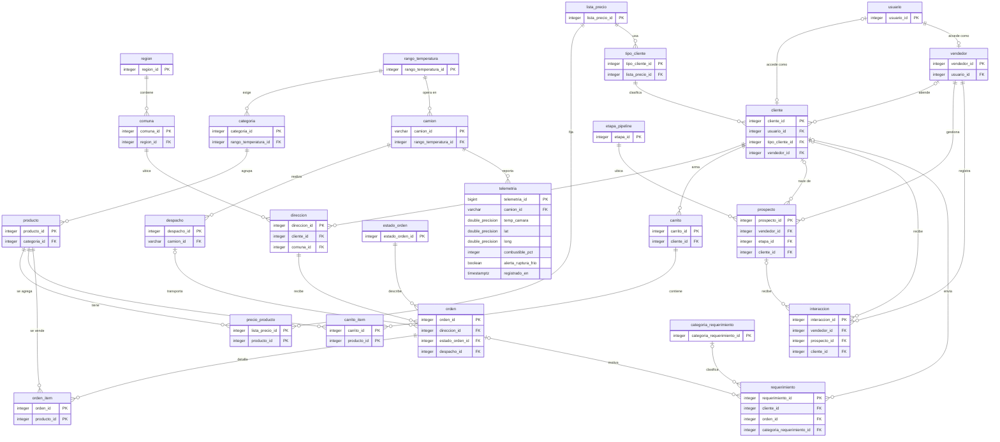

# 1 Introducción

El equipo consultor presenta el informe de ingeniería del Hito 1 para Cofrial SpA, en Transformación Digital TIEL15, evaluación EVA2_3 Unidad 02 (INACAP Sede Temuco, 2026). El propósito es justificar cómo el sistema construido conecta canales comerciales, gestión de clientes, logística y datos para responder a los tres focos del caso.

El documento integra diagnóstico, procesos, propuesta, metodología, herramientas, arquitectura, modelo de datos y canales. Describe la implementación versionada hasta el 25-oct-2026: aplicación Django, CRM propio, PostgreSQL, simulación de cincuenta camiones, Grafana, clasificación de requerimientos y asistente de tienda. Los anexos incluyen diccionario, cuentas ficticias, trazabilidad de la pauta, casos de uso y glosario.

Los hechos de Cofrial proceden del caso académico; los ejemplos y datos de demostración son ficticios. Las estimaciones económicas y emociones de los recorridos no son mediciones empresariales. Se separan las decisiones implementadas, la prueba histórica en AWS del 22 de octubre, las comprobaciones locales y las mejoras de producción. La fecha de entrega adoptada es el jueves 5 de noviembre de 2026.

# 2 Diagnóstico y análisis del dolor

## Síntesis

Los tres focos críticos del caso no son tres problemas distintos, sino un mismo problema visto desde tres ángulos: **Cofrial no tiene un dato único, en línea y confiable de su operación**. El servidor en la bodega guarda datos que nadie reconcilia, los camiones no emiten ninguna información y los pedidos y la cartera de clientes viven en canales y dispositivos personales. Cada dolor alimenta a los otros dos, de modo que atender uno solo no resuelve la situación: un camión con GPS seguiría recibiendo rutas por WhatsApp, y un portal de ventas seguiría escribiendo en un servidor sin respaldo. Por eso el análisis busca la causa raíz común y no solo los síntomas.

## Datos del caso (fuente: pauta)

**Tabla 1**
*Hechos del caso y su consecuencia de negocio*

| Dolor | Hechos | Consecuencia de negocio |
|---|---|---|
| On-premises vulnerable y silos | 1 servidor físico en bodega, sin redundancia eléctrica ni respaldos automáticos. Contabilidad en sistema cerrado; inventario en Excel locales | Riesgo de pérdida total de datos; inventario descuadrado permanentemente |
| Última milla a ciegas y Shadow IT | 50 camiones sin GPS ni registro de temperatura; coordinación por llamadas y WhatsApp personales | Entregas fallidas; mermas millonarias semanales por ruptura de frío no detectada |
| Sin canales digitales ni CRM | Sin web transaccional ni portal; pedidos por teléfono o correo; cartera en celulares de vendedores | Pedidos perdidos o mal registrados; sin embudo ni métricas de conversión; la cartera se va con el vendedor |

*Nota.* Elaboración propia a partir de la pauta del curso (INACAP Sede Temuco, 2026).

## Método de análisis

El equipo consultor usa tres herramientas, de lo general a lo específico: un **árbol de problemas**, propio de la metodología del marco lógico (Ortegón et al., 2005), para ubicar la causa raíz común; la técnica de los **cinco porqués** (Ohno, 1988) para profundizar en cada dolor; y un **ciclo de refuerzo** para mostrar cómo se alimentan entre sí. Las respuestas a los "porqués" son inferencias del equipo consultor a partir del caso; se contrastan con Cofrial en la fase de validación.

**Figura 1**
*Árbol de problemas de Cofrial SpA*

*Nota.* Elaboración propia. Las causas (rojo) convergen en un problema central (amarillo) que produce los efectos (azul) y, en conjunto, el riesgo de quiebra técnica que describe el caso.

## Análisis por dolor

### Dolor 1: infraestructura on-premises vulnerable y silos de datos

**Cinco porqués.**

**Tabla 2**
*Cinco porqués del dolor 1 (inferencias del equipo consultor)*

| Nivel | Pregunta | Respuesta |
|---|---|---|
| 1 | ¿Por qué Cofrial puede perder todos sus datos? | Porque todo está en un único servidor físico, sin copia automática |
| 2 | ¿Por qué no hay copia? | Porque el respaldo depende de que alguien lo haga a mano, y no hay redundancia eléctrica ni de equipo |
| 3 | ¿Por qué el inventario nunca cuadra? | Porque bodega lleva el stock en Excel locales y contabilidad lo registra en un sistema cerrado, sin enlace entre ambos |
| 4 | ¿Por qué nadie reconcilia ambos? | Porque ninguno es la fuente oficial: cada área confía en su propia planilla o sistema |
| 5 | Causa raíz | La infraestructura creció por acumulación, sin una arquitectura que defina dónde vive el dato oficial ni cómo se protege |

*Nota.* Elaboración propia.

**Riesgos técnicos.**

- **Punto único de falla.** Una falla de disco, un corte eléctrico o un incendio en la bodega detienen la facturación, el despacho y la consulta de inventario al mismo tiempo. Sin copias fuera de la bodega, la pérdida es total.
- **Recuperación indefinida.** No hay un objetivo de recuperación (cuánto dato se puede perder y cuánto tarda volver a operar). En la práctica, el dato perdido es el que no se respaldó y el tiempo de recuperación es el de conseguir un equipo y reconstruir a mano.
- **Silos sin integración.** El sistema contable cerrado no se conecta con el stock de bodega; cada traspaso es una digitación manual propensa a errores y sin trazabilidad.
- **Planillas sin control.** Excel no controla quién cambió una cantidad, ni evita que dos personas trabajen con versiones distintas del mismo archivo.

**Impacto de negocio.** El inventario descuadrado en un producto perecible tiene un costo doble: vender lo que no hay (entrega fallida y cliente molesto) o comprar de más lo que se vence (merma). Además, la continuidad del negocio depende de un equipo que nadie puede reemplazar rápido, lo que contradice los compromisos con clientes institucionales, que exigen abastecimiento sin interrupciones.

### Dolor 2: colapso de la última milla y Shadow IT

**Cinco porqués.**

**Tabla 3**
*Cinco porqués del dolor 2 (inferencias del equipo consultor)*

| Nivel | Pregunta | Respuesta |
|---|---|---|
| 1 | ¿Por qué hay mermas por ruptura de frío? | Porque nadie se entera de que la temperatura sube mientras el camión está en ruta |
| 2 | ¿Por qué nadie se entera? | Porque los camiones no miden ni registran la temperatura |
| 3 | ¿Por qué hay entregas fallidas? | Porque no se sabe dónde está cada camión ni en qué estado viaja la carga |
| 4 | ¿Por qué la coordinación es informal? | Porque las rutas y la carga se acuerdan por llamadas y grupos de WhatsApp personales, que no dejan un registro estructurado ni emiten alertas |
| 5 | Causa raíz | La flota no emite datos y el único canal de coordinación es conversacional: la información existe en la cabeza del conductor, pero no se captura |

*Nota.* Elaboración propia.

**Riesgos técnicos y regulatorios.**

- **Sin evidencia de cumplimiento.** El Reglamento Sanitario de los Alimentos establece, en su artículo 68, que los alimentos perecibles que requieren frío solo pueden transportarse en vehículos de carrocería cerrada, con equipos que mantengan la temperatura exigida y termómetros legibles desde el exterior (Ministerio de Salud, 1997). El registro continuo propuesto aporta trazabilidad del viaje y evidencia para revisar incidentes; esta es una justificación técnica del equipo consultor y no una obligación adicional de telemetría deducida de ese artículo.
- **Riesgo sanitario real.** Un hospital que recibe carne con la cadena de frío cortada puede no notarlo a simple vista; el daño no es solo comercial.
- **Datos de la empresa en cuentas personales.** Los chats de coordinación viven en teléfonos de las personas: si un conductor o un despachador se va, se va el historial, y no hay forma de auditar qué se acordó.
- **Reacción tardía.** Cuando la ruptura se descubre, ocurre al abrir la carga en el cliente: la pérdida ya está hecha y el cliente ya la presenció.

**Impacto de negocio.** Es el dolor de mayor costo directo: la carga rechazada se pierde completa, se paga el viaje y se daña la relación con el cliente. El caso lo describe como "pérdidas millonarias semanales"; la sección de impacto estimado muestra cómo dimensionarlas con supuestos explícitos.

### Dolor 3: ausencia de canales digitales y de CRM

**Cinco porqués.**

**Tabla 4**
*Cinco porqués del dolor 3 (inferencias del equipo consultor)*

| Nivel | Pregunta | Respuesta |
|---|---|---|
| 1 | ¿Por qué se pierden o se registran mal los pedidos? | Porque llegan por teléfono o correo y alguien los anota a mano |
| 2 | ¿Por qué llegan por cualquier vía? | Porque Cofrial no tiene un canal transaccional propio que sea el punto de entrada |
| 3 | ¿Por qué no hay métricas de ventas? | Porque la cartera y las conversaciones comerciales viven en los celulares de los vendedores |
| 4 | ¿Por qué eso es un riesgo? | Porque el conocimiento comercial es de la persona y no de la empresa: si el vendedor renuncia, se lleva la cartera |
| 5 | Causa raíz | La empresa no controla el punto de entrada de la información comercial, y lo que no entra a un sistema no se puede medir ni proteger |

*Nota.* Elaboración propia.

**Riesgos.**

- **Fuga de cartera.** La cartera de clientes institucionales es el activo comercial más valioso y hoy no pertenece a la empresa en ningún sentido práctico.
- **Decisiones a ciegas.** Sin embudo no se conoce la tasa de conversión, el tamaño medio del pedido ni la recurrencia de cada cliente; no se puede priorizar a quién visitar ni cuánto vender.
- **Desventaja competitiva.** Los competidores digitalizados atienden pedidos a cualquier hora y muestran el estado del despacho. Los clientes institucionales tienden a preferir al proveedor que les entrega trazabilidad (inferencia del equipo consultor, a validar con entrevistas a clientes).

**Impacto de negocio.** Cada pedido mal anotado es una venta perdida o una entrega equivocada; cada prospecto sin seguimiento es una oportunidad que nadie mide.

## Cómo se refuerzan los tres dolores

Los dolores forman un ciclo: lo que falla en uno agrava a los otros dos.

**Figura 2**
*Ciclo de refuerzo de los tres dolores*

*Nota.* Elaboración propia. El eslabón destacado (detección tardía de la ruptura de frío) es donde el ciclo se vuelve costoso.

Un pedido que llega por WhatsApp (dolor 3) no queda en ningún sistema, así que bodega no lo ve y su Excel no coincide con contabilidad (dolor 1). El camión sale sin GPS ni sensor (dolor 2), la ruptura de frío o la entrega fallida no se detecta a tiempo y termina en merma y en un cliente molesto, que reclama por los mismos canales informales y vuelve a alimentar el ciclo.

El ciclo tiene dos consecuencias para el diseño de la solución. Primero, hay que **romper el ciclo en el primer eslabón**: que el pedido nazca en un canal propio y quede registrado. Segundo, hay que **capturar los datos que hoy no existen** (temperatura y posición), porque ningún proceso se puede mejorar si no se mide.

## Impacto estimado con supuestos explícitos

Ni la pauta ni este equipo disponen de las cifras reales de Cofrial. Para no dejar el análisis en lo cualitativo, se propone un modelo con parámetros que se reemplazan por datos reales apenas existan. **Los valores de la tabla son ilustrativos.**

**Tabla 5**
*Modelo de pérdidas por ruptura de frío no detectada (supuestos ilustrativos)*

| Parámetro | Valor supuesto | Fundamento |
|---|---|---|
| Camiones en operación | 50 | Dato del caso |
| Viajes por camión | 1 al día, 6 días a la semana | Supuesto del equipo consultor |
| Viajes semanales | 300 | 50 camiones por 6 viajes |
| Valor medio de la carga por viaje | 1 500 000 pesos | Supuesto del equipo consultor |
| Fracción de la carga que se pierde si hay ruptura | 100 % (rechazo total) | Supuesto conservador de pérdida máxima |

*Nota.* Elaboración propia. Fórmula: pérdida semanal = viajes semanales × proporción de viajes con ruptura no detectada × valor medio de la carga × fracción perdida.

**Tabla 6**
*Escenarios de pérdida semanal según la frecuencia de rupturas (ilustrativo)*

| Escenario | Viajes con ruptura no detectada | Viajes afectados por semana | Pérdida semanal |
|---|---|---|---|
| Bajo | 3 % | 9 | 13,5 millones de pesos |
| Base | 5 % | 15 | 22,5 millones de pesos |
| Alto | 8 % | 24 | 36,0 millones de pesos |

*Nota.* Elaboración propia con los parámetros de la Tabla 5. El orden de magnitud es coherente con las "pérdidas millonarias semanales" que describe el caso, pero no lo prueba.

El resultado no pretende ser una predicción: sirve para mostrar que una variación de un par de puntos porcentuales en la frecuencia de rupturas mueve las pérdidas en decenas de millones, y que por eso detectar la ruptura a tiempo tiene un retorno alto frente al costo de una plataforma de bajo costo. Las otras dos pérdidas (entregas fallidas y horas de digitación duplicada) siguen la misma lógica y se calcularán cuando se disponga de los datos.

**Datos que se solicitarán a Cofrial para reemplazar los supuestos**

**Tabla 7**
*Datos a solicitar a Cofrial para validar el diagnóstico*

| Dato | Para qué sirve |
|---|---|
| Mermas semanales por ruptura de frío, en pesos y en kilos | Reemplazar los supuestos de la Tabla 5 |
| Cantidad de viajes semanales y valor medio por viaje | Calibrar el modelo de pérdidas |
| Porcentaje de entregas fallidas y su causa | Dimensionar el costo de la última milla |
| Pedidos semanales por canal (teléfono, correo, WhatsApp) | Línea base para medir cuánto se migra a la plataforma |
| Frecuencia de caídas del servidor y fecha del último respaldo | Cuantificar el riesgo del dolor 1 |
| Cantidad de vendedores y tamaño de su cartera | Dimensionar el riesgo de fuga de cartera |
| Exigencias de temperatura de los clientes institucionales | Definir los rangos críticos de la alerta |

*Nota.* Elaboración propia.

## Conclusión del diagnóstico

La causa raíz común es la ausencia de un dato único, en línea y confiable. De ella se desprenden tres palancas de solución, que la propuesta de valor (`02-propuesta-valor.md`) convierte en componentes concretos:

1. **Un dato central y protegido**, para terminar con el servidor único y los silos.
2. **Captura automática de lo que hoy no se mide** (temperatura, posición, combustible), para ver la última milla.
3. **Un canal propio para pedidos y relación comercial**, para que la información de ventas pertenezca a la empresa.

# 3 Procesos actuales y propuestos

## Notación elegida

Los procesos se modelan con Business Process Model and Notation (BPMN) 2.0, estándar abierto del Object Management Group (OMG) para representar procesos con responsables, eventos y decisiones (Object Management Group [OMG], 2013). La **Tabla 1** compara las alternativas consideradas.

**Tabla 1**
*Comparación de notaciones de modelado de procesos*

| Notación | Fortaleza | Limitación | Decisión |
|---|---|---|---|
| BPMN 2.0 | Estándar abierto, con carriles por responsable, eventos y compuertas | Requiere conocer la simbología | Adoptada. Muestra los traspasos entre vendedor, bodega y despacho, que es donde hoy se pierde la información |
| Diagrama de actividades UML | Conocido en desarrollo de software | Menos legible para la gerencia | Descartada |
| Flujograma simple | Muy fácil de leer | Sin carriles: oculta quién hace cada paso | Complementaria. Solo para la presentación |

*Nota.* Elaboración propia.

**Herramienta.** Los diagramas usan la notación BPMN 2.0 (carriles, eventos de inicio y fin, tareas y compuertas exclusivas) dibujada en draw.io, que es gratuito, guarda un archivo `.drawio` editable y exporta a PNG. Se eligió sobre bpmn.io porque ya se usa para el diagrama de arquitectura. Se trata de dibujos con notación BPMN, no de modelos ejecutables: si se necesitara un archivo `.bpmn`, se reconstruyen en bpmn.io a partir de estos diagramas. Los archivos y el script que los genera están en `informe/img/` (`generar-figuras-d1.py`).

**Convenciones de lectura.** Círculo verde: inicio. Círculo con borde grueso: fin. Círculo doble naranja: evento intermedio. Rombo: compuerta exclusiva (se sigue un solo camino). Círculos rojos numerados: **puntos de dolor** del proceso actual, explicados en la leyenda de cada diagrama AS-IS.

## Proceso 1: pedido de un cliente institucional (B2B)

**Figura 1**
*Proceso 1 AS-IS: pedido de un cliente institucional*

*Nota.* Elaboración propia. Carriles: cliente institucional, vendedor, bodega y contabilidad.

**Figura 2**
*Proceso 1 TO-BE: pedido B2B en la plataforma*

*Nota.* Elaboración propia. Carriles: cliente institucional, e-commerce, CRM, bodega y base de datos.

**Tabla 2**
*Proceso 1: de dónde viene el dolor y cómo lo resuelve el TO-BE*

| Punto de dolor (AS-IS) | Qué ocurre hoy | Cómo lo resuelve el TO-BE |
|---|---|---|
| 1. Registro informal | El vendedor anota el pedido en su celular o en papel | El cliente confirma el carrito; se crea una orden por rango de conservación, con OC diferida cuando falta |
| 2. Canal no oficial | El vendedor avisa a bodega por WhatsApp personal | Bodega ve la orden en la misma base de datos, sin intermediarios |
| 3. Stock descuadrado | Bodega revisa su Excel local, que no coincide con contabilidad | El portal valida el stock en tiempo real contra la base central y descuenta al confirmar |
| 4. Doble digitación | Contabilidad vuelve a ingresar el pedido en un sistema cerrado | La orden se registra una sola vez; la exportación contable se propone como evolución (ver límites en `02-propuesta-valor.md`) |
| 5. Sin seguimiento | Nadie sabe dónde está el pedido | El cliente ve el estado y el vendedor lo ve en el CRM |

*Nota.* Elaboración propia. Casos de uso asociados: CU-01 a CU-05 y CU-08.

## Proceso 2: despacho con cadena de frío

**Figura 3**
*Proceso 2 AS-IS: despacho con cadena de frío*

*Nota.* Elaboración propia. Carriles: despachador, conductor y cliente.

**Figura 4**
*Proceso 2 TO-BE: despacho con telemetría y alerta de frío*

*Nota.* Elaboración propia. Carriles: camión (IoT), plataforma, despachador y cliente. La compuerta compara `temp_camara` con el rango del camión (tabla `rango_temperatura`, ver `04b-modelo-datos.md`).

**Tabla 3**
*Proceso 2: de dónde viene el dolor y cómo lo resuelve el TO-BE*

| Punto de dolor (AS-IS) | Qué ocurre hoy | Cómo lo resuelve el TO-BE |
|---|---|---|
| 1. Coordinación informal | La ruta se asigna por teléfono o WhatsApp | El despacho queda registrado en la plataforma, asociado a un camión y a sus órdenes |
| 2. Última milla a ciegas | El conductor sale sin registro de temperatura ni GPS | El camión envía telemetría con posición, temperatura y combustible cada pocos segundos |
| 3. Ruptura no detectada | La temperatura sube y nadie se entera | Cada lectura se evalúa contra el rango del camión y marca `alerta_ruptura_frio` |
| 4. Pérdida | El cliente rechaza la carga al recibirla y se convierte en merma | El despachador ve la alerta mientras el camión está en ruta y puede actuar antes de entregar |

*Nota.* Elaboración propia. Casos de uso asociados: CU-10, CU-11 y CU-12.

## Proceso 3: gestión comercial de prospectos

**Figura 5**
*Proceso 3 AS-IS: gestión comercial de prospectos*

*Nota.* Elaboración propia. Carriles: vendedor y prospecto o cliente.

**Figura 6**
*Proceso 3 TO-BE: embudo comercial en el CRM*

*Nota.* Elaboración propia. Carriles: vendedor, CRM, cliente o prospecto y gerencia. El alta de un prospecto es manual; la clasificación automática de soporte no crea prospectos. Las etapas entre paréntesis corresponden a la tabla `etapa_pipeline`.

**Tabla 4**
*Proceso 3: de dónde viene el dolor y cómo lo resuelve el TO-BE*

| Punto de dolor (AS-IS) | Qué ocurre hoy | Cómo lo resuelve el TO-BE |
|---|---|---|
| 1. Cartera personal | El contacto se guarda en el celular del vendedor | El prospecto queda en el CRM, asignado al vendedor pero propiedad de la empresa |
| 2. Canales informales | Se contacta por llamada o WhatsApp, sin registro | Cada contacto se registra como interacción en la ficha |
| 3. Sin etapas ni métricas | Nadie sabe en qué punto está cada prospecto | El prospecto avanza por etapas visibles en un tablero |
| 4. Pérdidas sin motivo | Si el prospecto no acepta, no queda rastro | Se cierra como Perdido con el motivo, y la gerencia mide la conversión |

*Nota.* Elaboración propia. Casos de uso asociados: CU-06, CU-07 y CU-09. El requerimiento que llega por el portal se persiste antes de consultar a la IA y aparece en el CRM; si la API no responde, queda "sin clasificar" y lo revisa una persona.

# 4 Propuesta de valor y resolución de conflictos

## Propuesta de valor en una frase

Cofrial pasa de operar a ciegas con datos dispersos a operar con **un dato único y en línea**: cada pedido nace en un canal propio, cada camión informa su temperatura y su posición, y cada cliente y prospecto queda registrado en la empresa y no en un celular.

## La solución en dos frentes

La propuesta equilibra un Front-Office comercial, que captura la demanda, con un Back-Office logístico y cloud, que protege los datos y vigila la operación. Ambos escriben y leen de la misma base de datos, que es lo que elimina los silos.

**Tabla 1**
*Componentes de la solución y el dolor que ataca cada uno*

| Frente | Componente | Qué hace | Dolor que ataca |
|---|---|---|---|
| Front-Office | E-commerce B2B/B2C | Catálogo con precio según perfil, carrito y órdenes | Pedidos por teléfono y correo |
| Front-Office | CRM | Clientes, prospectos, embudo y seguimiento de pedidos web | Cartera en celulares, sin métricas |
| Front-Office | IA gratuita | Clasifica requerimientos y asiste en el catálogo | Atención lenta y desordenada |
| Back-Office | AWS (EC2 y RDS) | Aplicación persistente y base de datos con respaldos automáticos | Servidor único sin respaldo |
| Back-Office | IoT con Docker | Telemetría de los camiones (temperatura, posición, combustible) | Última milla a ciegas |
| Back-Office | Dashboard BI | Cruza ventas por canal con alertas de cadena de frío | Decisiones sin datos |

*Nota.* Elaboración propia.

## Matriz dolor, causa raíz, solución e indicador

**Tabla 2**
*Cómo la arquitectura neutraliza cada dolor, con su evidencia en el prototipo y su indicador*

| Dolor | Causa raíz (`01-diagnostico.md`) | Componente que lo resuelve | Cómo se demuestra en el Hito 2 | Indicador sugerido |
|---|---|---|---|---|
| Servidor único sin respaldo | Sin arquitectura que proteja el dato | EC2 + RDS con respaldos automáticos | Aplicación y base de datos corriendo en AWS | Recuperación ensayada y antigüedad del respaldo; disponibilidad por medir |
| Excel incomunicados | Sin fuente oficial del dato | Una sola base de datos para ventas, inventario y logística | Una orden web descuenta stock y se ve en el CRM | Rechazos por stock insuficiente y consistencia del descuento; diferencias físicas por medir |
| Camiones sin trazabilidad | La flota no emite datos | IoT: `lat` y `long` cada pocos segundos | Mapa con la posición en vivo | Camiones con lectura reciente / camiones activos; puntualidad real por medir |
| Ruptura de frío no detectada | La temperatura no se mide | IoT: `temp_camara` y `alerta_ruptura_frio` | Alerta visible en el dashboard apenas ocurre | Pedidos afectados y lecturas fuera de rango; merma evitada por validar |
| Coordinación por WhatsApp y llamadas | Único canal conversacional | Dashboard y CRM como canal oficial | Pedido y estado visibles en el CRM | Pedidos fuera del sistema |
| Pedidos por teléfono o correo | Sin punto de entrada propio | E-commerce B2B/B2C | Flujo catálogo, carrito y orden | Pedidos digitales sobre el total |
| Cartera en celulares | El conocimiento es de la persona | CRM con embudo | Un prospecto avanza de etapa en el CRM | Tasa de conversión |
| Atención lenta | Mensajes sin clasificar | IA gratuita (clasificación) | Un requerimiento se clasifica solo | Tiempo de primera respuesta |

*Nota.* Elaboración propia.

## Cómo se erradican los pedidos por WhatsApp y el papel

Quitar una herramienta informal no basta si las personas siguen necesitándola. La propuesta combina cinco mecanismos, de modo que usar la plataforma sea más cómodo que el canal informal:

**Tabla 3**
*Mecanismos para sustituir los canales informales*

| Mecanismo | Qué cambia | Control |
|---|---|---|
| Un solo punto de entrada | Todo pedido nace en el portal o lo ingresa el vendedor en el CRM | Pedidos fuera del sistema |
| Estado visible y en línea | El cliente y el vendedor consultan el pedido sin llamar ni escribir | Consultas de estado por canales informales |
| Alertas automáticas | El despachador se entera por el sistema y no por un llamado del conductor | Tiempo entre la ruptura y la acción |
| Cuentas institucionales | Cada interacción queda ligada a una cuenta de la empresa y no a un teléfono personal | Interacciones registradas en el CRM |
| Regla de gobierno | "Un pedido que no está en el sistema no existe": no se prepara ni se despacha | Cumplimiento por área |

*Nota.* Elaboración propia.

## Beneficios cuantificados con supuestos explícitos

Siguiendo el modelo de `01-diagnostico.md` (escenario base: 5 % de viajes con ruptura, 15 viajes afectados por semana, 22,5 millones de pesos de pérdida semanal), se estima cuánto cambia si el despachador recibe la alerta a tiempo. El parámetro nuevo es la proporción de rupturas en que el despachador alcanza a actuar (desviar, reprogramar o cambiar de camión).

**Tabla 4**
*Ahorro semanal según la capacidad de reacción ante la alerta (ilustrativo)*

| Rupturas en que se alcanza a actuar | Pérdida semanal con la plataforma | Ahorro semanal |
|---|---|---|
| 40 % | 13,5 millones de pesos | 9,0 millones de pesos |
| 60 % | 9,0 millones de pesos | 13,5 millones de pesos |
| 80 % | 4,5 millones de pesos | 18,0 millones de pesos |

*Nota.* Elaboración propia. Pérdida actual de referencia: 22,5 millones de pesos semanales (Tabla 6 de `01-diagnostico.md`). Todos los valores son ilustrativos y se reemplazan con datos reales de Cofrial.

El prototipo consume créditos de AWS Academy. Su ejecución académica no equivale a costo operativo nulo en producción. Para una operación real habría que estimar el costo mensual de las instancias, la base de datos, los sensores y el desarrollo, y compararlo con el ahorro del escenario que la empresa considere realista.

## Alcance y límites de la propuesta

Declarar los límites forma parte de la defensa:

- **Contabilidad.** El sistema contable cerrado no se integra en el prototipo. La ruta propuesta es exportar las ventas desde la base de datos central (archivo plano) como primer paso, y evaluar una integración directa cuando el proveedor lo permita.
- **IoT simulado.** Los datos de telemetría son sintéticos. En producción los camiones llevarían sensores con una pasarela hacia la base de datos, y la inserción directa a la base se reemplazaría por una API de ingesta (ver `03-arquitectura-cloud.md`).
- **Seguridad.** El prototipo expone HTTP porque no hay dominio propio; en producción corresponde HTTPS.
- **Cambio cultural.** La tecnología no cambia hábitos por sí sola; por eso se incluye una hoja de ruta de adopción.

## Hoja de ruta de adopción

**Tabla 5**
*Fases de adopción propuestas para Cofrial*

| Fase | Qué ocurre | Criterio para avanzar |
|---|---|---|
| 0. Preparación | Cargar clientes, productos y precios; definir rangos de temperatura; capacitar | Datos maestros cargados y revisados |
| 1. Piloto | Dos vendedores y cinco camiones operan solo con la plataforma, en paralelo con el método actual | Cero pedidos del piloto fuera del sistema durante dos semanas |
| 2. Extensión | Se suman el resto de los vendedores y la flota completa | Porcentaje de pedidos digitales sobre el total por encima del umbral acordado |
| 3. Cierre de canales informales | Los pedidos por WhatsApp y teléfono se redirigen al portal o al vendedor en el CRM | Pedidos fuera del sistema cercanos a cero |

*Nota.* Elaboración propia. Los umbrales se acuerdan con la gerencia de Cofrial.

**Riesgos de adopción y su mitigación**

**Tabla 6**
*Riesgos de adopción por grupo de usuarios*

| Grupo | Riesgo | Mitigación |
|---|---|---|
| Vendedores | Resisten entregar su cartera personal | La cartera e indicadores se centralizan; una política de comisiones sería una medida organizacional adicional |
| Conductores | Ven el sensor como vigilancia | Comunicar que protege la carga y a ellos ante reclamos injustos; datos de uso acotado |
| Clientes institucionales | Prefieren seguir llamando | Durante la transición el vendedor ingresa el pedido en su nombre; el portal se muestra como una ventaja |
| Contabilidad | Mantiene la doble digitación | Exportación periódica propuesta como primer paso; no implementada en el prototipo |

*Nota.* Elaboración propia.

# 5 Metodología y cronograma

## Metodología

El equipo consultor adopta Kanban (Anderson, 2010) como método de trabajo diario: el flujo se hace visible en un tablero y el trabajo en curso se limita. Los dos hitos de la pauta funcionan como cierres de iteración, de modo que se toma de Scrum solo la idea de revisar y ajustar en cada uno.

**Tabla 1**
*Enfoques de metodología considerados*

| Enfoque | Fortaleza | Limitación | Decisión |
|---|---|---|---|
| Kanban | Flujo visible y continuo; encaja con un tablero y dos personas | No fija iteraciones | Adoptada para el día a día |
| Scrum | Iteraciones con revisión | Ceremonias costosas para dos personas en cinco semanas | Complementaria: se toman los hitos como "sprints" |
| Cascada | Planificación simple | No absorbe cambios; el Hito 2 depende de aprender en el camino | Descartada |

Nota. Elaboración propia.

## Gestión en Trello

Tablero: https://trello.com/b/yrKII80H/cofrial-spa-transformaci%C3%B3n-digital

**Tabla 2**
*Listas del tablero de Trello y su uso*

| Lista | Uso |
|---|---|
| Inicio del proyecto | Kickoff, roles, herramientas |
| Decisiones (elegir stack) | Registro de decisiones adoptadas y sus fundamentos |
| Hito 1 · Informe | Backlog del informe, una tarjeta por sección |
| Hito 2 · Despliegue | Backlog del prototipo |
| En curso / En revisión / Terminado | Flujo Kanban |

Nota. Elaboración propia.

## Herramientas de gestión evaluadas

**Tabla 3**
*Herramientas de gestión evaluadas*

| Herramienta | Fortaleza | Limitación | Decisión |
|---|---|---|---|
| Trello | Gratis, simple, lo conocen ambos, se integra con asistentes de IA | Sin Gantt nativo en el plan gratuito | Adoptada |
| GitHub Projects | Vinculado al código | Menos cómodo para tareas del informe | Complementaria (issues del código) |
| Jira | Muy completo | Curva de aprendizaje alta para dos personas | Descartada |
| Notion | Flexible | Gestión de tareas menos directa | Descartada |

Nota. Elaboración propia.

## Cronograma y carta Gantt

El cronograma conserva el inicio académico planificado y actualiza el trabajo restante según el avance observado al 25-oct-2026. Las barras históricas representan ventanas de trabajo, no fechas certificadas de finalización. La instalación base tiene evidencia del 22 de octubre; las ampliaciones del 24 y 25 requieren su nueva comprobación en AWS. El Hito 1 se fija para el jueves 05-nov-2026, según el aviso del foro adoptado por el equipo consultor; se conserva el 12-nov-2026 para el Hito 2.

**Tabla 4**
*Cronograma actualizado por avance y trabajo restante*

| Actividad | Responsable | Inicio | Término | Situación al corte |
|---|---|---|---|---|
| Inicio y decisiones técnicas | Ambos | 13-oct | 15-oct | Decisiones implementadas |
| Diagnóstico, propuesta y procesos | Eric | 16-oct | 25-oct | Documentados; ajuste de consistencia |
| Modelo y memoria de arquitectura | Sergio | 19-oct | 25-oct | Documentados; correspondencia física explícita |
| Aplicación, CRM y clasificación IA | Eric | 20-oct | 25-oct | Implementados |
| AWS, simulador y Grafana | Sergio | 20-oct | 25-oct | Base AWS registrada el 22; ampliaciones en código |
| Asistente, OC diferida y compra mixta | Eric | 24-oct | 25-oct | Incorporados al repositorio |
| Actualización e integración del informe | Ambos | 25-oct | 30-oct | En curso y cierre planificado |
| Revalidación de la revisión actual en AWS | Ambos | 26-oct | 30-oct | Planificado |
| Correcciones, evidencias y edición final | Ambos | 31-oct | 4-nov | Planificado |
| Entrega Hito 1 | Ambos | 5-nov | 5-nov | Hito |
| Estabilización y ensayo de recuperación | Sergio | 6-nov | 9-nov | Planificado |
| Guion y ensayo de defensa integral | Ambos | 9-nov | 11-nov | Planificado |
| Entrega Hito 2 y defensa | Ambos | 12-nov | 12-nov | Hito |

Nota. Elaboración propia. Las fechas posteriores al corte son planificación del equipo consultor y pueden ajustarse al resultado de las verificaciones.

**Figura 1**
*Carta Gantt actualizada del proyecto*

Nota. Elaboración propia a partir de la Tabla 4. La línea de corte diferencia el avance documentado de las actividades planificadas; los hitos se destacan el 5 y el 12 de noviembre.

## Equipo y matriz RACI

**Tabla 5**
*Matriz de responsabilidades (RACI)*

| Actividad | Eric Aguayo Quintriqueo | Sergio Vásquez Marimán |
|---|---|---|
| Diagnóstico, propuesta y BPMN | R/A | C |
| Casos de uso, canales y CRM | R/A | C |
| Evaluación de herramientas y memoria AWS | C | R/A |
| Diagrama de arquitectura y MER | C | R/A |
| E-commerce, CRM e IA | R/A | I |
| AWS, IoT y BI | I | R/A |
| Revisión final y defensa | R | R/A |

Nota. R: responsable, A: aprueba, C: consultado, I: informado. Elaboración propia.

## Matriz de riesgos

**Tabla 6**
*Matriz de riesgos del proyecto*

| Riesgo | Probabilidad | Impacto | Mitigación |
|---|---|---|---|
| La sesión del Learner Lab se cierra y detiene las instancias | Alta | Alto | Servicios con reinicio automático; guion para levantar todo en menos de 10 minutos antes de la defensa |
| La IP pública cambia al reiniciar | Alta | Medio | IP elástica de la web; comprobarla tras recrear los recursos |
| Solo hay 7 días entre los hitos | Alta | Alto | Concentrar el período final en verificación, correcciones y defensa |
| La API de IA gratuita alcanza su límite | Media | Medio | Manejo de error y una segunda API de respaldo (ver `08-herramientas.md`) |
| Créditos de AWS Academy insuficientes | Baja | Alto | Instancias pequeñas y apagarlas al terminar cada sesión |
| Errores de normalización en el MER | Media | Alto | Revisión cruzada contra la checklist de 3FN antes del 27-oct |
| Imágenes Docker construidas en un Mac con chip Apple no corren en las EC2, que son x86 | Media | Alto | Construir con `--platform linux/amd64` y probar el contenedor antes de desplegar |
| Diferencias entre macOS y Linux: mayúsculas en nombres de archivo, puertos ocupados y versiones de Python o PostgreSQL | Media | Medio | Desarrollar y probar dentro de contenedores con las mismas versiones que en AWS; nombrar los archivos en minúsculas |

Nota. Elaboración propia.

# 6 Evaluación de herramientas

## Criterios

Cada decisión de herramienta se evalúa con los mismos seis criterios, definidos y ponderados antes de puntuar. Las alternativas se califican de 1 a 5 y el puntaje final es el promedio ponderado. Un puntaje de 2 o menos en el cumplimiento de la pauta es eliminatorio: la alternativa se descarta aunque sume más puntos en el resto.

**Tabla 1**
*Criterios de evaluación y ponderación aplicados a todas las decisiones*

| Criterio | Qué mide | Peso |
|---|---|---|
| C1 Cumplimiento de la pauta | Si cumple lo que la pauta exige. Puntaje 2 o menos es eliminatorio: la alternativa se descarta aunque sume más. | 30 % |
| C2 Viabilidad en el plazo | Si se puede construir y probar antes del 12 de noviembre. | 20 % |
| C3 Facilidad de aprendizaje | Esfuerzo para un equipo de dos personas que aprende mientras construye. | 15 % |
| C4 Costo cero | Que no genere gastos fuera de los créditos de AWS Academy. | 15 % |
| C5 Compatibilidad con AWS Academy | Que funcione con los permisos y las restricciones del Learner Lab. | 10 % |
| C6 Escalabilidad y evolución | Que el diseño sirva si Cofrial lo llevara a producción con 50 camiones reales. | 10 % |

*Nota.* Elaboración propia. Cada alternativa se puntúa de 1 a 5 por criterio; el puntaje final es el promedio ponderado.

## Cómputo del backend

**Tabla 2**
*Puntuación ponderada: cómputo del backend*

| Criterio (peso) | Amazon EC2 | Elastic Beanstalk | AWS Lambda | Servidor local |
|---|---|---|---|---|
| C1 Cumplimiento de la pauta (30 %) | 5 | 3 | 2 | 1 |
| C2 Viabilidad en el plazo (20 %) | 4 | 4 | 3 | 3 |
| C3 Facilidad de aprendizaje (15 %) | 4 | 3 | 2 | 3 |
| C4 Costo cero (15 %) | 5 | 5 | 5 | 2 |
| C5 Compatibilidad con AWS Academy (10 %) | 5 | 3 | 3 | 1 |
| C6 Escalabilidad y evolución (10 %) | 4 | 4 | 5 | 1 |
| **Puntaje ponderado** | **4,55** | **3,60** | **3,05** | **1,85** |
| **Decisión** | Adoptada | Descartada | Descartada | Descartada (eliminatorio) |

*Nota.* Elaboración propia.

**Conclusión.** La pauta exige EC2 con el backend persistente. Beanstalk crea EC2 por debajo, pero oculta la configuración que la rúbrica pide justificar (subredes y seguridad). Lambda no es un backend persistente. El servidor local es justamente el dolor que se busca eliminar.

## Base de datos relacional

**Tabla 3**
*Puntuación ponderada: base de datos relacional*

| Criterio (peso) | RDS PostgreSQL | RDS MySQL | PostgreSQL en EC2 | DynamoDB |
|---|---|---|---|---|
| C1 Cumplimiento de la pauta (30 %) | 5 | 5 | 2 | 1 |
| C2 Viabilidad en el plazo (20 %) | 4 | 4 | 3 | 3 |
| C3 Facilidad de aprendizaje (15 %) | 4 | 4 | 3 | 2 |
| C4 Costo cero (15 %) | 5 | 5 | 5 | 5 |
| C5 Compatibilidad con AWS Academy (10 %) | 5 | 5 | 4 | 4 |
| C6 Escalabilidad y evolución (10 %) | 5 | 4 | 3 | 5 |
| **Puntaje ponderado** | **4,65** | **4,55** | **3,10** | **2,85** |
| **Decisión** | Adoptada | Complementaria (alternativa válida) | Descartada | Descartada (eliminatorio) |

*Nota.* Elaboración propia.

**Conclusión.** La pauta exige RDS relacional. PostgreSQL y MySQL quedan casi empatados; PostgreSQL gana por su manejo de datos geográficos y series de tiempo, útiles para la telemetría, y por su integración con Grafana. Instalar la BD en EC2 obliga a gestionar respaldos a mano, que es el dolor original. DynamoDB no es relacional.

## Framework web (e-commerce, CRM y API)

**Tabla 4**
*Puntuación ponderada: framework web (e-commerce, crm y api)*

| Criterio (peso) | Django + plantillas, CSS propio y JavaScript | React + Django REST Framework | Next.js (React y Tailwind) | Astro (modo servidor) |
|---|---|---|---|---|
| C1 Cumplimiento de la pauta (30 %) | 5 | 5 | 5 | 5 |
| C2 Viabilidad en el plazo (20 %) | 5 | 4 | 3 | 3 |
| C3 Facilidad de aprendizaje (15 %) | 4 | 4 | 3 | 4 |
| C4 Costo cero (15 %) | 5 | 5 | 5 | 5 |
| C5 Compatibilidad con AWS Academy (10 %) | 5 | 5 | 5 | 5 |
| C6 Escalabilidad y evolución (10 %) | 4 | 5 | 5 | 4 |
| **Puntaje ponderado** | **4,75** | **4,65** | **4,30** | **4,35** |
| **Decisión** | Adoptada | Complementaria (empate técnico) | Descartada | Descartada |

*Nota.* Elaboración propia. Borrador pendiente de validación del equipo consultor. En C2 se mide también cuánto código hay que escribir: Django trae ORM con migraciones, autenticación, grupos de permisos y un panel de administración; Next.js y Astro obligan a elegir y armar cada una de esas piezas. En C3 se asume que Eric ya trabajó con React y Django REST Framework; los valores representan el juicio de conveniencia del equipo consultor, no una medición experimental.

**Conclusión.** Django con plantillas (4,75) y React con Django REST Framework (4,65) quedan en un empate técnico. Con Django, el diseño de datos se traduce en modelos y migraciones, y el panel de administración da el CRM base (clientes, prospectos, pedidos) sin escribir interfaz. Python además sirve para los cálculos (listas de precios, mermas, umbrales de cadena de frío) y para el simulador IoT, con un solo lenguaje. React con Django REST Framework conserva esas ventajas del backend (el panel de administración sigue disponible como CRM base) y suma el ecosistema de React; su costo es mantener y desplegar dos aplicaciones, con CORS, autenticación por token y validaciones duplicadas. Si los dos integrantes ya dominan React, esa opción es defendible; si no, Django con plantillas ahorra tiempo. Next.js y Astro quedan atrás porque no traen autenticación, ORM ni panel de administración. La decisión implementada utiliza plantillas, vistas propias del CRM y API JSON con DRF; no incorpora React, HTMX ni Tailwind.

## Simulación IoT

**Tabla 5**
*Puntuación ponderada: simulación iot*

| Criterio (peso) | Docker + Node/TypeScript | Docker + Python | AWS IoT Core | Inserción manual o Excel |
|---|---|---|---|---|
| C1 Cumplimiento de la pauta (30 %) | 5 | 5 | 2 | 1 |
| C2 Viabilidad en el plazo (20 %) | 4 | 5 | 2 | 5 |
| C3 Facilidad de aprendizaje (15 %) | 3 | 5 | 2 | 5 |
| C4 Costo cero (15 %) | 5 | 5 | 4 | 5 |
| C5 Compatibilidad con AWS Academy (10 %) | 5 | 5 | 2 | 5 |
| C6 Escalabilidad y evolución (10 %) | 4 | 4 | 5 | 1 |
| **Puntaje ponderado** | **4,40** | **4,90** | **2,60** | **3,40** |
| **Decisión** | Complementaria (alternativa válida) | Adoptada | Descartada | Descartada (eliminatorio) |

*Nota.* Elaboración propia.

**Conclusión.** La pauta exige contenedores Docker en una EC2 dedicada con inyección automatizada. Con Django adoptado para la web (Tabla 4), Python gana porque web e IoT comparten lenguaje: el equipo consultor aprende una sola herramienta, el simulador usa una imagen ligera de Python y se ahorra mantener una segunda cadena de dependencias. Antes de elegir Django, Node/TypeScript puntuaba más (4,75 contra 4,55) solo por esa misma razón. IoT Core es el servicio de producción, pero no reemplaza el requisito de Docker y sus permisos en el Learner Lab son inciertos. La carga manual baja la nota a 60 %.

## Dashboard de BI

**Tabla 6**
*Puntuación ponderada: dashboard de bi*

| Criterio (peso) | Grafana | Metabase | Gráficos propios (Chart.js) | Amazon QuickSight |
|---|---|---|---|---|
| C1 Cumplimiento de la pauta (30 %) | 5 | 4 | 4 | 3 |
| C2 Viabilidad en el plazo (20 %) | 4 | 5 | 3 | 2 |
| C3 Facilidad de aprendizaje (15 %) | 4 | 5 | 3 | 2 |
| C4 Costo cero (15 %) | 5 | 5 | 5 | 1 |
| C5 Compatibilidad con AWS Academy (10 %) | 5 | 5 | 5 | 1 |
| C6 Escalabilidad y evolución (10 %) | 4 | 3 | 3 | 5 |
| **Puntaje ponderado** | **4,55** | **4,50** | **3,80** | **2,35** |
| **Decisión** | Adoptada | Complementaria | Complementaria (torre de control) | Descartada |

*Nota.* Elaboración propia.

**Conclusión.** Grafana y Metabase quedan casi empatados. Grafana gana en lo que pesa más, la rúbrica: refresco cada pocos segundos ("en vivo") y un panel de mapa para lat/long. Metabase es más simple de armar. Los gráficos propios se reservan para la torre de control. QuickSight es de pago y su disponibilidad en el Learner Lab no está garantizada.

## Servicio de IA de costo cero

**Tabla 7**
*Puntuación ponderada: servicio de ia de costo cero*

| Criterio (peso) | Google Gemini API (free tier) | Groq (free tier) | Hugging Face Inference | OpenAI API |
|---|---|---|---|---|
| C1 Cumplimiento de la pauta (30 %) | 5 | 5 | 4 | 1 |
| C2 Viabilidad en el plazo (20 %) | 5 | 5 | 3 | 5 |
| C3 Facilidad de aprendizaje (15 %) | 4 | 4 | 3 | 4 |
| C4 Costo cero (15 %) | 5 | 5 | 5 | 1 |
| C5 Compatibilidad con AWS Academy (10 %) | 5 | 5 | 5 | 5 |
| C6 Escalabilidad y evolución (10 %) | 4 | 3 | 3 | 5 |
| **Puntaje ponderado** | **4,75** | **4,65** | **3,80** | **3,05** |
| **Decisión** | Adoptada | Complementaria (respaldo) | Descartada | Descartada (eliminatorio) |

*Nota.* Elaboración propia.

**Conclusión.** La pauta exige costo cero. Gemini y Groq ofrecen capas gratuitas con buena calidad en español; Groq queda como respaldo si se alcanza el límite. OpenAI no tiene capa gratuita permanente, por lo que incumple el requisito.

**Resultado de la implementación.** El clasificador usa Gemini y Groq en orden configurable y conserva el requerimiento antes de invocar al proveedor. El asistente de tienda reutiliza la integración, con Groq primero por defecto, contexto del perfil y pedidos propios, controles de respuesta y modo de solo lectura. Los modelos no se consideran contratos permanentes de disponibilidad: se configuran y prueban por proveedor. El resultado histórico de veinte clasificaciones correctas corresponde a una muestra registrada el 22-oct-2026 y no a la precisión general del asistente. El presupuesto nominal es de doce segundos para clasificación y diez para chat, sin garantía de plazo extremo a extremo.

## Diagramas de arquitectura

**Tabla 8**
*Puntuación ponderada: herramienta para el diagrama de arquitectura cloud*

| Criterio (peso) | draw.io | Lucidchart (plan gratuito) | Mermaid | archify (HTML interactivo) |
|---|---|---|---|---|
| C1 Cumplimiento de la pauta (30 %) | 5 | 4 | 4 | 3 |
| C2 Viabilidad en el plazo (20 %) | 5 | 4 | 5 | 4 |
| C3 Facilidad de aprendizaje (15 %) | 4 | 4 | 4 | 4 |
| C4 Costo cero (15 %) | 5 | 2 | 5 | 5 |
| C5 Compatibilidad con AWS Academy (10 %) | 5 | 5 | 5 | 5 |
| C6 Escalabilidad y evolución (10 %) | 4 | 3 | 3 | 3 |
| **Puntaje ponderado** | **4,75** | **3,70** | **4,35** | **3,85** |
| **Decisión** | Adoptada | Descartada | Complementaria para modelos | Complementaria (defensa en vivo) |

*Nota.* Elaboración propia. Borrador pendiente de validación del equipo consultor. En C1 se evaluó si genera un diagrama de topología con los íconos oficiales de AWS, elegidos por el equipo consultor para mejorar la lectura; la rúbrica H1-D3 exige claridad profesional, no una biblioteca de íconos específica. En C5 todas puntúan 5 porque ninguna depende de los permisos del Learner Lab. El puntaje de archify en C1 se verificó probándolo con el mismo diagrama: no incluye íconos oficiales de AWS y solo agrupa por región y Security Group, sin cajas de VPC, subredes ni zonas de disponibilidad. A cambio entrega un HTML interactivo (zoom, modo claro y oscuro, exportar) que pasó sus 9 validaciones de calidad.

**Conclusión.** draw.io gana porque es gratuito, trae la librería oficial de íconos AWS y guarda el diagrama como archivo `.drawio` editable que se versiona en git, de modo que cualquiera del equipo consultor lo corrige sin depender de la herramienta que lo generó. Mermaid es una alternativa válida para modelos y se utiliza en el MER; el equipo consultor prefiere un archivo draw.io editable para la topología. Lucidchart pierde por el límite de su plan gratuito. archify queda como complemento para animar el flujo en la defensa del Hito 2.

## Síntesis de decisiones

**Tabla 9**
*Resumen de las decisiones adoptadas y sus alternativas descartadas*

| Componente | Adoptada | Alternativa más cercana | Por qué se prefiere |
|---|---|---|---|
| Cómputo | Amazon EC2 | Elastic Beanstalk | Lo exige la pauta y deja visible la configuración de red y seguridad |
| Base de datos | RDS PostgreSQL | RDS MySQL | Datos geográficos, series de tiempo e integración con Grafana |
| Web | Django + plantillas, CSS propio y JavaScript | React + Django REST Framework | ORM, autenticación y panel de administración incluidos; Python para cálculos e IoT |
| IoT | Docker + Python | Docker + Node/TypeScript | Mismo lenguaje que la web (Django) y menos dependencias que mantener |
| BI | Grafana | Metabase | Refresco en vivo y panel de mapa |
| IA | Gemini (free tier) | Groq (free tier) | Calidad en español; Groq queda de respaldo |
| Gestión | Trello | GitHub Projects | Ya en uso; GitHub queda para issues del código |
| Procesos | BPMN 2.0 dibujado en draw.io | Flujograma | Carriles por responsable; mismo programa que el diagrama de arquitectura |
| Diagrama de arquitectura | draw.io (diagrams.net) con íconos oficiales de AWS | archify (HTML interactivo) | Gratis, archivo `.drawio` editable y versionable en git, exporta PNG y SVG |

*Nota.* Elaboración propia.

# 7 Memoria de decisiones de arquitectura cloud

El equipo consultor adoptó una arquitectura de aplicación única Django con módulos comerciales, CRM y logística, una EC2 dedicada a la simulación IoT y persistencia común en RDS PostgreSQL. Esta memoria describe la configuración implementada en los archivos de despliegue, no las alternativas que se abandonaron durante el desarrollo (Aguayo Quintriqueo y Vásquez Marimán, 2026).

## Decisiones y trade-offs

**Tabla 1**
*Decisiones de arquitectura y consecuencias para Cofrial*

| Tema | Configuración adoptada | Alternativa considerada | Beneficio y costo aceptado |
|---|---|---|---|
| Red | VPC propia con una subred pública y dos privadas | Todos los recursos públicos | RDS queda sin acceso público; exige administrar rutas y grupos de seguridad |
| Seguridad | SG web, IoT y RDS referenciados entre sí | Abrir 5432 por rango público | Solo las EC2 autorizadas acceden a la base; deben mantenerse las reglas |
| Cómputo | EC2 web t3.small y EC2 IoT t3.micro con Docker Compose | Una sola EC2, Lambda o Beanstalk | Aísla la generación de telemetría y deja visible la infraestructura; requiere administrar dos servidores |
| Persistencia | RDS PostgreSQL 16 db.t3.micro, 20 GB, Single-AZ | PostgreSQL en EC2 | Respaldos automáticos y persistencia independiente de la aplicación; costo compartido y sin redundancia activa |
| Aplicación | Django, Gunicorn y WhiteNoise | Nginx delante de Gunicorn; frontend separado | Menos componentes y una sola autenticación; no hay proxy inverso ni balanceador en el prototipo |
| BI | Grafana en la EC2 web, usuario SQL de solo lectura | Otra instancia para BI | Ahorra recursos; comparte memoria y disponibilidad con la web |
| IA y mapas | APIs externas configurables, con respaldo y falla controlada | Servicios propios | Menor desarrollo; dependencia de red, cuotas y disponibilidad de terceros |

Nota. Elaboración propia.

### Red y aislamiento

La VPC `10.0.0.0/16` contiene la subred pública `10.0.1.0/24`, compartida por web e IoT, y las privadas `10.0.2.0/24` y `10.0.3.0/24` del grupo de subredes de RDS. El script selecciona las dos primeras zonas disponibles de la región, sin fijar sus nombres. La tabla pública agrega una ruta por defecto hacia el Internet Gateway; las privadas conservan la comunicación local. No se configura NAT Gateway.

Compartir subred pública simplifica la red para dos integrantes y reduce componentes. La separación entre las EC2 se realiza mediante sus Security Groups. La EC2 IoT necesita salida para instalar paquetes y descargar el código, pero no publica una API de telemetría. RDS se crea con acceso público deshabilitado. Las dos subredes privadas permiten formar el DB subnet group; no constituyen una réplica ni convierten el despliegue en Multi-AZ.

### Seguridad y administración

`sg-web` permite 80 y 3000 desde internet y 22 solo desde la IP del equipo consultor; `sg-iot` permite únicamente SSH desde esa IP. `sg-rds` acepta 5432 desde los grupos web e IoT. Aplicación, simulador y Grafana usan `sslmode=require` hacia RDS. El tramo navegador–web del prototipo utiliza HTTP: no se ha configurado terminación TLS. El uso de HTTPS con un dominio y un certificado corresponde a una mejora de producción, no a una imposibilidad técnica universal.

El script no asigna un perfil de instancia IAM ni configura Session Manager. La administración implementada es SSH con llave. Los secretos se generan o se entregan por entorno y se conservan fuera de Git; no se implementó Secrets Manager. Grafana permite consulta anónima como Viewer, con acceso SQL mediante `grafana_ro`; la edición exige autenticación administrativa. Esa exposición es aceptada solo para datos ficticios del entorno académico.

### Cómputo y aplicación

La EC2 web sirve el puerto 80 hacia Gunicorn en el contenedor Django y publica Grafana en 3000. WhiteNoise sirve los estáticos; Nginx no participa. El compose de AWS configura dos procesos Gunicorn, cuatro hilos por proceso, tiempo de espera de 60 s y rotación de registros de 10 MB con tres archivos. La política `unless-stopped` recupera los servicios al arrancar la instancia, salvo detenciones manuales deliberadas de los contenedores.

La aplicación oficial reside en `web/`. D-01 y D-03 se concretan con plantillas Django, CSS propio, JavaScript con `fetch`, DRF para los endpoints correspondientes, autenticación Django y migraciones. Se descartaron el scaffold `backend/`, HTMX y Tailwind. El CRM utiliza vistas propias para la operación comercial; el panel administrativo es complementario.

### Datos y recuperación

RDS separa los datos de la vida útil de las EC2 y configura retención automática de un día. Esta elección mejora el respaldo respecto del servidor del caso, pero no elimina las fallas de zona. `provision.sh destruir` omite la instantánea final y elimina los respaldos automatizados; no se debe atribuir a ese procedimiento una recuperación posterior al borrado. Conservar una instantánea manual antes de destruir datos de valor es una medida operativa adicional, no una acción automatizada actualmente.

Con cincuenta camiones y un intervalo de cinco segundos, la carga teórica es de diez lecturas por segundo y 864 000 por día si la operación es continua. Los índices por camión y fecha apoyan las consultas. La retención o agregación periódica de telemetría es una mejora propuesta y no una tarea programada implementada. Compartir RDS permite cruzar ventas y frío sin integración adicional, a cambio de competencia entre escrituras IoT y consultas transaccionales.

### IoT y servicios externos

D-04 configura cinco contenedores de diez camiones en una EC2 dedicada. Cada proceso mantiene una conexión y escribe por lotes las lecturas de su grupo. Los seis campos de la pauta se conservan. El simulador consulta despachos abiertos y sus direcciones; avanza por tramos rectos y se detiene en los destinos. El cierre del viaje sigue siendo una acción del despachador.

D-06 implementa dos usos separados de IA: clasificación de requerimientos con Gemini y Groq, y asistente de tienda con Groq y Gemini por defecto. D-08 implementa Leaflet autoalojado, teselas de OpenStreetMap, geocodificación y rutas externas con respaldo geométrico sencillo. No se presentan como sensores físicos, rutas óptimas garantizadas ni servicios con disponibilidad contractual.

## Límites y evolución

**Tabla 2**
*Límites implementados y evolución propuesta*

| Límite actual | Consecuencia | Control existente | Evolución propuesta |
|---|---|---|---|
| EC2 web única y RDS Single-AZ | Interrupción ante falla de instancia o zona | Datos separados de las EC2 y reconstrucción con scripts | Redundancia web y RDS Multi-AZ |
| HTTP público | Credenciales sin cifrado en ese tramo | Datos ficticios; acceso administrativo restringido | HTTPS y dominio |
| Grafana público como Viewer | Lectura externa de datos de demostración | Usuario SQL de solo lectura; edición autenticada | Autenticación y acceso privado |
| Respaldo de un día y borrado sin snapshot | Recuperación limitada; pérdida tras destruir | Advertencia y separación de tareas de recreación | Política de respaldo y prueba de restauración |
| Telemetría directa a RDS | Acoplamiento del simulador a la base | Nodo dedicado, SG y SSL | API de ingesta o mensajería |
| Chat con caché por proceso | Límites de mensajes no globales entre procesos | Contadores locales y alcance de solo lectura | Caché compartida |

Nota. Elaboración propia. Las mejoras no se presentan como requisitos adicionales de la pauta.

## Configuración vigente y evidencia de despliegue

**Tabla 3**
*Configuración implementada y alcance de la evidencia*

| Aspecto | Configuración vigente del repositorio | Evidencia y alcance |
|---|---|---|
| VPC y subredes | 10.0.0.0/16; pública 10.0.1.0/24; privadas 10.0.2.0/24 y 10.0.3.0/24 | `aws/provision.sh`; verificación histórica de AWS del 22-oct-2026 |
| EC2 y RDS | Web t3.small, IoT t3.micro, PostgreSQL 16 db.t3.micro Single-AZ | Infraestructura descrita en el registro de despliegue |
| Web y BI | Gunicorn + WhiteNoise y Grafana; 80 y 3000 públicos | Compose AWS y scripts de verificación |
| Administración | SSH desde IP del equipo, sin perfil de instancia | Reglas SG y creación de EC2 |
| Base privada | 5432 solo desde web/IoT; SSL; respaldos un día | Script y configuración de los servicios |
| Avances del 24 y 25 de octubre | 50 camiones, asistente de tienda, OC diferida, cierre de viajes y compra por rango | Código y configuración incorporados; requieren comprobación conjunta de esta revisión en AWS |

Nota. Elaboración propia. La comprobación histórica de AWS y las verificaciones locales del código actual se distinguen en `04e-plan-despliegue.md`. El documento técnico histórico del Learner Lab se conserva como referencia de contexto, no como certificación de cuotas vigentes (Amazon Web Services, 2021).

# 8 Diagrama de arquitectura cloud

## Topología implementada

La Figura 1 representa la configuración vigente de `aws/provision.sh` y los compose de AWS. El equipo consultor reemplazó el dibujo inicial de cuatro subredes por una topología con una subred pública compartida y dos privadas. La región por defecto es us-east-1; las zonas se seleccionan al ejecutar el script.

**Figura 1**
*Arquitectura cloud implementada para el prototipo Cofrial SpA*

Nota. Elaboración propia. Las líneas indican acceso web, consultas SQL cifradas y llamadas a servicios externos. La segunda subred privada pertenece al DB subnet group; no aloja una réplica activa.

## Elementos y flujos

**Tabla 1**
*Elementos de la topología implementada*

| Elemento | Configuración | Función |
|---|---|---|
| Región | us-east-1 por defecto | Entorno del laboratorio académico |
| VPC | 10.0.0.0/16 | Comunicación privada común |
| Subred pública | 10.0.1.0/24, zona A | EC2 web t3.small y EC2 IoT t3.micro; salida por IGW |
| Subred privada A | 10.0.2.0/24, zona A | Integrante del grupo de subredes de RDS |
| Subred privada B | 10.0.3.0/24, zona B | Segundo integrante del grupo; sin réplica Multi-AZ |
| RDS | PostgreSQL 16, db.t3.micro, 20 GB, Single-AZ, sin acceso público | Pedidos, CRM y telemetría |
| sg-web | 80 y 3000 públicos; 22 desde la IP del equipo | Portal y Grafana; administración SSH |
| sg-iot | 22 desde la IP del equipo | Administración; sin servicio público IoT |
| sg-rds | 5432 desde sg-web y sg-iot | Acceso SQL de aplicación, BI y simulador |
| API de IA externa | Gemini y Groq | Clasificación y asistente de tienda |
| Mapas externos | OpenStreetMap, Nominatim y OSRM | Teselas, ubicación de direcciones y rutas |

Nota. Elaboración propia. Zona A y zona B identifican las zonas seleccionadas por el script; no fijan letras de disponibilidad.

El cliente compra por el portal; Django persiste las órdenes y el CRM las consulta sin duplicarlas. El nodo IoT inserta lecturas y Grafana consulta RDS con una cuenta de solo lectura. Las llamadas a IA salen desde la aplicación; el navegador obtiene teselas y rutas según la pantalla. La protección de RDS depende de su acceso privado y de las referencias entre Security Groups, aunque las EC2 compartan subred.

La topología no incluye Nginx, balanceador, NAT Gateway, réplica Multi-AZ, Secrets Manager ni Session Manager porque esos componentes no están configurados en el despliegue actual. Sus alternativas de evolución se justifican en `03-arquitectura-cloud.md`.

# 9 Modelo de datos: MER en tercera forma normal

## Alcance y supuestos

El diseño de referencia tiene **25 entidades** en cinco módulos: geografía y cadena de frío, comercial (catálogo, precios, carrito y órdenes), clientes y accesos, CRM y logística e IoT. Reglas del prototipo y supuestos de negocio:

- Los montos son pesos chilenos enteros, sin decimales.
- Cada tipo de cliente (B2B o B2C) usa una lista de precios; un precio por producto y lista. El historial de precios queda en las líneas de cada orden.
- Un cliente puede tener varias direcciones y un solo carrito abierto.
- Un despacho (viaje de un camión) lleva varias órdenes; una orden va en un solo despacho.
- La telemetría llega cada 5 segundos por camión (estimación: unas 864 000 lecturas diarias con 50 camiones).
- El pago queda fuera del alcance: B2B con OC o referencia temporal y OC pendiente; no se integra una pasarela de pago ni emisión tributaria.
- La implementación usa un ID autogenerado y una restricción UNIQUE sobre el par en precio_producto, carrito_item y orden_item. Utiliza autenticación Django en lugar de la tabla lógica usuario (Django Software Foundation, 2025). El diccionario distingue el diseño de referencia de sus extensiones físicas.

## Diagrama entidad-relación

**Figura 1**
*Modelo entidad-relación del ecosistema Cofrial (claves y campos de telemetría)*

*Nota.* Elaboración propia. Se muestran las claves primarias (PK) y foráneas (FK); la tabla `telemetria` aparece completa. Los demás campos están en el diccionario de datos. Generado con Mermaid y el motor de trazado ELK.

Código del diagrama (Mermaid)

<!-- INICIO:diagrama -->

<!-- FIN:diagrama -->

## Telemetría IoT: nombres exactos exigidos por la pauta

**Tabla 1**
*Correspondencia entre la pauta y la tabla `telemetria`*

| Campo exigido | Tipo exigido | Columna | Tipo en PostgreSQL | Control |
|---|---|---|---|---|
| `camion_id` | String | `camion_id` | varchar(20), FK a `camion` | No se acepta un camión inexistente |
| `temp_camara` | Float | `temp_camara` | double precision | Obligatorio |
| `lat` | Coordenada | `lat` | double precision | Entre -90 y 90 |
| `long` | Coordenada | `"long"` | double precision | Entre -180 y 180; se conserva entre comillas como en los scripts |
| `combustible_pct` | Integer | `combustible_pct` | integer | Entre 0 y 100 |
| `alerta_ruptura_frio` | Boolean | `alerta_ruptura_frio` | boolean | Verdadero si `temp_camara` sale del rango del camión |

*Nota.* Elaboración propia. Se agregan `telemetria_id` (clave) y `registrado_en` (momento de la lectura), necesarios para las series de tiempo. Una restricción impide dos lecturas del mismo camión en el mismo instante.

## Normalización

La normalización sigue el modelo relacional propuesto por Codd (1970): cada tabla se revisa contra la primera, segunda y tercera forma normal, y se documenta por separado la excepción física de requerimientos vinculados a pedidos.

### Resultado por forma normal

- **Primera forma normal (1FN).** Todos los campos son atómicos y no hay grupos repetitivos: los productos de un carrito o de una orden están en tablas de líneas (`carrito_item`, `orden_item`), no en columnas como `producto1`, `producto2`. Cada tabla tiene clave primaria.
- **Segunda forma normal (2FN).** Solo tres tablas tienen clave compuesta: `precio_producto`, `carrito_item` y `orden_item`. En ellas, cada atributo depende de la clave completa: el precio depende de la lista y del producto a la vez, la cantidad del carrito depende del carrito y del producto. Las demás tablas tienen clave de una columna, por lo que no pueden tener dependencias parciales.
- **Tercera forma normal (3FN).** El núcleo evita dependencias transitivas mediante catálogos y relaciones. La tabla física requerimiento mantiene una redundancia condicional, analizada a continuación; no se afirma 3FN estricta universal para todo el esquema físico. Las decisiones del núcleo son:
  - La región no se guarda en la dirección: está en `comuna`, y la dirección apunta a la comuna.
  - La lista de precios no se guarda en el cliente: está en `tipo_cliente`.
  - El rango de temperatura no se guarda en el producto ni en el camión: está en `rango_temperatura`, al que apuntan `categoria` y `camion`.
  - **El cliente de una orden no se guarda en la orden:** se obtiene por su dirección de entrega, porque cada dirección pertenece a un cliente. Guardarlo habría creado una dependencia transitiva. La vista `v_orden` lo expone sin repetirlo.
  - El canal (B2B o B2C) y el total de la orden tampoco se guardan: se calculan con `v_orden` y `v_orden_total`.
  - El estado de un despacho no se guarda: se deduce de `salida_en` y `llegada_en`.
- **Alcance de la afirmación.** No se declara BCNF para todo el esquema. Las claves candidatas y dependencias se revisan por relación; la coexistencia de cliente y orden en requerimiento exige una distinción entre diseño lógico normalizado y representación física.

### Verificación tabla por tabla

**Tabla 2**
*Dependencias funcionales y resultado de la verificación en 3FN*

| Tabla | Clave primaria | Dependencias funcionales relevantes | Resultado |
|---|---|---|---|
| `region` | `region_id` | `region_id` → `nombre` | 3FN |
| `comuna` | `comuna_id` | `comuna_id` → `region_id`, `nombre` | 3FN |
| `rango_temperatura` | `rango_temperatura_id` | → `nombre`, `temp_min_c`, `temp_max_c` | 3FN |
| `categoria` | `categoria_id` | → `nombre`, `rango_temperatura_id` | 3FN |
| `producto` | `producto_id` | → `sku`, `nombre`, `categoria_id`, `unidad_medida`, `stock_disponible`; sin atributos de la categoría | 3FN |
| `lista_precio` | `lista_precio_id` | → `nombre` | 3FN |
| `precio_producto` | (`lista_precio_id`, `producto_id`) | clave completa → `precio_clp` | 3FN |
| `tipo_cliente` | `tipo_cliente_id` | → `codigo`, `nombre`, `lista_precio_id` | 3FN |
| `usuario` | `usuario_id` | → `email`, `password_hash`, `rol`, `activo` | 3FN |
| `vendedor` | `vendedor_id` | → `usuario_id`, `nombre`, `telefono` | 3FN |
| `cliente` | `cliente_id` | → `tipo_cliente_id`, `vendedor_id`, `rut`, `nombre`; sin la lista de precios | 3FN |
| `direccion` | `direccion_id` | → `cliente_id`, `calle_numero`, `comuna_id`; sin la región | 3FN |
| `carrito` | `carrito_id` | → `cliente_id`, `estado`, `creado_en` | 3FN |
| `carrito_item` | (`carrito_id`, `producto_id`) | clave completa → `cantidad` | 3FN |
| `estado_orden` | `estado_orden_id` | → `nombre`, `orden_flujo`, `es_final` | 3FN |
| `camion` | `camion_id` | → `patente`, `capacidad_kg`, `rango_temperatura_id`; `patente` → `camion_id` (clave candidata) | 3FN |
| `despacho` | `despacho_id` | → `camion_id`, `programado_para`, `salida_en`, `llegada_en` | 3FN |
| `orden` | `orden_id` | → `direccion_id`, `estado_orden_id`, `despacho_id`, `numero_oc`, `creada_en`; sin cliente, canal ni total | 3FN |
| `orden_item` | (`orden_id`, `producto_id`) | clave completa → `cantidad`, `precio_unitario_clp` | 3FN |
| `telemetria` | `telemetria_id` | → todas las lecturas; (`camion_id`, `registrado_en`) es clave candidata | 3FN, ver D1 |
| `etapa_pipeline` | `etapa_id` | → `nombre`, `orden_etapa`, `es_final`, `es_ganada` | 3FN |
| `prospecto` | `prospecto_id` | → `vendedor_id`, `etapa_id`, `cliente_id`, datos de contacto, `origen`, `monto_estimado_clp`, `cerrado_en`, `motivo_perdida` | 3FN |
| `interaccion` | `interaccion_id` | → `vendedor_id`, `prospecto_id`, `cliente_id`, `tipo`, `detalle` | 3FN |
| `categoria_requerimiento` | `categoria_requerimiento_id` | → `nombre` | 3FN |
| `requerimiento` | `requerimiento_id` | → `cliente_id`, `orden_id`, `asunto`, `descripcion`, categoría, `confianza_ia`, `estado`, `creado_en`, `respondido_en` | Excepción física: ver análisis de requerimiento |

*Nota.* Elaboración propia.

### Desnormalizaciones controladas

Tres datos parecen repetir información y se mantienen a propósito. Cada uno tiene una razón y un control:

**Tabla 3**
*Redundancias aparentes y su justificación*

| Dato | Por qué parece redundante | Justificación | Control |
|---|---|---|---|
| **D1.** `telemetria.alerta_ruptura_frio` | Se puede calcular comparando `temp_camara` con el rango del camión | La pauta exige guardarlo. Además registra el resultado con el rango vigente al momento de la lectura, y la consulta 5 detecta cualquier inconsistencia | El simulador lo calcula al insertar; `consultas_bi.sql` incluye un control que debe devolver cero filas |
| **D2.** `orden_item.precio_unitario_clp` | Existe `precio_producto.precio_clp` | Es un hecho histórico: el precio pagado no cambia si después se modifica la lista. Depende de la orden y del producto, no del producto solo | Se copia de la lista dentro de la misma transacción que crea la orden |
| **D3.** `producto.stock_disponible` | Sería la suma de movimientos de inventario | No hay tabla de movimientos; el stock es el dato primario y se descuenta al generar la orden | Descuento dentro de la transacción de la orden, con restricción de no negativo. Limitación: no deja historial de movimientos |

*Nota.* Elaboración propia.

**Clave natural en `camion`.** La pauta pide que `camion_id` sea un string, por eso la clave de `camion` es ese código (por ejemplo `CAM-01`) y no un entero autogenerado. La patente queda como segunda clave candidata.

### Reglas de negocio que el esquema no puede garantizar

El diseño relacional no expresa estas reglas; se validan en la aplicación o con pruebas:

- Un usuario con rol `vendedor` debe tener fila en `vendedor`, y uno con rol `cliente`, fila en `cliente`.
- Un cliente B2B debería tener vendedor asignado; uno B2C normalmente no.
- Una orden solo puede asignarse a un despacho cuyo camión tenga un rango de temperatura compatible con la categoría de sus productos.
- En un requerimiento, si `orden_id` está presente, la orden debe ser del mismo `cliente_id`. En las filas vinculadas a una orden existe la dependencia orden_id → cliente_id por la dirección de entrega; que orden_id sea opcional no elimina esa redundancia. El portal limita la selección a órdenes propias, pero no hay una restricción SQL que garantice la coincidencia en todas las vías de escritura.
- Al ganar un prospecto se crea el cliente, se completa `prospecto.cliente_id` y la etapa pasa a "Cliente ganado".
- Al perder un prospecto, la etapa «Perdido» exige `motivo_perdida` y `cerrado_en`; la base solo impide un motivo sin fecha de cierre, por lo que la exigencia completa se valida en la aplicación (RN-11 de `04d-crm.md`).
- La clasificación de un requerimiento no es obligatoria: si la IA no responde, queda `sin_clasificar`.

## Correspondencia entre diseño lógico y modelo físico

El MER principal y el SQL representan el diseño de referencia de veinticinco entidades, no un inventario literal de todas las tablas del framework. La aplicación tiene veinticinco modelos de dominio: sustituye usuario por auth_user e incorpora aviso_stock; además Django crea tablas técnicas de permisos, grupos, sesiones y administración. Las migraciones son la fuente de la instalación física.

**Tabla 5**
*Diferencias deliberadas entre referencia lógica e implementación*

| Elemento | Referencia lógica | Implementación vigente |
|---|---|---|
| Identidad | usuario y rol | auth_user, grupos, sesiones y relaciones a cliente/vendedor |
| Líneas y precios | Clave compuesta | ID autogenerado y UNIQUE sobre el par; conserva la dependencia de la clave candidata |
| Geolocalización | Dirección textual | direccion.lat y long, opcionales, para mapas y entregas |
| OC diferida | numero_oc en orden | numero_oc y oc_pendiente; referencia WEB temporal para B2B sin OC |
| Demostración | Telemetría ordinaria | telemetria.forzada distingue las inserciones administrativas |
| Reposición | Sin entidad específica | aviso_stock con cliente, producto, cantidad mínima y atención |
| Requerimiento | Cliente opcional y orden opcional | Se conservan ambas relaciones; el portal verifica propiedad de la orden |

Nota. Elaboración propia. La separación de órdenes por rango y el cierre manual de despachos reutilizan entidades existentes.

### Dependencia condicional del requerimiento y representación en 3FN

La implementación conserva requerimiento.cliente_id y requerimiento.orden_id para admitir consultas generales y reclamos ligados a compras. En el subconjunto de reclamos con orden, orden_id determina al cliente a través de orden → direccion → cliente. Repetirlo es una decisión física de acceso y no una demostración de 3FN estricta. La relación reclamo–pedido se mantiene: retirarla eliminaría una función que ya utiliza el portal.

Para expresar el mismo significado sin esa dependencia, el diseño lógico se descompone por origen en dos relaciones disjuntas: requerimiento_general(requerimiento_id, cliente_id, asunto, descripcion, categoria_id, confianza, estado, fechas) y requerimiento_pedido(requerimiento_id, orden_id, asunto, descripcion, categoria_id, confianza, estado, fechas). En la segunda el cliente se obtiene por la orden; en la primera no hay orden que lo determine. La representación lógica resultante contiene veintiséis relaciones en lugar de veinticinco; no es un recuento de tablas físicas instaladas. requerimiento_id es clave en ambas, los atributos de atención dependen de esa clave y los datos del pedido no se copian. La reconstrucción del registro físico usa unión de ambos tipos y deriva el cliente únicamente en el segundo; la partición por orden nula/no nula conserva todos los registros y evita duplicarlos si se cumple la coincidencia de cliente y orden. Una fila física que contradiga esa regla requiere depuración antes de reconstruir el mismo dato.

**Figura 2**
*Descomposición lógica de requerimientos y correspondencia física*

Nota. Elaboración propia. La parte superior es una representación lógica normalizada del mismo comportamiento; la inferior es la tabla física utilizada. No se presenta la descomposición como una migración ejecutada.

Esta distinción permite evaluar con precisión el diseño en 3FN y la decisión física del prototipo. La correspondencia se documenta sin cambiar código ni eliminar referencias a pedidos. Una migración física futura requeriría adaptar servicios y consultas; no forma parte de esta actualización documental.

## Cómo responde el modelo a la rúbrica y a los casos de uso

**Tabla 4**
*Casos de uso y tablas que los soportan*

| Caso de uso | Tablas principales |
|---|---|
| CU-01 Perfil e inicio de sesión | `usuario`, `cliente`, `tipo_cliente` |
| CU-02 Catálogo con precio por perfil | `producto`, `categoria`, `precio_producto`, `lista_precio`, `tipo_cliente` |
| CU-03 Carrito | `carrito`, `carrito_item` |
| CU-04 Generar orden | `orden`, `orden_item`, `direccion`, `estado_orden`, `producto` (stock) |
| CU-05 y CU-08 Seguimiento del pedido | `orden`, `estado_orden`, `despacho`, `telemetria` |
| CU-06 y CU-07 Clientes y prospectos | `cliente`, `prospecto`, `etapa_pipeline`, `interaccion`, `vendedor` |
| CU-09 Requerimiento con IA | `requerimiento`, `categoria_requerimiento` |
| CU-10 y CU-11 Telemetría y ruptura de frío | `telemetria`, `camion`, `rango_temperatura` |
| CU-12 Monitoreo de flota | `camion`, `despacho`, `telemetria` |
| CU-13 Dashboard ventas y frío | `v_orden`, `v_orden_total`, `telemetria` (ver `consultas_bi.sql`) |

*Nota.* Elaboración propia.

## Validación realizada

La verificación histórica del esquema de referencia (archivo `esquema.sql` del repositorio del proyecto; Aguayo Quintriqueo y Vásquez Marimán, 2026) se realizó en PostgreSQL 16, en un contenedor temporal; no certifica la revisión actual de las migraciones Django:

- El script `esquema.sql` crea sin errores las 25 tablas y 2 vistas.
- `datos_prueba.sql` carga datos ficticios coherentes (hospital B2B, cliente B2C, camiones, órdenes, lecturas con una alerta, pipeline y un requerimiento).
- `consultas_bi.sql` entrega ventas por día y canal, alertas por día, el cruce de ambas y las órdenes afectadas por una ruptura de frío. Los montos coinciden con el cálculo manual (por ejemplo, 10 × 38 990 + 5 × 29 990 = 539 850 pesos para la orden B2B).
- 15 inserciones inválidas fueron rechazadas por la base de datos: orden sin dirección o con dirección inexistente, combustible fuera de 0 a 100, latitud imposible, camión inexistente, lectura duplicada, precio negativo, interacción sin destinatario, etapa ganada que no cierra, segundo carrito abierto, producto repetido en una orden, despacho que llega sin haber salido, dos direcciones principales, un motivo de pérdida en un prospecto sin cerrar y una respuesta anterior a la creación del requerimiento.

Archivos: `informe/modelo/esquema.sql`, `informe/modelo/datos_prueba.sql` y `informe/modelo/consultas_bi.sql`.

## Diccionario de datos

Formato por tabla: campo, tipo, nulo, clave, descripción y ejemplo. Todos los datos de ejemplo son ficticios.

<!-- INICIO:diccionario -->
### Tablas de Geografía

**Tabla D1**  
*`region`: Regiones de Chile donde se entregan pedidos.*

| Campo | Tipo | Nulo | Clave | Descripción | Ejemplo |
|---|---|---|---|---|---|
| `region_id` | integer | No | PK | Identificador de la región. | 9 |
| `nombre` | varchar(60) | No | UK | Nombre de la región. | La Araucanía |

*Nota.* Elaboración propia.

**Tabla D2**  
*`comuna`: Comunas, cada una dentro de una región. La región no se repite en la dirección.*

| Campo | Tipo | Nulo | Clave | Descripción | Ejemplo |
|---|---|---|---|---|---|
| `comuna_id` | integer | No | PK | Identificador de la comuna. | 1 |
| `region_id` | integer | No | FK → region | Región a la que pertenece. | 9 |
| `nombre` | varchar(60) | No | — | Nombre de la comuna. | Temuco |

*Restricciones adicionales:* `UNIQUE (region_id, nombre)`.

*Nota.* Elaboración propia.

### Tablas de Cadena de frío

**Tabla D3**  
*`rango_temperatura`: Rangos de temperatura de conservación. Definen cuándo una lectura es crítica.*

| Campo | Tipo | Nulo | Clave | Descripción | Ejemplo |
|---|---|---|---|---|---|
| `rango_temperatura_id` | integer | No | PK | Identificador del rango. | 1 |
| `nombre` | varchar(40) | No | UK | Nombre del rango. | Refrigerado |
| `temp_min_c` | numeric(5,1) | No | — | Temperatura mínima permitida en grados Celsius. | 0.0 |
| `temp_max_c` | numeric(5,1) | No | — | Temperatura máxima permitida en grados Celsius. | 4.0 |

*Restricciones adicionales:* `CHECK (temp_min_c < temp_max_c)`.

*Nota.* Elaboración propia.

### Tablas de Comercial

**Tabla D4**  
*`categoria`: Categorías de producto. Cada una exige un rango de temperatura de conservación.*

| Campo | Tipo | Nulo | Clave | Descripción | Ejemplo |
|---|---|---|---|---|---|
| `categoria_id` | integer | No | PK | Identificador de la categoría. | 1 |
| `nombre` | varchar(60) | No | UK | Nombre de la categoría. | Cárnicos refrigerados |
| `rango_temperatura_id` | integer | No | FK → rango_temperatura | Rango de conservación que exige la categoría. | 1 |

*Nota.* Elaboración propia.

**Tabla D5**  
*`producto`: Productos del catálogo de refrigerados y congelados.*

| Campo | Tipo | Nulo | Clave | Descripción | Ejemplo |
|---|---|---|---|---|---|
| `producto_id` | integer | No | PK | Identificador del producto. | 101 |
| `sku` | varchar(30) | No | UK | Código interno único del producto. | VAC-LOM-5K |
| `nombre` | varchar(120) | No | — | Nombre comercial. | Lomo vetado de vacuno 5 kg |
| `descripcion` | text | Sí | — | Descripción para el catálogo. | Corte envasado al vacío |
| `categoria_id` | integer | No | FK → categoria | Categoría del producto. | 1 |
| `unidad_medida` | varchar(10) | No | — | Unidad en que se vende. | caja |
| `stock_disponible` | integer | No | — | Unidades disponibles en bodega. Se descuenta al generar una orden. | 120 |
| `activo` | boolean | No | — | Si se muestra en el catálogo. | true |

*Restricciones adicionales:* `unidad_medida IN ('kg','un','caja')`; `stock_disponible >= 0`.

*Nota.* Elaboración propia.

**Tabla D6**  
*`lista_precio`: Listas de precios: institucional para B2B y pública para B2C.*

| Campo | Tipo | Nulo | Clave | Descripción | Ejemplo |
|---|---|---|---|---|---|
| `lista_precio_id` | integer | No | PK | Identificador de la lista. | 1 |
| `nombre` | varchar(60) | No | UK | Nombre de la lista. | Institucional B2B |

*Nota.* Elaboración propia.

**Tabla D7**  
*`precio_producto`: Precio de cada producto en cada lista de precios.*

| Campo | Tipo | Nulo | Clave | Descripción | Ejemplo |
|---|---|---|---|---|---|
| `lista_precio_id` | integer | No | PK, FK → lista_precio | Lista de precios. | 1 |
| `producto_id` | integer | No | PK, FK → producto | Producto. | 101 |
| `precio_clp` | integer | No | — | Precio unitario en pesos chilenos, sin decimales. | 38990 |

*Restricciones adicionales:* `precio_clp > 0`.

*Nota.* Elaboración propia.

**Tabla D8**  
*`tipo_cliente`: Tipos de cliente. Cada tipo usa una lista de precios, así el cliente no la repite.*

| Campo | Tipo | Nulo | Clave | Descripción | Ejemplo |
|---|---|---|---|---|---|
| `tipo_cliente_id` | integer | No | PK | Identificador del tipo. | 1 |
| `codigo` | varchar(3) | No | UK | Código del canal. | B2B |
| `nombre` | varchar(40) | No | — | Nombre descriptivo. | Institucional |
| `lista_precio_id` | integer | No | FK → lista_precio | Lista de precios que le corresponde. | 1 |

*Restricciones adicionales:* `codigo IN ('B2B','B2C')`.

*Nota.* Elaboración propia.

**Tabla D9**  
*`carrito`: Carrito de compras de un cliente.*

| Campo | Tipo | Nulo | Clave | Descripción | Ejemplo |
|---|---|---|---|---|---|
| `carrito_id` | integer | No | PK | Identificador del carrito. | 55 |
| `cliente_id` | integer | No | FK → cliente | Cliente dueño del carrito. | 15 |
| `estado` | varchar(12) | No | — | Estado del carrito. | abierto |
| `creado_en` | timestamptz | No | — | Fecha y hora de creación. | 2026-10-12 10:05:00-03 |

*Restricciones adicionales:* `estado IN ('abierto','convertido','abandonado')`.

*Nota.* Elaboración propia.

**Tabla D10**  
*`carrito_item`: Productos y cantidades dentro de un carrito. El precio no se guarda: se calcula con la lista del cliente.*

| Campo | Tipo | Nulo | Clave | Descripción | Ejemplo |
|---|---|---|---|---|---|
| `carrito_id` | integer | No | PK, FK → carrito | Carrito. | 55 |
| `producto_id` | integer | No | PK, FK → producto | Producto. | 101 |
| `cantidad` | integer | No | — | Cantidad solicitada. | 10 |

*Restricciones adicionales:* `cantidad > 0`.

*Nota.* Elaboración propia.

**Tabla D11**  
*`estado_orden`: Estados por los que pasa una orden.*

| Campo | Tipo | Nulo | Clave | Descripción | Ejemplo |
|---|---|---|---|---|---|
| `estado_orden_id` | integer | No | PK | Identificador del estado. | 1 |
| `nombre` | varchar(30) | No | UK | Nombre del estado. | Recibida |
| `orden_flujo` | smallint | No | UK | Posición en el flujo del pedido. | 1 |
| `es_final` | boolean | No | — | Si cierra el pedido (entregada o cancelada). | false |

*Nota.* Elaboración propia.

**Tabla D12**  
*`orden`: Órdenes de compra generadas en el portal. El cliente, el canal y el total se obtienen por consulta (vistas v_orden y v_orden_total), no se guardan.*

| Campo | Tipo | Nulo | Clave | Descripción | Ejemplo |
|---|---|---|---|---|---|
| `orden_id` | integer | No | PK | Identificador de la orden. | 1001 |
| `direccion_id` | integer | No | FK → direccion | Dirección de entrega. De ella se obtiene el cliente que compra. | 30 |
| `estado_orden_id` | integer | No | FK → estado_orden | Estado actual. | 1 |
| `despacho_id` | integer | Sí | FK → despacho | Despacho que la lleva (vacío hasta asignarla). | 88 |
| `numero_oc` | varchar(30) | Sí | — | Número de orden de compra del cliente (B2B); si falta, referencia propia WEB-año-número. | OC-2026-0457 |
| `oc_pendiente` | boolean | No | — | Verdadero si el cliente institucional compró sin su orden de compra y aún no la agrega. | falso |
| `creada_en` | timestamptz | No | — | Fecha y hora de la orden. | 2026-10-12 10:20:00-03 |

*Nota.* Elaboración propia.

**Tabla D13**  
*`orden_item`: Líneas de una orden, con el precio vigente al momento de comprar.*

| Campo | Tipo | Nulo | Clave | Descripción | Ejemplo |
|---|---|---|---|---|---|
| `orden_id` | integer | No | PK, FK → orden | Orden. | 1001 |
| `producto_id` | integer | No | PK, FK → producto | Producto. | 101 |
| `cantidad` | integer | No | — | Cantidad comprada. | 10 |
| `precio_unitario_clp` | integer | No | — | Precio pagado por unidad, copiado de la lista al comprar. | 38990 |

*Restricciones adicionales:* `cantidad > 0`; `precio_unitario_clp > 0`.

*Nota.* Elaboración propia.

### Tablas de Clientes

**Tabla D14**  
*`usuario`: Cuentas de acceso al portal, al CRM y al panel. Si el framework trae su propia autenticación, reemplaza esta tabla.*

| Campo | Tipo | Nulo | Clave | Descripción | Ejemplo |
|---|---|---|---|---|---|
| `usuario_id` | integer | No | PK | Identificador de la cuenta. | 1 |
| `email` | varchar(120) | No | UK | Correo de acceso. | compras@hospital.cl |
| `password_hash` | varchar(255) | No | — | Contraseña cifrada (nunca en texto plano). | pbkdf2_sha256$... |
| `rol` | varchar(20) | No | — | Rol que define los permisos. | cliente |
| `activo` | boolean | No | — | Si la cuenta puede iniciar sesión. | true |
| `creado_en` | timestamptz | No | — | Fecha y hora de creación. | 2026-10-12 09:30:00-03 |

*Restricciones adicionales:* `rol IN ('cliente','vendedor','despachador','gerencia','admin')`.

*Nota.* Elaboración propia.

**Tabla D15**  
*`cliente`: Clientes B2B y B2C. Reemplaza la cartera que hoy vive en los celulares de los vendedores.*

| Campo | Tipo | Nulo | Clave | Descripción | Ejemplo |
|---|---|---|---|---|---|
| `cliente_id` | integer | No | PK | Identificador del cliente. | 15 |
| `usuario_id` | integer | Sí | FK → usuario, UK | Cuenta de acceso al portal, si ya la tiene. | 12 |
| `tipo_cliente_id` | integer | No | FK → tipo_cliente | Canal del cliente (B2B o B2C). | 1 |
| `vendedor_id` | integer | Sí | FK → vendedor | Vendedor que atiende la cuenta (aplica a B2B). | 1 |
| `rut` | varchar(12) | No | UK | RUT del cliente o de la empresa. | 61.973.200-4 |
| `nombre` | varchar(120) | No | — | Nombre de la persona o razón social. | Hospital Regional de Temuco |
| `email` | varchar(120) | No | — | Correo de contacto. | abastecimiento@hospital.cl |
| `telefono` | varchar(20) | Sí | — | Teléfono de contacto. | +56452123456 |
| `creado_en` | timestamptz | No | — | Fecha de alta. | 2026-10-12 09:30:00-03 |

*Nota.* Elaboración propia.

**Tabla D16**  
*`direccion`: Direcciones de entrega de cada cliente.*

| Campo | Tipo | Nulo | Clave | Descripción | Ejemplo |
|---|---|---|---|---|---|
| `direccion_id` | integer | No | PK | Identificador de la dirección. | 30 |
| `cliente_id` | integer | No | FK → cliente | Cliente dueño de la dirección. | 15 |
| `calle_numero` | varchar(150) | No | — | Calle y número. | Manuel Montt 115 |
| `comuna_id` | integer | No | FK → comuna | Comuna (de ahí se obtiene la región). | 1 |
| `referencia` | varchar(150) | Sí | — | Indicación para el conductor. | Entrada de bodega, portón 2 |
| `es_principal` | boolean | No | — | Si es la dirección por defecto. | true |

*Restricciones adicionales:* `UNIQUE (direccion_id, cliente_id)`.

*Nota.* Elaboración propia.

### Tablas de CRM

**Tabla D17**  
*`vendedor`: Vendedores que administran la cartera de clientes y los prospectos.*

| Campo | Tipo | Nulo | Clave | Descripción | Ejemplo |
|---|---|---|---|---|---|
| `vendedor_id` | integer | No | PK | Identificador del vendedor. | 1 |
| `usuario_id` | integer | No | FK → usuario, UK | Cuenta con la que ingresa al CRM. | 7 |
| `nombre` | varchar(120) | No | — | Nombre completo. | María Paz Soto |
| `telefono` | varchar(20) | Sí | — | Teléfono de contacto. | +56912345678 |
| `activo` | boolean | No | — | Si sigue en funciones. | true |

*Nota.* Elaboración propia.

**Tabla D18**  
*`etapa_pipeline`: Etapas del embudo comercial.*

| Campo | Tipo | Nulo | Clave | Descripción | Ejemplo |
|---|---|---|---|---|---|
| `etapa_id` | integer | No | PK | Identificador de la etapa. | 1 |
| `nombre` | varchar(30) | No | UK | Nombre de la etapa. | Propuesta enviada |
| `orden_etapa` | smallint | No | UK | Posición en el embudo. | 3 |
| `es_final` | boolean | No | — | Si cierra la oportunidad. | false |
| `es_ganada` | boolean | No | — | Si el cierre es una venta lograda. | false |

*Restricciones adicionales:* `CHECK (NOT es_ganada OR es_final)`.

*Nota.* Elaboración propia.

**Tabla D19**  
*`prospecto`: Posibles clientes que sigue un vendedor a lo largo del embudo.*

| Campo | Tipo | Nulo | Clave | Descripción | Ejemplo |
|---|---|---|---|---|---|
| `prospecto_id` | integer | No | PK | Identificador del prospecto. | 40 |
| `vendedor_id` | integer | No | FK → vendedor | Vendedor responsable. | 1 |
| `etapa_id` | integer | No | FK → etapa_pipeline | Etapa actual del embudo. | 2 |
| `cliente_id` | integer | Sí | FK → cliente | Cliente en que se convirtió (vacío mientras no se gane). | 15 |
| `nombre_contacto` | varchar(120) | No | — | Persona de contacto. | Carlos Muñoz |
| `empresa` | varchar(120) | Sí | — | Empresa u organización. | Supermercado El Sur |
| `email` | varchar(120) | Sí | — | Correo de contacto. | cmunoz@elsur.cl |
| `telefono` | varchar(20) | Sí | — | Teléfono de contacto. | +56987654321 |
| `origen` | varchar(20) | No | — | Cómo llegó el prospecto. | web |
| `monto_estimado_clp` | integer | Sí | — | Venta mensual estimada en pesos. | 2500000 |
| `creado_en` | timestamptz | No | — | Fecha de ingreso. | 2026-10-12 11:00:00-03 |
| `cerrado_en` | timestamptz | Sí | — | Fecha de cierre (ganado o perdido); vacío mientras siga abierto. | 2026-10-20 16:00:00-03 |
| `motivo_perdida` | varchar(200) | Sí | — | Por qué se perdió la venta; solo si el prospecto se cerró como perdido. | Eligió otro proveedor por precio |

*Restricciones adicionales:* `CHECK (email IS NOT NULL OR telefono IS NOT NULL)`; `CHECK (cerrado_en IS NOT NULL OR motivo_perdida IS NULL)`; `origen IN ('web','referido','llamada','feria','otro')`; `monto_estimado_clp >= 0`.

*Nota.* Elaboración propia.

**Tabla D20**  
*`interaccion`: Llamadas, correos, reuniones y notas registradas en la ficha de un prospecto o cliente.*

| Campo | Tipo | Nulo | Clave | Descripción | Ejemplo |
|---|---|---|---|---|---|
| `interaccion_id` | integer | No | PK | Identificador de la interacción. | 300 |
| `vendedor_id` | integer | No | FK → vendedor | Vendedor que la registra. | 1 |
| `prospecto_id` | integer | Sí | FK → prospecto | Prospecto relacionado. | 40 |
| `cliente_id` | integer | Sí | FK → cliente | Cliente relacionado. | 15 |
| `tipo` | varchar(10) | No | — | Tipo de interacción. | llamada |
| `detalle` | text | No | — | Resumen de lo conversado. | Se envía propuesta de precios |
| `registrada_en` | timestamptz | No | — | Fecha y hora. | 2026-10-12 12:30:00-03 |

*Restricciones adicionales:* `CHECK (prospecto_id IS NOT NULL OR cliente_id IS NOT NULL)`; `tipo IN ('llamada','correo','reunion','nota')`.

*Nota.* Elaboración propia.

**Tabla D21**  
*`categoria_requerimiento`: Categorías con las que se clasifican consultas y reclamos.*

| Campo | Tipo | Nulo | Clave | Descripción | Ejemplo |
|---|---|---|---|---|---|
| `categoria_requerimiento_id` | integer | No | PK | Identificador de la categoría. | 4 |
| `nombre` | varchar(40) | No | UK | Nombre de la categoría. | Calidad o frío |

*Nota.* Elaboración propia.

**Tabla D22**  
*`requerimiento`: Consultas y reclamos de clientes, clasificados por la IA.*

| Campo | Tipo | Nulo | Clave | Descripción | Ejemplo |
|---|---|---|---|---|---|
| `requerimiento_id` | integer | No | PK | Identificador del requerimiento. | 500 |
| `cliente_id` | integer | Sí | FK → cliente | Cliente que lo envía (vacío si es una consulta anónima). | 15 |
| `orden_id` | integer | Sí | FK → orden | Orden a la que se refiere. | 1001 |
| `asunto` | varchar(150) | No | — | Asunto del mensaje. | Llegó tibia la carga |
| `descripcion` | text | No | — | Texto completo del cliente. | El pedido llegó con la cadena de frío cortada. |
| `categoria_requerimiento_id` | integer | Sí | FK → categoria_requerimiento | Categoría asignada por la IA (vacía si no pudo clasificar). | 4 |
| `confianza_ia` | numeric(3,2) | Sí | — | Seguridad de la clasificación, entre 0 y 1. | 0.91 |
| `estado` | varchar(14) | No | — | Estado del requerimiento. | clasificado |
| `creado_en` | timestamptz | No | — | Fecha y hora de ingreso. | 2026-10-13 12:00:00-03 |
| `respondido_en` | timestamptz | Sí | — | Fecha y hora de la primera respuesta al cliente (vacío si aún no se responde). | 2026-10-13 12:40:00-03 |

*Restricciones adicionales:* `CHECK (respondido_en IS NULL OR respondido_en >= creado_en)`; `confianza_ia BETWEEN 0 AND 1`; `estado IN ('sin_clasificar','clasificado','resuelto')`.

*Nota.* Elaboración propia.

### Tablas de Logística

**Tabla D23**  
*`camion`: Flota de camiones frigoríficos. La clave es el código que usa la telemetría (texto, según la pauta).*

| Campo | Tipo | Nulo | Clave | Descripción | Ejemplo |
|---|---|---|---|---|---|
| `camion_id` | varchar(20) | No | PK | Código del camión, el mismo que envía la telemetría. | CAM-01 |
| `patente` | varchar(8) | No | UK | Patente del vehículo. | HJKL-42 |
| `capacidad_kg` | integer | No | — | Capacidad de carga en kilos. | 8000 |
| `rango_temperatura_id` | integer | No | FK → rango_temperatura | Rango en que opera su cámara. | 1 |
| `activo` | boolean | No | — | Si está en servicio. | true |

*Restricciones adicionales:* `capacidad_kg > 0`.

*Nota.* Elaboración propia.

**Tabla D24**  
*`despacho`: Viaje de un camión con una o más órdenes. Su estado se deduce de las marcas de tiempo.*

| Campo | Tipo | Nulo | Clave | Descripción | Ejemplo |
|---|---|---|---|---|---|
| `despacho_id` | integer | No | PK | Identificador del despacho. | 88 |
| `camion_id` | varchar(20) | No | FK → camion | Camión asignado. | CAM-01 |
| `programado_para` | timestamptz | No | — | Salida planificada. | 2026-10-13 07:00:00-03 |
| `salida_en` | timestamptz | Sí | — | Salida real (vacío si aún no sale). | 2026-10-13 07:12:00-03 |
| `llegada_en` | timestamptz | Sí | — | Cierre del viaje (vacío si sigue en ruta). | 2026-10-13 11:40:00-03 |

*Restricciones adicionales:* `CHECK (llegada_en IS NULL OR salida_en IS NOT NULL)`; `CHECK (llegada_en IS NULL OR llegada_en >= salida_en)`.

*Nota.* Elaboración propia.

### Tablas de Logística e IoT

**Tabla D25**  
*`telemetria`: Lecturas que envían los contenedores del simulador. Los nombres de campo son los que exige la pauta.*

| Campo | Tipo | Nulo | Clave | Descripción | Ejemplo |
|---|---|---|---|---|---|
| `telemetria_id` | bigint | No | PK | Identificador de la lectura. | 250311 |
| `camion_id` | varchar(20) | No | FK → camion | Camión que reporta (string). | CAM-01 |
| `temp_camara` | double precision | No | — | Temperatura de la cámara en grados Celsius (float). | 3.6 |
| `lat` | double precision | No | — | Latitud en grados decimales. | -38.7359 |
| `long` | double precision | No | — | Longitud en grados decimales. En SQL se escribe entre comillas. | -72.5904 |
| `combustible_pct` | integer | No | — | Nivel de combustible, de 0 a 100 (integer). | 64 |
| `alerta_ruptura_frio` | boolean | No | — | Verdadero si temp_camara sale del rango crítico del camión. | false |
| `registrado_en` | timestamptz | No | — | Momento de la lectura. | 2026-10-13 08:15:05-03 |

*Restricciones adicionales:* `UNIQUE (camion_id, registrado_en)`; `lat BETWEEN -90 AND 90`; `"long" BETWEEN -180 AND 180`; `combustible_pct BETWEEN 0 AND 100`.

*Nota.* Elaboración propia.
<!-- FIN:diccionario -->

### Extensiones físicas de la aplicación

El diccionario anterior corresponde al diseño lógico de referencia. Las siguientes tablas documentan las extensiones que utilizan las migraciones Django; no deben confundirse con columnas presentes en el SQL académico original.

**Tabla D26**
*Campos físicos adicionales de dirección, orden y telemetría*

| Campo | Tipo físico | Nulo | Propósito |
|---|---|---|---|
| direccion.lat | double precision | Sí | Latitud de entrega para seguimiento y ruta |
| direccion.long | double precision | Sí | Longitud de entrega para seguimiento y ruta |
| orden.oc_pendiente | boolean, por defecto false | No | Diferencia referencia WEB temporal y OC institucional informada |
| telemetria.forzada | boolean, por defecto false | No | Distingue lecturas administrativas de demostración |

Nota. Elaboración propia. La demostración no cambia los seis campos exigidos por la pauta.

**Tabla D27**
*Diccionario físico de aviso_stock*

| Campo | Tipo | Nulo | Clave y función |
|---|---|---|---|
| aviso_id | integer autogenerado | No | PK |
| cliente_id | integer | No | FK cliente que espera el producto |
| producto_id | integer | No | FK producto solicitado |
| cantidad_minima | integer positivo | No | Cantidad que debe alcanzar el stock, al menos uno |
| creado_en | timestamptz | No | Momento de la solicitud |
| atendido_en | timestamptz | Sí | Momento en que se atiende el aviso |

Nota. Elaboración propia. UNIQUE parcial sobre cliente y producto mientras atendido_en sea nulo. El sistema muestra el aviso en el portal; no envía correo.

**Tabla D28**
*Adaptaciones de identidad y claves en la implementación*

| Entidad | Adaptación física | Restricción preservada |
|---|---|---|
| usuario | auth_user de Django con contraseña protegida mediante hash; grupos y sesiones en tablas técnicas | Identidad única y relación uno a uno desde cliente/vendedor |
| precio_producto | ID autogenerado además de lista_precio_id y producto_id | UNIQUE del par lista–producto |
| carrito_item | ID autogenerado además de carrito_id y producto_id | UNIQUE del par carrito–producto |
| orden_item | ID autogenerado además de orden_id y producto_id | UNIQUE del par orden–producto |

Nota. Elaboración propia. Las migraciones y modelos Django son la referencia del esquema físico. El ID adicional no elimina la clave candidata compuesta.

# 10 Arquitectura de canales: wireframes y recorridos de usuario

## Perfiles y qué los diferencia

El portal atiende a dos perfiles con la misma plataforma y la misma base de datos. Lo que cambia entre ellos no es la pantalla, sino las reglas que se aplican.

**Tabla 1**
*Diferencias de negocio entre los perfiles B2B y B2C*

| | B2B (institucional) | B2C (público general) | Regla |
|---|---|---|---|
| Quiénes | Hospitales, supermercados, ferias, instituciones | Personas | |
| Lista de precios | Institucional | Pública | RN-01 |
| Número de orden de compra | Se solicita; si falta, la orden queda «OC pendiente» | No aplica | RN-05 |
| Vendedor asignado | Sí; ve sus pedidos en el CRM | No | RN-09 |
| Compra recurrente | «Repetir mi último pedido» | Recompra desde el historial | RN-08 |
| Pago | Sin emisión tributaria integrada | Sin pasarela ni cobro electrónico | Fuera de alcance |
| Registro | Alta institucional gestionada por el personal autorizado | Registro previo B2C con RUT, correo, dirección y clave | |

*Nota.* Elaboración propia. La forma de solicitar la orden de compra (con la opción de dejarla pendiente) y la forma de pago son supuestos a validar con Cofrial.

## Arquitectura de canales

La propuesta ofrece tres canales de entrada. Los tres terminan en la misma base de datos, que es lo que impide que un pedido o una consulta vuelvan a vivir en un celular.

**Tabla 2**
*Canales de entrada y dónde queda el registro*

| Canal | Quién lo usa | Qué puede hacer | Dónde queda el registro |
|---|---|---|---|
| Portal web | Clientes B2B y B2C | Comprar, seguir el pedido y reportar un problema | `orden`, `requerimiento` |
| CRM del vendedor | Vendedor | Gestionar su cartera y, durante la transición, ingresar un pedido a nombre del cliente (RN-15) | `orden`, `interaccion`, `prospecto` |
| Atención por requerimientos | Clientes autenticados | Enviar una consulta o un reclamo, clasificado por IA | `requerimiento` |

*Nota.* Elaboración propia.

## User journeys

Cada journey sigue a una persona ficticia a lo largo de seis etapas. Compara lo que ocurre hoy (línea roja punteada) con lo que ocurre con la plataforma (línea verde) e indica en cada etapa la pantalla, el dato y la regla de negocio que intervienen. Las pantallas (W1 a W6) se muestran en la sección siguiente.

**Figura 1**
*User journey B2B: encargada de abastecimiento de un hospital*

*Nota.* Elaboración propia. Persona ficticia. Las emociones son estimaciones del equipo consultor en una escala de 1 (frustrado) a 5 (satisfecho).

**Lectura del journey B2B.** La mayor brecha está en las etapas 4 y 5 (confirmar y seguir el despacho), donde hoy el cliente espera una confirmación por WhatsApp y no sabe en qué condiciones viaja la carga. Es también donde el cliente institucional más valora la plataforma: un hospital necesita demostrar que la cadena de frío se mantuvo. La compra recurrente (etapa 2) reduce el esfuerzo de un cliente que pide casi lo mismo cada semana.

**Figura 2**
*User journey B2C: cliente particular*

*Nota.* Elaboración propia. Persona ficticia. Las emociones son estimaciones del equipo consultor en una escala de 1 a 5.

**Lectura del journey B2C.** Hoy no existe un canal para este perfil, por lo que la comparación es contra no poder comprar a distancia. La etapa crítica es el carrito y los datos (3): el equipo consultor considera que solicitar datos repetidos aumenta la fricción, por eso la cuenta se crea una sola vez y con los campos mínimos.

## Wireframes del portal

Los wireframes son de baja fidelidad (escala de grises) y llevan anotaciones numeradas que explican la regla de negocio y la tabla de datos detrás de cada elemento. Los ejemplos de productos y precios coinciden con los datos de prueba del modelo (`informe/modelo/datos_prueba.sql`).

**Figura 3**
*W1. Inicio y selección de perfil*

*Nota.* Elaboración propia.

**Figura 4**
*W2. Catálogo con filtros y precio según el perfil*

*Nota.* Elaboración propia.

**Figura 5**
*W3. Detalle de producto con rango de conservación*

*Nota.* Elaboración propia.

**Figura 6**
*W4. Carrito con validaciones de stock, dirección y orden de compra*

*Nota.* Elaboración propia.

**Figura 7**
*W5. Confirmación de la orden*

*Nota.* Elaboración propia.

**Figura 8**
*W6. Seguimiento del pedido con estado, posición y temperatura*

*Nota.* Elaboración propia.

## Ciclo de vida de una orden

**Figura 9**
*Estados de una orden y sus transiciones*

*Nota.* Elaboración propia. Los estados corresponden a la tabla `estado_orden`.

## Reglas de negocio del portal

**Tabla 3**
*Reglas de negocio del e-commerce*

| ID | Regla | Dónde se ve |
|---|---|---|
| RN-01 | **Precio por perfil.** El precio mostrado y cobrado sale de la lista de precios del tipo de cliente. Un cliente solo ve su lista. | W2, W3, W4 |
| RN-02 | **Stock transaccional.** Una orden solo se genera si todas sus líneas tienen stock suficiente. La validación y el descuento ocurren en una misma transacción con bloqueo del producto, para que dos compras simultáneas no vendan la misma unidad. | W4, W5 |
| RN-03 | **Un carrito abierto por cliente.** Al generar la orden el carrito pasa a «convertido». | W4 |
| RN-04 | **Dirección propia.** La dirección de entrega debe pertenecer al cliente que compra. | W4 |
| RN-05 | **Orden de compra B2B.** Se solicita a los clientes institucionales su número de orden de compra, que emite la propia institución y no puede generarlo Cofrial. Si todavía no la tienen, la orden se crea igual, con una referencia propia (WEB-año-número) y marcada «OC pendiente»; el cliente la reemplaza por la real desde el detalle del pedido, y el CRM muestra cuántas órdenes siguen pendientes para que ventas la gestione. No aplica a B2C. | W4 |
| RN-06 | **Precio congelado.** Cada línea de la orden guarda el precio vigente al comprar; cambios posteriores de la lista no la alteran. | W5 |
| RN-07 | **Estados y cancelación.** La orden avanza según la Figura 9. Se puede cancelar antes de «Despachada»; el cliente solo mientras esté «Recibida», y el vendedor hasta «En preparación». Cancelar repone el stock. | W5, W6 |
| RN-08 | **Compra recurrente.** «Repetir mi último pedido» copia al carrito las líneas de la última orden no cancelada; las cantidades se ajustan al stock disponible y se avisa de cada ajuste. | W2 |

*Nota.* Elaboración propia. Las reglas del CRM (RN-09 a RN-15) y la separación térmica del portal (RN-16) están en `04d-crm.md`.

## Implementación actual de los recorridos

Los wireframes representan reglas y navegación, no una captura exacta del estilo actual. El sitio implementado utiliza plantillas Django, CSS propio, fuente Schibsted Grotesk autoalojada y JavaScript progresivo. El catálogo se puede consultar sin sesión con lista pública; la sesión determina el perfil institucional y sus precios. Comprar y enviar requerimientos exige una cuenta de cliente. La selección visual de perfil no cambia por sí sola los permisos ni la lista asignada a la cuenta.

**Tabla 4**
*Recorridos implementados y controles por etapa*

| Etapa | B2B | B2C | Control implementado |
|---|---|---|---|
| Acceso | Cuenta institucional y vendedor asignado | Registro público con RUT, correo, dirección y clave | Autenticación Django; el rol de la cuenta gobierna el acceso |
| Catálogo | Precios institucionales netos e IVA desglosado | Precios públicos con IVA incluido | Lista asociada al tipo de cliente; búsqueda y filtros |
| Carrito | Recompra y número de OC opcional | Selección de productos y cantidades | Dirección propia, validación de stock y precios vigentes |
| Confirmación | Si falta OC se genera WEB-año-número y queda pendiente | No aplica OC | Una transacción; una orden por rango de temperatura |
| Seguimiento | Órdenes propias, referencia institucional y OC pendiente | Órdenes propias y estado de entrega | Mapa, última lectura, ETA aproximada y aviso de señal antigua |
| Atención | Requerimiento asociado opcionalmente a una orden propia | Mismo canal de soporte | Persistencia previa a IA, bandeja CRM y resolución manual |

Nota. Elaboración propia. Las emociones de los journeys son hipótesis de diseño; no corresponden a entrevistas realizadas.

**RN-16 Separación térmica.** Un carrito puede contener refrigerados y congelados, pero la confirmación genera una orden por rango de conservación. Todas comparten la dirección y la OC institucional entregada; sin OC, cada orden B2B obtiene su propia referencia WEB. El stock se valida antes de crear el conjunto y el carrito se convierte una sola vez. El despacho comprueba nuevamente que la orden sea homogénea y compatible con el camión. El informe utiliza RN-16 para evitar colisión con RN-09, que identifica la cartera por vendedor en el CRM.

El número de OC se completa desde el detalle de una orden propia mientras no sea final. La falta de OC no impide crear ni despachar la orden: queda visible para la gestión comercial, sin afirmar un bloqueo que el código no realiza. El pedido asistido del CRM reutiliza el mismo servicio de compra; una compra mixta también puede producir varias órdenes, aunque el servicio de retorno identifica la primera.

El seguimiento se actualiza cada cinco segundos y la campanita cada quince. La ETA utiliza distancia recta multiplicada por 1,3 y velocidad media configurable de 50 km/h, valores compartidos con el simulador. Si la señal tiene más de diez minutos, se omite la ETA. OSRM propone geometría vial cuando responde; el movimiento sintético sigue tramos rectos. El registro manual de llegada cierra el viaje y libera el camión. La temperatura actual y el antecedente de una ruptura reciente se muestran como datos distintos; el gráfico de seguimiento comprende la última hora del camión, mientras que CRM y BI vinculan lecturas al intervalo de cada despacho.

## Atención y asistente de inteligencia artificial

El asistente de tienda está implementado en catálogo, detalle, carrito y seguimiento. Responde sobre productos, precios del perfil, conservación, stock y pedidos de la propia cuenta; no crea órdenes ni cambia datos. El servidor construye el contexto y omite nombre, RUT, correo, teléfono y dirección de ese contexto. El mensaje que escribe el usuario sí se envía al proveedor y puede contener información que la persona haya incluido. No se guardan los mensajes en los registros del asistente.

El chat utiliza Groq y luego Gemini por defecto, con presupuesto nominal de diez segundos y configuración independiente del clasificador. Limita las entradas a 300 caracteres y usa contadores de seis mensajes por minuto y sesenta por hora por proceso. Como la caché es local a cada proceso Gunicorn, no es un límite global estricto para toda la instalación. Los controles rechazan intentos detectados de manipulación y montos ajenos al contexto, sin garantizar que todo riesgo de generación esté eliminado. Si falla el proveedor, la tienda sigue disponible y ofrece soporte.

## Presentación y estados de interfaz

El catálogo de demostración contiene veinte productos en cuatro categorías. Las imágenes prioritarias son representaciones referenciales generadas con IA y no fotografías de envases reales de Cofrial; los recursos previos quedan como respaldo. Se utilizan AVIF adaptables y JPG de respaldo, tipografía y Leaflet autoalojados. Los mapas conservan dependencias externas para teselas, geocodificación y rutas.

Las pantallas contemplan vacío, carga, errores de formulario, confirmación de acciones y pérdida de conexión con señal de antigüedad. El cliente puede solicitar avisos de reposición por cantidad mínima; se muestran dentro del portal y el CRM consulta la demanda en espera. No se ha implementado correo de reposición, pasarela de pago, factura electrónica ni integración automática con el sistema contable.

# 11 Arquitectura funcional del CRM y pipeline comercial

## Arquitectura funcional

El CRM no es un sistema aparte: es una vista de la misma base de datos que usa el portal y el simulador IoT. Eso es lo que cumple el requisito de «una sola fuente de verdad» y lo que permite, por ejemplo, que el vendedor vea una alerta de cadena de frío en la ficha de su cliente.

**Figura 1**
*Arquitectura funcional del CRM*

*Nota.* Elaboración propia. Los módulos leen y escriben en la base de datos central; el portal, el simulador IoT y la API de IA son fuentes que la alimentan, y Grafana la consulta en vivo.

## Módulos

**Tabla 1**
*Módulos del CRM, usuarios, datos y pantallas*

| Módulo | Usuarios | Qué hace | Tablas principales | Pantalla |
|---|---|---|---|---|
| Clientes | Vendedor, gerencia, administrador | Ficha del cliente, historial de pedidos e interacciones, alertas de frío que lo afectan | `cliente`, `direccion`, `interaccion`, `v_orden` | W8 |
| Prospectos | Vendedor | Embudo comercial por etapas, con el monto estimado de cada oportunidad | `prospecto`, `etapa_pipeline`, `interaccion` | W7 |
| Pedidos web | Vendedor | Seguimiento de las órdenes del portal: estado, despacho y total | `orden`, `orden_item`, `estado_orden`, `despacho` | W8 |
| Requerimientos | Vendedor | Bandeja de consultas y reclamos clasificados por IA | `requerimiento`, `categoria_requerimiento` | W9 |
| Alertas de frío | Despachador, vendedor | Pedidos afectados por una ruptura de frío durante el viaje | `telemetria`, `despacho`, `orden` | W8 |
| Reportes | Gerencia | Conversión, valor del embudo, ventas por canal | `prospecto`, `v_orden`, `v_orden_total` | Grafana |

*Nota.* Elaboración propia. Las pantallas W7 a W9 corresponden a los wireframes de esta sección; W1 a W6 están en `04c-canales-b2b-b2c.md`.

## Roles y permisos

La autenticación por rol y los filtros de cartera centralizan el acceso comercial (RN-09). La Tabla 2 describe el alcance del panel CRM; Grafana mantiene un visor público separado.

**Tabla 2**
*Permisos por rol y módulo (L: leer, E: escribir, —: sin acceso)*

| Módulo | Vendedor | Despachador | Gerencia | Administrador |
|---|---|---|---|---|
| Clientes (su cartera) | L, E | — | L | L, E |
| Clientes (cartera de otros) | — | — | L | L, E |
| Prospectos (propios) | L, E | — | L | L, E |
| Pedidos web (de sus clientes) | L | — | L | L, E |
| Crear pedido a nombre del cliente | E | — | — | E |
| Requerimientos | L, E | — | L | L, E |
| Alertas de frío | L | L | L | L |
| Indicadores CRM | L (propios) | — | L (todos) | L (todos) |
| Tablero Grafana de demostración | L público como Viewer | L público como Viewer | L público como Viewer | Administración autenticada |

*Nota.* Elaboración propia. Los clientes B2B y B2C no entran al CRM: usan solo el portal.

## Pipeline comercial

**Figura 2**
*Etapas del embudo comercial y transiciones permitidas*

*Nota.* Elaboración propia. «Perdido» se puede alcanzar desde cualquier etapa abierta, siempre con motivo.

**Tabla 3**
*Etapas del pipeline: criterio de entrada y salida*

| Etapa | Qué significa | Para entrar | Siguiente acción esperada |
|---|---|---|---|
| 1. Prospecto | Contacto nuevo, sin conversación | Se ingresa con contacto, correo o teléfono y origen | Hacer el primer contacto |
| 2. Contactado | Hubo al menos una conversación | Tener una interacción registrada y mover la etapa explícitamente | Preparar la propuesta |
| 3. Propuesta enviada | El cliente tiene precios y condiciones | Movimiento explícito desde Contactado | Dar seguimiento; no hay alerta automática a cuatro días |
| 4. Negociación | El cliente respondió con condiciones | Movimiento explícito desde Propuesta enviada | Cerrar el acuerdo |
| 5. Cliente ganado | Aceptó | RUT informado, correo y RUT no duplicado | Se crea el cliente con su lista de precios (RN-11) |
| 6. Perdido | No compró | Motivo de pérdida | Aprender del motivo |

*Nota.* Elaboración propia. Las etapas corresponden a la tabla `etapa_pipeline`.

## Reglas de negocio del CRM

**Tabla 4**
*Reglas de negocio del CRM*

| ID | Regla | Efecto |
|---|---|---|
| RN-09 | **Cartera por vendedor.** Cada cliente B2B tiene un vendedor asignado y cada prospecto, un responsable. El vendedor ve sus clientes y prospectos; gerencia ve todas las carteras. La bandeja de requerimientos es compartida entre roles comerciales autorizados. | La cartera es de la empresa |
| RN-10 | **Transiciones del pipeline.** Solo se permiten los movimientos de la Figura 2. No se puede saltar, por ejemplo, de Prospecto a Negociación. | Datos de embudo confiables |
| RN-11 | **Cierre.** Perder un prospecto exige un motivo y registra la fecha de cierre. Ganarlo crea el cliente (tipo B2B, con la lista institucional y el mismo vendedor) y vincula el prospecto a él. | Se aprende de las ventas perdidas; la conversión se puede medir |
| RN-12 | **Registro de interacciones.** Toda llamada, correo o reunión con un prospecto o cliente se registra en su ficha. «Si no está en el CRM, no ocurrió.» | Historial en la empresa, no en el celular |
| RN-13 | **Alerta de frío.** Cuando una lectura trae `alerta_ruptura_frio` durante el viaje de un despacho, sus órdenes se consideran afectadas y aparecen destacadas en la ficha del cliente y en el seguimiento del pedido. | El vendedor actúa antes del reclamo |
| RN-14 | **Clasificación con IA.** Cada requerimiento se clasifica con IA y se guarda con su confianza. Si la API falla o la confianza es menor que 0,60 (umbral implementado), queda marcado para revisión manual. La falla del proveedor no elimina el requerimiento ya persistido. | La IA ayuda, la persona decide |
| RN-15 | **Pedido a nombre del cliente.** Durante la transición, el vendedor puede generar el pedido desde la ficha del cliente y debe registrar la interacción (llamada o correo) que lo originó. | Los clientes que aún llaman quedan dentro del sistema |

*Nota.* Elaboración propia. Las reglas del portal (RN-01 a RN-08) están en `04c-canales-b2b-b2c.md`.

## Clasificación implementada y evidencia

El cliente autenticado registra un requerimiento general o vinculado a una orden propia. El sistema lo guarda antes de invocar al proveedor; una respuesta válida con confianza igual o superior a 0,60 clasifica el nuevo requerimiento. Una falla o una respuesta de baja confianza mantiene el nuevo registro sin clasificar para resolución manual. En un reintento sobre un registro ya clasificado, una falla no borra la clasificación anterior.

El orden por defecto es Gemini y luego Groq, configurable por entorno (Google, s.f.; Groq, s.f.). El presupuesto nominal de doce segundos se distribuye reservando margen al respaldo; no se presenta como un plazo máximo garantizado de todo el recorrido HTTP. No existe cola de reintento en segundo plano ni enrutamiento automático por área: el personal reintenta o clasifica desde la bandeja compartida. La página IA permite comparar respuestas sin crear requerimientos y distingue los resultados automáticos de los manuales.

El registro histórico del 22-oct-2026 informa veinte clasificaciones correctas sobre veinte mensajes etiquetados con ambos proveedores. Es evidencia de esa muestra, no una tasa universal de precisión. La meta de 85 % pertenece al equipo consultor y no es un requisito adicional de la pauta; el asistente de tienda tiene su propia evaluación.

## Transiciones y alcance de los controles

El embudo permite avanzar solo a la siguiente etapa o pasar a Perdido desde cualquier etapa abierta. Negociación puede pasar a Cliente ganado o Perdido. No permite retroceder de Propuesta a Contactado ni ganar directamente desde Propuesta. Registrar una interacción y mover la etapa son acciones separadas; la primera interacción es requisito para entrar a Contactado, pero no produce el movimiento automáticamente. Ganar exige RUT informado, correo y ausencia de un cliente con ese RUT; no equivale a validar aquí el dígito verificador.

Clientes, prospectos, pedidos e indicadores comerciales se filtran por cartera para el vendedor. Los requerimientos constituyen una bandeja compartida entre los roles comerciales autorizados; los clientes acceden únicamente a su propio historial de soporte. Los permisos de lectura y escritura se aplican en vistas y servicios. La eliminación del Shadow IT requiere además las medidas de adopción propuestas; el prototipo no prueba todavía que Cofrial haya abandonado sus canales informales.

## Wireframes del CRM

**Figura 3**
*W7. Embudo comercial con indicadores*

*Nota.* Elaboración propia.

**Figura 4**
*W8. Ficha de cliente con alertas de frío y pedidos*

*Nota.* Elaboración propia.

**Figura 5**
*W9. Bandeja de requerimientos clasificados por IA*

*Nota.* Elaboración propia.

## Flujos entre componentes

Estos son los eventos que conectan el portal, el IoT, la IA y el CRM. Cada uno se prueba en la demostración del Hito 2.

**Tabla 5**
*Eventos entre componentes y su efecto en el CRM*

| Evento | Origen | Qué ocurre en el CRM |
|---|---|---|
| Se genera una orden | Portal | Aparece en «Pedidos web» del vendedor asignado y en la ficha del cliente |
| Cambia el estado de la orden | Bodega o vendedor | El estado se actualiza para el cliente y para el vendedor; despacho registra la salida y el cierre del viaje |
| Llega una lectura con alerta de frío | Simulador IoT | La orden del despacho en curso aparece como afectada en la ficha del cliente |
| Llega un requerimiento | Portal | Aparece en la bandeja con la categoría que sugiere la IA |
| Se gana un prospecto | Vendedor | Se crea el cliente y desaparece del embudo abierto |

*Nota.* Elaboración propia.

## Indicadores del CRM

Los indicadores se definen mediante consultas sobre la base de datos (`informe/modelo/consultas_bi.sql`), sin planillas. La disponibilidad de una consulta SQL de referencia no implica que exista una tarjeta específica para ella en el panel actual.

**Tabla 6**
*Indicadores del CRM, fórmula y consulta*

| Indicador | Fórmula | Consulta |
|---|---|---|
| Conversión del mes | ganados / (ganados + perdidos), según la fecha de cierre | 6 |
| Valor del embudo | suma del monto estimado de los prospectos abiertos, por etapa | 7 |
| Prospectos sin actividad | abiertos sin interacción en los últimos 7 días | 8 |
| Primera respuesta a requerimientos | promedio de (respondido_en − creado_en), en minutos | 9 |
| Pedidos afectados por frío | órdenes cuyo despacho tuvo una lectura con alerta | 4 |
| Ventas por canal | total de las órdenes por B2B y B2C | 1 |

*Nota.* Elaboración propia. «Pedidos fuera del sistema» no se calcula desde la base de datos: se mide con un conteo manual en la fase de adopción (ver `02-propuesta-valor.md`).

## Cómo el CRM erradica el Shadow IT

**Tabla 7**
*Prácticas informales sustituidas, mecanismo y control*

| Antes | Ahora | Mecanismo | Control |
|---|---|---|---|
| Cartera en el celular del vendedor | Cartera centralizada y asignada en el CRM | RN-09: el prospecto y el cliente viven en la base; el vendedor accede por su cuenta | Prospectos y clientes cargados por vendedor |
| Pedido por WhatsApp o correo | Pedido en el portal, visible en el CRM | RN-15: si el cliente llama, el vendedor lo ingresa en la plataforma | Pedidos fuera del sistema |
| Seguimiento por llamada | Estado del pedido y del camión en línea | RN-13: el cliente y el vendedor ven el estado y las alertas | Consultas de estado por canales informales |
| Conversaciones sin registro | Historial en la ficha | RN-12: toda interacción se registra | Interacciones registradas por semana |
| Ventas perdidas sin explicación | Motivo de pérdida | RN-11: no se puede perder sin motivo | Porcentaje de pérdidas con motivo |
| Reclamos por canales informales | Requerimientos clasificados | RN-14: bandeja única | Requerimientos con primera respuesta |

*Nota.* Elaboración propia.

**Qué impide volver al canal informal.** La plataforma no elimina el WhatsApp por decreto: lo hace innecesario. El vendedor dispone de cartera e indicadores sobre lo registrado; no se implementó cálculo de comisiones, y el cliente gana porque ve el estado sin llamar. Además, se propone a la gerencia una regla de adopción: lo que no está en el sistema no se prepara ni se despacha (ver hoja de ruta en `02-propuesta-valor.md`).

# 12 Plan de despliegue y verificación

## Estado y alcance

El equipo consultor registra una prueba integral en AWS Academy del 22-oct-2026. El código incorporado hasta el 25-oct-2026 amplía esa base con cincuenta camiones, asistente de tienda, cierre de viajes, OC diferida y separación de compras por temperatura. La presencia de estas funciones en el repositorio no se confunde con una nueva prueba de esa revisión en la nube.

**Tabla 1**
*Componentes implementados y comprobación de aceptación*

| Componente | Implementación | Comprobación |
|---|---|---|
| Red y persistencia | VPC con tres subredes, dos EC2 y RDS privada Single-AZ | Portal accesible; SQL solo desde grupos autorizados; estado RDS |
| E-commerce | Precios por perfil, stock transaccional, carrito, órdenes por rango y OC diferida | Compra B2B/B2C, dirección propia, stock, división de órdenes y posterior OC |
| CRM | Cartera, prospectos, interacciones, pedidos asistidos y requerimientos | Aislamiento por cartera, avance sin saltos, motivo de pérdida, creación de cliente y gestión de OC |
| IoT | Cinco contenedores, diez camiones cada uno | Cincuenta camiones con lectura reciente y seis campos correctos |
| BI | Grafana cada cinco segundos; usuario SQL de solo lectura | Cruce ventas-frío, filtros de camión y lecturas recientes |
| IA | Clasificación y asistente separados, proveedores configurables | Respuesta válida, acceso solo a pedidos propios y continuidad ante proveedor caído |
| Despacho | Camión activo y libre, compatibilidad térmica y cierre manual | Viaje creado; órdenes despachadas; llegada libera camión y entrega órdenes |

Nota. Elaboración propia. Se derivan los criterios de la pauta EVA2_3 y de las reglas implementadas, sin agregar exigencias de otra evaluación (INACAP Sede Temuco, 2026).

## Procedimiento reproducible

El entorno local se inicia con `docker-compose.yml`; AWS utiliza los compose separados de `aws/`. La EC2 web aplica las migraciones Django, carga datos ficticios de forma idempotente, prepara el usuario BI y arranca Gunicorn. La EC2 IoT inicia los cinco grupos de camiones. La instalación física se obtiene mediante migraciones y no ejecutando encima el SQL académico de referencia.

`provision.sh encender` recupera las instancias del laboratorio. `recrear-web` y `recrear-iot` reemplazan solo el nodo correspondiente; el segundo conserva web, RDS e IP elástica y produce una interrupción breve de telemetría. El procedimiento `destruir` elimina datos sin snapshot final; no forma parte del ensayo ordinario de recuperación.

## Evidencias de comprobación

**Tabla 2**
*Evidencias y límites de las verificaciones*

| Evidencia | Fecha o alcance | Qué permite concluir |
|---|---|---|
| Registro de prueba integral AWS | 22-oct-2026 | Funcionamiento de la revisión instalada entonces; no certifica automáticamente cambios posteriores |
| Clasificador con APIs reales | Registro histórico: veinte mensajes, veinte categorías correctas con respaldo | Resultado de esa muestra; no garantiza exactitud universal ni mide el chat |
| Pruebas Django | Resultado de la ejecución local consignado en el registro técnico de esta revisión | Comportamiento de reglas y rutas bajo datos de prueba; IA externa simulada en las pruebas correspondientes |
| Pruebas del simulador | Movimiento, paradas y velocidad compartida | Consistencia del movimiento sintético; no prueba sensores físicos |
| Pruebas de recreación AWS | Doble de CLI sin recursos reales | Selección del nodo correcto y sintaxis del script; no prueba un despliegue en la cuenta |
| Verificador de AWS | Script disponible, no ejecutado contra AWS en esta revisión | Procedimiento para revalidar compras, cincuenta camiones y consultas de Grafana |

Nota. Elaboración propia. Los resultados completos se conservan en `docs/revision-hito1-2026-10-25.md`.

## Recorrido de defensa

La demostración comienza con una compra institucional sin OC y un carrito con productos de dos rangos. Se muestran las órdenes resultantes, el stock y la OC pendiente en el CRM; luego se completa la referencia institucional. El vendedor registra una interacción y avanza un prospecto con las restricciones reales del embudo. El despachador selecciona camiones compatibles, crea el viaje y muestra el seguimiento con telemetría. Una ruptura del simulador o del modo de demostración se cruza con los pedidos afectados en CRM y Grafana. Finalmente se registra un requerimiento vinculado a una orden propia y se consulta al asistente, mostrando la continuidad del portal cuando la IA no está disponible. El cierre manual del viaje entrega las órdenes despachadas y libera el camión.

El modo de demostración es una herramienta administrativa separada: inserta lecturas `forzada`, dura como máximo 180 s y permite retirar solo esas lecturas. Las mediciones ordinarias siguen siendo generadas por los contenedores. En la defensa se identifica qué origen produjo la alerta.

# 13 Conclusiones

## Respuesta al problema

El equipo consultor concluye que el sistema implementado responde a los tres focos del caso mediante una persistencia común y flujos verificables. La aplicación y RDS separan los datos del servidor físico original; el stock y las órdenes dejan de depender de planillas independientes; la telemetría y su cruce con despachos hacen visible la cadena de frío; el portal y el CRM registran clientes, oportunidades y atención en un entorno empresarial.

El beneficio no se limita a reunir pantallas. La compra bloquea stock durante la transacción, conserva el precio contratado, valida la dirección y separa órdenes por conservación. El CRM restringe carteras y transiciones, exige motivo de pérdida y permite pedidos asistidos. El despacho comprueba compatibilidad y registra el cierre del viaje. La clasificación persiste el requerimiento antes de invocar a la IA y el asistente consulta información del perfil sin ejecutar compras.

## Decisiones y límites

Django, PostgreSQL, Python, Grafana, Gemini, Groq y Leaflet son decisiones ya implementadas. La documentación actualiza las alternativas abandonadas y explica sus trade-offs. La red compartida por web e IoT mantiene aislamiento mediante Security Groups; RDS privada mejora la protección de datos, aunque Single-AZ no ofrece alta disponibilidad. HTTP, Grafana público de solo lectura, respaldos mínimos y servicios externos sin garantía de disponibilidad delimitan el alcance académico.

El modelo conserva el vínculo entre requerimiento y orden. Su análisis distingue el núcleo normalizado, la dependencia condicional de la representación física y la descomposición lógica que evita repetir el cliente de una compra. La incorporación de autenticación Django, avisos de stock, coordenadas, OC pendiente y telemetría forzada se documenta para que el MER de referencia no se confunda con un inventario literal de la instalación.

## Evidencia y proyección

La prueba histórica de AWS del 22-oct-2026 respalda la instalación existente entonces. Las ampliaciones incorporadas hasta el 25 de octubre requieren comprobar en conjunto la misma revisión instalada antes de la defensa. La muestra histórica de veinte aciertos del clasificador no garantiza precisión universal ni certifica el chat. Las pruebas locales y las de simulación se informan con su alcance propio.

El Gantt actualizado concentra el trabajo restante en revalidación, correcciones, cierre del informe y ensayo de defensa; no presenta como construcción futura los componentes ya implementados. Los beneficios económicos, la puntualidad real y el abandono de canales informales deben medirse con Cofrial. La integración contable, sensores físicos, alta disponibilidad y automatizaciones de atención permanecen como evolución propuesta y no como capacidades actuales.
